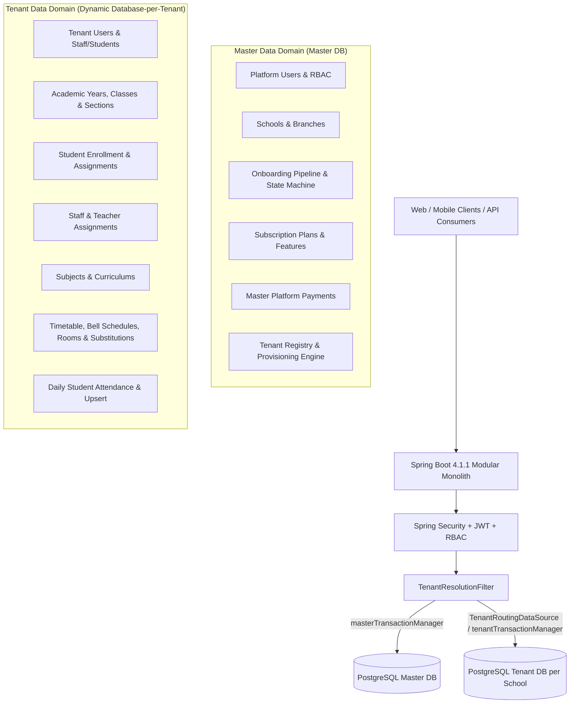
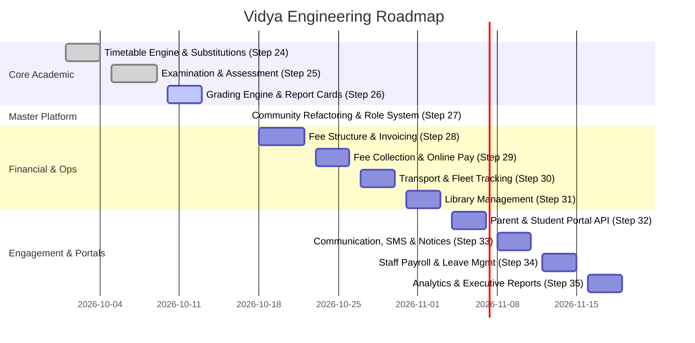

# Vidya — Multi-Tenant SaaS School Management System
## AI-Ready Comprehensive Architectural & Development Overview

> **Version**: 1.0.0-SNAPSHOT  
> **Java Version**: 25  
> **Framework**: Spring Boot 4.1.1  
> **Test Status**: `983 passed / 983 total (100%)`  
> **Architecture**: Modular Monolith with Multi-Tenant Database-per-Tenant Isolation

---

## 1. Product Vision & Domain Purpose

**Vidya** is an enterprise-grade, multi-tenant Software-as-a-Service (SaaS) School Management Platform designed to streamline and automate complete academic, administrative, and financial operations for K-12 schools, multi-branch educational institutions, and school chains.

### Core Value Propositions
- **Strict Tenant Isolation**: Complete data privacy and compliance via a dedicated PostgreSQL database per tenant (school).
- **Comprehensive Academic Lifecycle**: From student admissions, academic year setup, and section teacher assignments to daily attendance, timetables, examinations, and fee collections.
- **SaaS Platform Operations**: Centralized school onboarding workflows, subscription plans, tenant provisioning, automated database migrations, and billing in the Master database.

---

## 2. High-Level System Architecture



---

## 3. Technology Stack & Framework Choices

| Layer / Concern | Technology / Library | Purpose |
|---|---|---|
| **Language** | Java 25 | Latest modern language features, pattern matching, records, virtual threads |
| **Framework** | Spring Boot 4.1.1 | Core backend framework |
| **Persistence** | Spring Data JPA / Hibernate ORM | Entity management and repositories |
| **Database** | PostgreSQL 16+ | Relational data store for Master and Tenant databases |
| **Database Migrations** | Flyway | Versioned migrations (`db/migration/master` and `db/migration/tenant`) |
| **Cache & Distributed State** | Redis / Spring Session | Distributed session store (`spring-session-data-redis` with Lettuce driver) |
| **Security** | Spring Security 6+ | Stateless JWT authentication (Access & Refresh tokens), role & authority RBAC |
| **API Documentation** | SpringDoc OpenAPI (Swagger 3) | Interactive REST API documentation |
| **Validation** | Jakarta Bean Validation / Hibernate Validator | Input validation with standard constraints |
| **Boilerplate Reduction**| Lombok | `@Getter`, `@Setter`, `@Builder`, `@RequiredArgsConstructor` |
| **Testing** | JUnit 5, Mockito, AssertJ, MockMvc, Testcontainers | Unit, mock MVC, and real containerized PostgreSQL integration tests |

---

## 4. Multi-Tenancy Architecture Deep Dive

### 4.1 Database-per-Tenant Strategy
1. **Master DB (`masterTransactionManager`)**:
   - Stores global platform data: platform admins, schools, school branches, subscription tiers, platform payment receipts, tenant registration, and onboarding state machines.
2. **Tenant DB (`tenantTransactionManager`)**:
   - Dynamically routed via `TenantContext.getTenantId()`.
   - Each tenant school operates on a physically isolated PostgreSQL database with its own Flyway migration lifecycle.

### 4.2 Dynamic Routing Lifecycle
```text
HTTP Request
  └─ Header: X-Tenant-ID: <schoolId>
       └─ TenantResolutionFilter: Sets TenantContext.setTenantId(schoolId) after TenantAuthorizationService validation
            └─ Service Layer: @Transactional(transactionManager = "tenantTransactionManager")
                 └─ TenantRoutingDataSource.determineCurrentLookupKey() -> returns schoolId
                      └─ Returns dedicated ConnectionPool for that tenant DB
                           └─ After completion: TenantContext.clear() in finally block
```

### 4.3 Database Migration Separation
- Master DB migrations: `src/main/resources/db/migration/master/V1__*.sql` (currently at `V20`)
- Tenant DB migrations: `src/main/resources/db/migration/tenant/V1__*.sql` (currently at `V14`)

---

## 5. What Is Completed (Steps 1 – 25)

Vidya currently has **983 passing tests** across **25 fully implemented steps**.

### 5.1 Master Platform Domain (`com.vidya.master`)
- [x] **Platform Identity & RBAC** (`V1`): Platform Super Admin, Platform Admin, role hierarchy, password hashing.
- [x] **Community & School Directory** (`V2-V5`): Educational trusts/communities, school entities, multi-branch hierarchy.
- [x] **Community Refactoring & Role Customization** (`V21`): Normalized community data into separate tables (personal, professional, address, bank, payroll, commission, login history) with customizable role definitions per community type and granular permission system (view, create, edit, delete, approve, export).
- [x] **Tenant Provisioning Engine** (`V6-V7`): Tenant database provisioning, dynamic datasource registration, automated Flyway execution on new tenant creation.
- [x] **Multi-Step School Onboarding Engine** (`V8-V10`, `V19`): State-machine driven onboarding (Basic Info, Legal Docs, Academic Setup, Verification, Approval, Tenant Provisioning).
- [x] **SaaS Subscription & Feature Gating** (`V11-V14`): Subscription tiers (Standard, Pro, Enterprise), feature toggles, limits, school subscriptions.
- [x] **Platform Payments & Billing** (`V15`): Payment transactions, settlement tracking, webhook infrastructure.
- [x] **Platform Audit & Compliance** (`V16-V18`, `V20`): Centralized platform activity logging, security filters, and tenant authorization.

### 5.2 Tenant Academic & Administration Domain (`com.vidya.tenantdata`)
- [x] **Tenant Identity & Profiles** (`V3`): `TenantUser` (STUDENT, TEACHER, PARENT, STAFF, SCHOOL_ADMIN) and `TenantUserProfile`.
- [x] **Academic Structure Foundation** (`V2`, `V5`):
  - `AcademicYear` with state machine (DRAFT -> ACTIVE -> ARCHIVED -> CLOSED).
  - `AcademicClass` (Class 1 to Class 12, Pre-K, etc.).
  - `Section` (Section A, B, C with capacity constraints).
- [x] **Student Management & Enrollment** (`V4`, `V10`):
  - `Student` master record with unique `studentCode` and admission tracking.
  - `StudentAcademicAssignment` mapping student to Year, Class, Section, and Roll Number.
  - Student status state machine (ACTIVE, PROMOTED, TRANSFERRED, EXPELLED, ALUMNI).
- [x] **Staff & Teacher Management** (`V6`):
  - `Staff` profiles, employment statuses, designations, department mapping.
- [x] **Curriculum & Subjects** (`V7`):
  - `Subject`, `Curriculum`, `CurriculumSubject` linking classes to academic subjects.
- [x] **Teacher Subject Assignments** (`V8`, Step 21):
  - Mapping teachers to subjects across specific sections and academic years.
- [x] **Class Teacher / Section Teacher Assignment** (`V11`, Step 22):
  - Single active class teacher per section invariant with historical assignment tracking.
- [x] **Student Daily Attendance & Bulk Upsert** (`V12`, Step 23):
  - Daily attendance tracking (`StudentAttendance`) with state machine (PRESENT, ABSENT, LATE, HALF_DAY, EXCUSED, DELETED).
  - Transactional bulk upsert (`POST /api/v1/attendance/bulk`) with natural key `studentId + academicYearId + attendanceDate`.
  - PostgreSQL partial unique index protection (`WHERE deleted_at IS NULL`) preventing concurrent duplicates.
  - Attendance summary calculations with weighted percentage computation.
- [x] **Timetable & Scheduling Engine** (`V13-V14`, Step 24A-24H):
  - Canonical entities: `room`, `bell_schedule`, `bell_schedule_period`, `timetable`, `timetable_entry`, `timetable_substitution`.
  - Conflict-free grid queries (section, teacher, room occupancy, teacher load) with bounded statement counts.
  - Fail-fast bulk upsert with clash detection.
  - Day schedule views (`/sections/{id}/day?date=` and `/teachers/{id}/day?date=`).
  - Substitution management (`POST /api/v1/timetables/{id}/substitutions`) and weekly/day schedule overlays.
- [x] **Examination & Assessment Foundation** (`V17`, Step 25):
  - Canonical entities: `grading_scale`, `grading_scale_tier`, `exam_term`, `exam_schedule`, `exam_subject_config`, `student_mark_entry`.
  - Configurable grading scales & percentage bands with automatic grade point and passing threshold mapping.
  - Class-level exam scheduling with subject exam paper configs (room, timings, max marks, passing threshold, theory/practical breakdown).
  - Bulk marks evaluation (`POST /api/v1/exam-marks/bulk`) and evaluation locking workflow (`POST /api/v1/exam-marks/subject-configs/{id}/lock`).

---

## 6. Pending Modules & Development Roadmap

The remaining features required to complete the full-suite School Management System:


    Grading & Report Cards (Step 26)       :2026-10-13, 2026-10-16
    section Financial & Ops
    Fee Structure & Invoicing (Step 27)    :2026-10-17, 2026-10-21
    Fee Collection & Online Pay (Step 28)  :2026-10-22, 2026-10-25
    Transport & Fleet Tracking (Step 29)   :2026-10-26, 2026-10-29
    Library Management (Step 30)           :2026-10-30, 2026-11-02
    section Engagement & Portals
    Parent & Student Portal API (Step 31)  :2026-11-03, 2026-11-06
    Communication, SMS & Notices (Step 32) :2026-11-07, 2026-11-10
    Staff Payroll & Leave Mgmt (Step 33)   :2026-11-11, 2026-11-14
    Analytics & Executive Reports (Step 34):2026-11-15, 2026-11-18
```

### Detailed Roadmap Specifications

#### Step 24 — Timetable Scheduling & Substitution Engine
- **Objective**: Manage master bell schedules, periods, room inventories, weekly timetable entries, conflict resolution, daily schedule views, and teacher substitutions.
- **Key Tables**: `room`, `bell_schedule`, `bell_schedule_period`, `timetable`, `timetable_entry`, `timetable_substitution`.
- **Invariants**:
  - Teacher conflict: A teacher cannot be scheduled in two sections at the same weekday + period.
  - Room conflict: A room cannot host two sections at the same weekday + period.
  - Substitution conflict: A substitute teacher or substitute room cannot be assigned to multiple sections at the same period on the same date.
  - Bounded queries: Grid and day views execute in $O(1)$ prepared SQL statements regardless of timetable size.

#### Step 25 — Examination & Assessment Foundation
- **Objective**: Define exam terms (Term 1, Mid-term, Final), exam schedules, max marks, passing thresholds, and grading scales (CBSE/ICSE/State Board).
- **Key Tables**: `exam_term`, `exam_schedule`, `exam_subject_config`, `student_mark_entry`.

#### Step 26 — Grading Engine & Report Card Generation
- **Objective**: Compute weighted grades, CGPA/GPA, class rankings, attendance integration, and printable report card generation.
- **Key Tables**: `grading_scale`, `student_report_card`, `report_card_remark`.

#### Step 27 — Community Refactoring & Role Customization System ✅
- **Objective**: Normalize community data into separate tables (personal, professional, address, bank, payroll, commission, login history) and implement customizable role definitions per community type with granular permission system.
- **Key Tables**: `community_personal_detail`, `community_professional_detail`, `community_address`, `community_bank_detail`, `community_payroll`, `community_commission`, `community_login_history`, `community_role_definition`, `community_permission`, `community_role_permission`.
- **Features**:
  - Customizable roles per community type (PARTNER, FIELD_AGENCY, NGO, GOVT, OTHER)
  - Granular permissions (view, create, edit, delete, approve, export) per permission
  - System role protection (cannot be modified/deleted)
  - Multiple addresses and bank accounts per community
  - JSONB-based flexible configuration for payroll and commission
  - Complete login history tracking with device/browser metadata
  - Backward compatibility with legacy role enum

#### Step 28 — Fee Structure, Categories & Invoicing
- **Objective**: Define fee heads (Tuition, Transport, Lab, Annual), fee structures per class/section, discounts/concessions, and automated invoice generation per academic term.
- **Key Tables**: `fee_head`, `fee_structure`, `fee_discount`, `student_fee_invoice`, `student_fee_item`.

#### Step 29 — Fee Collection, Payment Gateway & Receipts
- **Objective**: Record cash, cheque, bank transfer, and Razorpay/PayU online payments, handle partial payments, overdue fines, and generate immutable fee receipts.
- **Key Tables**: `fee_payment`, `fee_receipt`, `fee_fine_policy`.

#### Step 30 — Transport & Fleet Management
- **Objective**: Manage school buses, drivers, routes, stops, vehicle tracking metadata, and student transport assignments with fee integration.
- **Key Tables**: `vehicle`, `driver`, `transport_route`, `transport_stop`, `student_transport_assignment`.

#### Step 31 — Library Management System
- **Objective**: Book cataloging (ISBN, Dewey Decimal), book copies, barcodes, student/staff issue and return workflows, overdue fines calculation.
- **Key Tables**: `book_catalog`, `book_copy`, `book_issue_record`, `library_fine`.

#### Step 32 — Parent & Student Portal API
- **Objective**: Dedicated endpoints for parents and students to view academic progress, daily attendance, class timetable, homework/assignments, notices, and fee ledger.

#### Step 33 — Communication, Noticeboard & SMS/WhatsApp Notification Service
- **Objective**: Broadcast circulars, school events, emergency closures, attendance SMS alerts to parents, and integrated notification templates.
- **Key Tables**: `notice_announcement`, `notification_template`, `notification_log`.

#### Step 34 — Staff Payroll, Attendance & Leave Management
- **Objective**: Teacher/staff biometric/manual attendance, leave quotas and approval workflows, salary structures, payslip generation, and deductions.
- **Key Tables**: `staff_leave_policy`, `staff_leave_application`, `staff_salary_structure`, `staff_payroll_run`.

#### Step 35 — Comprehensive Analytics & Executive Dashboards
- **Objective**: School Principal & Platform Admin dashboards: student retention metrics, attendance heatmaps, fee collection realization percentages, and teacher workload analytics.

---

## 7. Strict Architectural Patterns & Implementation Invariants

When implementing any feature in Vidya, the following architectural invariants **MUST** be adhered to:

### 7.1 Database & Isolation Rules
1. **Never Mix Master and Tenant DBs**: A single SQL query or transaction must NEVER span both Master and Tenant databases.
2. **Flyway Migration Strictness**:
   - Master DB changes go to `src/main/resources/db/migration/master/V{N}__*.sql`.
   - Tenant DB changes go to `src/main/resources/db/migration/tenant/V{N}__*.sql`.
   - Never edit an existing migration file that has already been applied.
3. **Partial Unique Indexes for Soft Deletes**:
   ```sql
   CREATE UNIQUE INDEX idx_table_unique_active
       ON table_name (natural_key_col1, natural_key_col2)
       WHERE deleted_at IS NULL;
   ```

### 7.2 Entity Standards
- **Primary Keys**: Always `UUID` generated via `@GeneratedValue(strategy = GenerationType.UUID)`.
- **Business Identifiers**: Always include a unique, human-readable immutable business code generated via `CodeGenerator` (e.g., `ATT-XXXX`, `STU-XXXX`, `SEC-XXXX`, `SUB-XXXX`).
- **Audit Columns**: Include `createdAt`, `updatedAt`, `createdBy`, `updatedBy`.
- **Soft Deletion**: Include `@Column(name = "deleted_at") private Instant deletedAt;`.
- **Optimistic Locking**: Always include `@Version @Column(name = "version") private Long version;`.
- **Constructors & Factory Methods**: Protected default constructor for JPA (`@NoArgsConstructor(access = AccessLevel.PROTECTED)`), explicit domain constructor for creation.
- **Data Normalization**: For complex entities with multiple concerns (e.g., Community), separate into related detail tables (personal, professional, address, bank, payroll, commission) for modularity and granular RBAC.

### 7.2.1 Community Role Customization System
- **Role Definitions**: Each community type (PARTNER, FIELD_AGENCY, NGO, GOVT, OTHER) can define custom roles via `CommunityRoleDefinition` entity.
- **Granular Permissions**: Permissions are defined in `CommunityPermission` entity with action-level control (view, create, edit, delete, approve, export).
- **Role-Permission Mapping**: `CommunityRolePermission` entity maps roles to permissions with granular action flags.
- **System Role Protection**: System roles (marked with `isSystemRole = true`) cannot be modified or deleted.
- **Backward Compatibility**: Legacy role enums are preserved as `legacy_role` column for migration compatibility.
- **Flexible Configuration**: Use JSONB columns for complex configurations (e.g., payroll salary structures, commission tier configs).

### 7.3 Service & Transaction Standards
- **Explicit Transaction Manager**:
  - For Tenant DB operations: `@Transactional(transactionManager = "tenantTransactionManager")`
  - For Master DB operations: `@Transactional(transactionManager = "masterTransactionManager")`
- **Fail-Fast Two-Phase Processing (Crucial for Bulk APIs)**:
  1. *Phase 1 (Validation)*: Validate all inputs, academic hierarchies, foreign keys, uniqueness, and business rules. If any violation is found, throw domain exception before any write.
  2. *Phase 2 (Mutation)*: Perform database writes and return clean response.

### 7.4 Controller & API Response Standards
- **Endpoint Versioning**: All REST endpoints must use prefix `/api/v1/...`.
- **Standard Envelope**:
  - Single object / action: `ResponseEntity.ok(ApiResponse.success("CODE", "Message", data))`
  - Paginated list: `ResponseEntity.ok(PagedApiResponse.of("CODE", "Message", page))`
- **RBAC**: Protect endpoints with `@PreAuthorize("hasAuthority('...') or hasRole('...')")`.
- **Documentation**: Annotate with SpringDoc `@Operation(summary = "...", description = "...")`.

### 7.5 Testing Standards
- Every service method must have unit tests covering:
  1. Happy path (creation, retrieval, update, delete)
  2. Non-existent resource (`ResourceNotFoundException`)
  3. Duplicate resource or unique violation (`DuplicateResourceException` / `BusinessException`)
  4. State machine violation (`InvalidStateTransitionException`)
  5. Bulk atomic rollback on partial invalid input
- Every REST controller must have MockMvc unit tests verifying HTTP status codes (200, 201, 400, 404, 409).
- Total test suite must always remain 100% green (`0 failures, 0 errors, 0 skipped`).

---

## 8. Directory & Package Blueprint

```text
com.vidya
├── VidyaApplication.java
├── common/                  # Cross-cutting concerns
│   ├── api/                 # ApiResponse, PagedApiResponse, ErrorResponse, ApiResponseCode
│   ├── exception/           # BusinessException, ResourceNotFoundException, DuplicateResourceException, etc.
│   └── util/                # CodeGenerator, DateUtils, SecurityUtils
├── config/                  # Master & Tenant DataSource configuration, Flyway config, Redis config
├── master/                  # Master Platform Domain (SaaS Operations)
│   ├── audit/               # Platform-wide audit logs
│   ├── community/           # Multi-school community networks with role customization
│   │   ├── entity/          # Community, CommunityMember, CommunityRoleDefinition, CommunityPermission, etc.
│   │   ├── repository/      # Community data access
│   │   ├── service/         # Community business logic including role/permission management
│   │   ├── controller/      # Community REST endpoints
│   │   └── dto/             # Community request/response DTOs
│   ├── onboarding/          # Multi-step school onboarding state machine
│   ├── payment/             # Master platform billing & payments
│   ├── school/              # Schools & School Branches
│   ├── subscription/        # SaaS subscription plans, features & tiers
│   ├── tenant/              # Tenant registry, datasource routing & provisioning
│   └── workflow/            # Master state-machine workflows
├── security/                # JWT filters, TenantResolutionFilter, Spring Security RBAC
└── tenantdata/              # Tenant School Domain (Dynamic Database-per-Tenant)
    ├── academic/            # AcademicYear, AcademicClass, Section, Assignments
    ├── assignment/          # Teacher-Subject & Class Teacher assignments
    ├── attendance/          # Student attendance, daily sheets, bulk upsert
    ├── staff/               # Staff master record, employment, designations
    ├── student/             # Student master record, enrollments, admissions
    ├── subject/             # Subjects, Curriculums, Subject-Class mapping
    └── timetable/           # Room, BellSchedule, Timetable, Entries, and Substitutions
```


---

## 9. AI Developer Instruction Sheet (Quick Prompting Reference)

When continuing or extending Vidya:
1. **Identify the Domain**: Is the feature Master DB (`com.vidya.master`) or Tenant DB (`com.vidya.tenantdata`)?
2. **Check Existing Flyway Migrations**: Inspect highest migration number in `db/migration/tenant` or `master`.
3. **Follow the Standard Flow**:
   - `Flyway Migration SQL` -> `JPA Entity` -> `Spring Data Repository` -> `DTOs` -> `Mapper` -> `Service Interface & Implementation` -> `REST Controller` -> `Unit Tests (Service, Controller, Entity)`.
4. **Ensure Isolation & Transaction Manager**: Always specify the correct transaction manager.
5. **Run Verification**: Run `mvn test` to ensure all existing and new tests pass with 0 failures.
