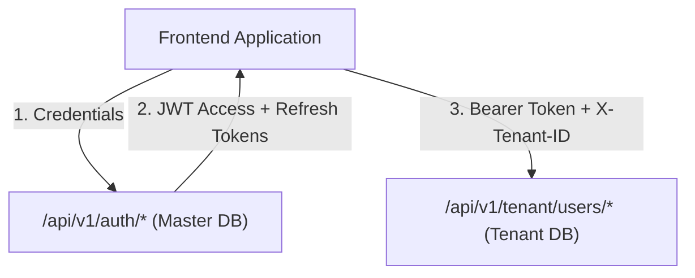

# Platform Users & Authentication API Integration Guide

This document provides frontend engineering teams with complete technical specifications for integrating Vidya ERP's Authentication, Platform User profiles, and School Tenant Operational User management APIs.

---

## 1. Architectural Overview & Context

Vidya ERP separates identity and operational users across its multi-tenant architecture:



- **Platform Users (`/api/v1/auth/*`)**: Master identity records that authenticate via email and password, issuing stateless JWT tokens with role-based and permission-based claims.
- **Tenant Users (`/api/v1/tenant/users/*`)**: School-specific operational users (Teachers, Staff, Students, Parents, School Admins) scoped within individual school databases.

---

## 2. Request Headers & Protocol

### 2.1 Master Endpoints (`/api/v1/auth/*`)
| Header | Required | Example / Value | Description |
| :--- | :---: | :--- | :--- |
| `Content-Type` | **Yes** | `application/json` | Request payload format |
| `Authorization` | Conditional | `Bearer eyJhbGciOi...` | Required for authenticated endpoints like `/me` |
| `X-Correlation-ID` | No | `req-847291a5-3d8b` | Optional client trace identifier for audit logs |

### 2.2 Tenant Endpoints (`/api/v1/tenant/users/*`)
| Header | Required | Example / Value | Description |
| :--- | :---: | :--- | :--- |
| `Content-Type` | **Yes** | `application/json` | Request payload format |
| `Authorization` | **Yes** | `Bearer eyJhbGciOi...` | JWT access token obtained at login |
| `X-Tenant-ID` | **Yes** | `d4e5f6a7-b8c9-0123-def0-123456789abc` | Target school tenant UUID or school tenant code |
| `X-Correlation-ID` | No | `req-847291a5-3d8b` | Client request trace ID |

---

## 3. Standard Response Envelopes

Every API response follows a consistent contract:

### 3.1 Single Entity Envelope (`ApiResponse<T>`)
```json
{
  "success": true,
  "code": "LOGIN_SUCCESS",
  "message": "Authentication successful",
  "data": { ... },
  "timestamp": "2026-10-17T08:00:00Z",
  "correlationId": "req-847291a5-3d8b"
}
```

### 3.2 Paginated List Envelope (`PagedApiResponse<T>`)
```json
{
  "success": true,
  "code": "TENANT_USERS_FETCHED",
  "message": "Tenant users retrieved successfully",
  "data": [ { ... } ],
  "page": {
    "number": 0,
    "size": 20,
    "totalElements": 85,
    "totalPages": 5,
    "first": true,
    "last": false
  },
  "timestamp": "2026-10-17T08:00:00Z",
  "correlationId": "req-847291a5-3d8b"
}
```

---

## 4. Authentication Endpoints (`/api/v1/auth`)

### 4.1 Login / Authenticate
Authenticates platform user credentials and returns JWT access & refresh tokens.

- **Method**: `POST`
- **Path**: `/api/v1/auth/login`
- **Auth Required**: No

#### Request Body
```json
{
  "email": "admin@greenwood.edu.in",
  "password": "SecurePassword123!"
}
```

#### Response (`200 OK`)
```json
{
  "success": true,
  "code": "LOGIN_SUCCESS",
  "message": "Authentication successful",
  "data": {
    "accessToken": "eyJhbGciOiJIUzI1NiIsInR5cCI6IkpXVCJ9...",
    "refreshToken": "d5a8e0f9-234b-48cf-8d9e-17d4e321589a",
    "tokenType": "Bearer",
    "expiresIn": 86400000,
    "user": {
      "id": "1e2f3a4b-5c6d-7e8f-9a0b-1c2d3e4f5a6b",
      "userCode": "USR-ADM-001",
      "email": "admin@greenwood.edu.in",
      "firstName": "Arun",
      "lastName": "Kumar",
      "fullName": "Arun Kumar",
      "phone": "+919876543210",
      "status": "ACTIVE",
      "platformRole": "SCHOOL_ADMIN",
      "schoolId": "d4e5f6a7-b8c9-0123-def0-123456789abc",
      "permissions": [
        "USER_READ",
        "USER_CREATE",
        "USER_UPDATE",
        "ACADEMIC_YEAR_READ",
        "STUDENT_READ"
      ],
      "lastLoginAt": "2026-10-17T08:15:22Z",
      "createdAt": "2026-01-10T10:00:00Z"
    }
  },
  "timestamp": "2026-10-17T08:15:23Z",
  "correlationId": "req-98f2b1c4"
}
```

#### Error Responses
- `401 Unauthorized`: Invalid email or password (`INVALID_CREDENTIALS`).
- `403 Forbidden`: Account locked or marked inactive (`ACCOUNT_LOCKED`).

---

### 4.2 Refresh Access Token
Issues a new JWT access token using a valid, non-expired refresh token.

- **Method**: `POST`
- **Path**: `/api/v1/auth/refresh`
- **Auth Required**: No

#### Request Body
```json
{
  "refreshToken": "d5a8e0f9-234b-48cf-8d9e-17d4e321589a"
}
```

#### Response (`200 OK`)
```json
{
  "success": true,
  "code": "TOKEN_REFRESHED",
  "message": "Token refreshed successfully",
  "data": {
    "accessToken": "eyJhbGciOiJIUzI1NiIsInR5cCI6IkpXVCJ9...",
    "refreshToken": "d5a8e0f9-234b-48cf-8d9e-17d4e321589a",
    "tokenType": "Bearer",
    "expiresIn": 86400000,
    "user": { ... }
  },
  "timestamp": "2026-10-17T08:30:00Z"
}
```

---

### 4.3 Logout Session
Revokes the refresh token and invalidates active session tokens.

- **Method**: `POST`
- **Path**: `/api/v1/auth/logout`
- **Auth Required**: Optional (Header or Body token)

#### Request Body
```json
{
  "refreshToken": "d5a8e0f9-234b-48cf-8d9e-17d4e321589a"
}
```

#### Response (`200 OK`)
```json
{
  "success": true,
  "code": "LOGOUT_SUCCESS",
  "message": "Logged out successfully",
  "data": null,
  "timestamp": "2026-10-17T08:45:00Z"
}
```

---

### 4.4 Get Current User Profile
Retrieves detailed profile information for the token holder.

- **Method**: `GET`
- **Path**: `/api/v1/auth/me`
- **Auth Required**: Yes (`Authorization: Bearer <token>`)

#### Response (`200 OK`)
```json
{
  "success": true,
  "code": "SUCCESS",
  "message": "Current user profile retrieved successfully",
  "data": {
    "id": "1e2f3a4b-5c6d-7e8f-9a0b-1c2d3e4f5a6b",
    "userCode": "USR-ADM-001",
    "email": "admin@greenwood.edu.in",
    "firstName": "Arun",
    "lastName": "Kumar",
    "fullName": "Arun Kumar",
    "phone": "+919876543210",
    "status": "ACTIVE",
    "platformRole": "SCHOOL_ADMIN",
    "schoolId": "d4e5f6a7-b8c9-0123-def0-123456789abc",
    "permissions": ["USER_READ", "USER_CREATE", "USER_UPDATE"],
    "lastLoginAt": "2026-10-17T08:15:22Z",
    "createdAt": "2026-01-10T10:00:00Z"
  },
  "timestamp": "2026-10-17T08:50:00Z"
}
```

---

## 5. Tenant Users Endpoints (`/api/v1/tenant/users`)

All endpoints in this section require:
1. `Authorization: Bearer <accessToken>`
2. `X-Tenant-ID: <schoolTenantId>`

### 5.1 Create Tenant User
Creates a new operational user (Teacher, Staff, Student, Admin) within the current school tenant database.

- **Method**: `POST`
- **Path**: `/api/v1/tenant/users`
- **RBAC**: `USER_CREATE` or roles `SCHOOL_ADMIN`, `SCHOOL_OWNER`, `PLATFORM_ADMIN`, `PLATFORM_SUPER_ADMIN`

#### Request Body
```json
{
  "email": "priya.sharma@greenwood.edu.in",
  "phone": "+919876501234",
  "firstName": "Priya",
  "lastName": "Sharma",
  "userType": "TEACHER",
  "gender": "FEMALE",
  "dateOfBirth": "1988-06-20",
  "masterUserId": null,
  "addressLine1": "Flat 302, Prestige Enclave",
  "city": "Bengaluru",
  "state": "Karnataka",
  "postalCode": "560034"
}
```

#### Response (`201 Created`)
```json
{
  "success": true,
  "code": "TENANT_USER_CREATED",
  "message": "Tenant user successfully created",
  "data": {
    "id": "7a8b9c0d-1e2f-3a4b-5c6d-7e8f9a0b1c2d",
    "userCode": "USR-TEACH-042",
    "masterUserId": null,
    "email": "priya.sharma@greenwood.edu.in",
    "phone": "+919876501234",
    "userType": "TEACHER",
    "status": "ACTIVE",
    "profile": {
      "id": "8b9c0d1e-2f3a-4b5c-6d7e-8f9a0b1c2d3e",
      "firstName": "Priya",
      "lastName": "Sharma",
      "fullName": "Priya Sharma",
      "gender": "FEMALE",
      "dateOfBirth": "1988-06-20",
      "addressLine1": "Flat 302, Prestige Enclave",
      "addressLine2": null,
      "city": "Bengaluru",
      "state": "Karnataka",
      "postalCode": "560034",
      "emergencyContactName": null,
      "emergencyContactPhone": null
    },
    "createdAt": "2026-10-17T09:00:00Z",
    "updatedAt": "2026-10-17T09:00:00Z",
    "createdBy": "1e2f3a4b-5c6d-7e8f-9a0b-1c2d3e4f5a6b",
    "updatedBy": "1e2f3a4b-5c6d-7e8f-9a0b-1c2d3e4f5a6b",
    "version": 0
  },
  "timestamp": "2026-10-17T09:00:00Z"
}
```

---

### 5.2 List Tenant Users (Paginated & Filtered)
- **Method**: `GET`
- **Path**: `/api/v1/tenant/users`
- **Query Parameters**:
  - `status` (*optional*): `ACTIVE`, `INACTIVE`, `SUSPENDED`, `LOCKED`, `INVITED`
  - `userType` (*optional*): `ADMIN`, `STAFF`, `TEACHER`, `STUDENT`, `PARENT`
  - `page` (*optional*, default: `0`): Page index (0-based)
  - `size` (*optional*, default: `20`): Page size
  - `sort` (*optional*, default: `createdAt,desc`): Sort expression

#### Request Example
```http
GET /api/v1/tenant/users?userType=TEACHER&status=ACTIVE&page=0&size=10 HTTP/1.1
Host: api.vidyaerp.com
Authorization: Bearer <accessToken>
X-Tenant-ID: d4e5f6a7-b8c9-0123-def0-123456789abc
```

#### Response (`200 OK`)
```json
{
  "success": true,
  "code": "TENANT_USERS_FETCHED",
  "message": "Tenant users retrieved successfully",
  "data": [
    {
      "id": "7a8b9c0d-1e2f-3a4b-5c6d-7e8f9a0b1c2d",
      "userCode": "USR-TEACH-042",
      "email": "priya.sharma@greenwood.edu.in",
      "phone": "+919876501234",
      "userType": "TEACHER",
      "status": "ACTIVE",
      "firstName": "Priya",
      "lastName": "Sharma",
      "fullName": "Priya Sharma",
      "createdAt": "2026-10-17T09:00:00Z"
    }
  ],
  "page": {
    "number": 0,
    "size": 10,
    "totalElements": 24,
    "totalPages": 3,
    "first": true,
    "last": false
  },
  "timestamp": "2026-10-17T09:05:00Z"
}
```

---

### 5.3 Get Tenant User by ID
- **Method**: `GET`
- **Path**: `/api/v1/tenant/users/{id}`

#### Response (`200 OK`)
Returns `TenantUserDetailResponse` matching the payload in section 5.1.

---

### 5.4 Update Tenant User Details
- **Method**: `PUT`
- **Path**: `/api/v1/tenant/users/{id}`

#### Request Body
```json
{
  "phone": "+919876509999",
  "firstName": "Priya",
  "lastName": "Sharma-Verma",
  "userType": "TEACHER",
  "gender": "FEMALE",
  "dateOfBirth": "1988-06-20",
  "addressLine1": "Flat 302, Prestige Enclave",
  "addressLine2": "Outer Ring Road",
  "city": "Bengaluru",
  "state": "Karnataka",
  "postalCode": "560034",
  "emergencyContactName": "Rohit Verma",
  "emergencyContactPhone": "+919876508888"
}
```

#### Response (`200 OK`)
Returns updated `TenantUserDetailResponse`.

---

### 5.5 Update Tenant User Status (Lifecycle)
- **Method**: `PATCH`
- **Path**: `/api/v1/tenant/users/{id}/status`

#### Request Body
```json
{
  "status": "INACTIVE"
}
```

#### Response (`200 OK`)
Returns updated `TenantUserDetailResponse` reflecting the new status.

---

### 5.6 Soft Delete Tenant User
- **Method**: `DELETE`
- **Path**: `/api/v1/tenant/users/{id}`

#### Response (`200 OK`)
```json
{
  "success": true,
  "code": "TENANT_USER_DELETED",
  "message": "Tenant user successfully deleted",
  "data": null,
  "timestamp": "2026-10-17T09:15:00Z"
}
```

---

## 6. TypeScript Type Definitions

Save this to your frontend codebase (`src/types/auth-and-users.ts`):

```typescript
// Unified API Response Wrappers
export interface ApiResponse<T> {
  success: boolean;
  code: string;
  message: string;
  data: T;
  timestamp: string;
  correlationId?: string;
}

export interface PageMetadata {
  number: number;
  size: number;
  totalElements: number;
  totalPages: number;
  first: boolean;
  last: boolean;
}

export interface PagedApiResponse<T> {
  success: boolean;
  code: string;
  message: string;
  data: T[];
  page: PageMetadata;
  timestamp: string;
  correlationId?: string;
}

// Authentication Models
export type PlatformRole =
  | 'PLATFORM_SUPER_ADMIN'
  | 'PLATFORM_ADMIN'
  | 'PLATFORM_SUPPORT'
  | 'SCHOOL_OWNER'
  | 'SCHOOL_ADMIN'
  | 'CAMPUS_PRINCIPAL'
  | 'TEACHER'
  | 'STAFF'
  | 'STUDENT'
  | 'PARENT';

export type UserStatus = 'ACTIVE' | 'INACTIVE' | 'SUSPENDED' | 'LOCKED' | 'PENDING_VERIFICATION';

export interface PlatformUserResponse {
  id: string;
  userCode: string;
  email: string;
  firstName: string;
  lastName: string;
  fullName: string;
  phone: string;
  status: UserStatus;
  platformRole: PlatformRole;
  schoolId: string | null;
  permissions: string[];
  lastLoginAt: string | null;
  createdAt: string;
}

export interface AuthResponse {
  accessToken: string;
  refreshToken: string;
  tokenType: string;
  expiresIn: number;
  user: PlatformUserResponse;
}

export interface LoginRequest {
  email: string;
  password: string;
}

export interface RefreshTokenRequest {
  refreshToken: string;
}

// Tenant User Models
export type TenantUserType = 'ADMIN' | 'STAFF' | 'TEACHER' | 'STUDENT' | 'PARENT';
export type TenantUserStatus = 'ACTIVE' | 'INACTIVE' | 'SUSPENDED' | 'LOCKED' | 'INVITED';

export interface TenantUserProfileDto {
  id: string;
  firstName: string;
  lastName: string;
  fullName: string;
  gender?: string;
  dateOfBirth?: string;
  addressLine1?: string;
  addressLine2?: string;
  city?: string;
  state?: string;
  postalCode?: string;
  emergencyContactName?: string;
  emergencyContactPhone?: string;
}

export interface TenantUserSummaryResponse {
  id: string;
  userCode: string;
  email: string;
  phone: string;
  userType: TenantUserType;
  status: TenantUserStatus;
  firstName: string;
  lastName: string;
  fullName: string;
  createdAt: string;
}

export interface TenantUserDetailResponse {
  id: string;
  userCode: string;
  masterUserId: string | null;
  email: string;
  phone: string;
  userType: TenantUserType;
  status: TenantUserStatus;
  profile: TenantUserProfileDto;
  createdAt: string;
  updatedAt: string;
  createdBy: string;
  updatedBy: string;
  version: number;
}

export interface CreateTenantUserRequest {
  email: string;
  phone?: string;
  firstName: string;
  lastName?: string;
  userType: TenantUserType;
  gender?: string;
  dateOfBirth?: string;
  masterUserId?: string;
  addressLine1?: string;
  city?: string;
  state?: string;
  postalCode?: string;
}

export interface UpdateTenantUserRequest {
  phone?: string;
  firstName?: string;
  lastName?: string;
  userType?: TenantUserType;
  gender?: string;
  dateOfBirth?: string;
  addressLine1?: string;
  addressLine2?: string;
  city?: string;
  state?: string;
  postalCode?: string;
  emergencyContactName?: string;
  emergencyContactPhone?: string;
}

export interface UpdateTenantUserStatusRequest {
  status: TenantUserStatus;
}
```

---

## 7. Frontend Integration Code Sample (Axios + Token Auto-Refresh)

```typescript
import axios, { AxiosError, InternalAxiosRequestConfig } from 'axios';
import { ApiResponse, AuthResponse } from './types/auth-and-users';

const api = axios.create({
  baseURL: process.env.NEXT_PUBLIC_API_URL || 'https://api.vidyaerp.com',
  headers: {
    'Content-Type': 'application/json',
  },
});

// Interceptor: Attach Bearer token and current X-Tenant-ID
api.interceptors.request.use((config: InternalAxiosRequestConfig) => {
  const token = localStorage.getItem('access_token');
  const activeTenantId = localStorage.getItem('active_tenant_id');

  if (token) {
    config.headers.Authorization = `Bearer ${token}`;
  }

  // Master routes (/api/v1/auth/*, /api/v1/schools, etc.) do NOT require X-Tenant-ID
  const isMasterPath = config.url?.startsWith('/api/v1/auth') || config.url?.startsWith('/api/v1/schools');
  if (!isMasterPath && activeTenantId) {
    config.headers['X-Tenant-ID'] = activeTenantId;
  }

  return config;
});

// Interceptor: Automatic Refresh on 401
api.interceptors.response.use(
  (response) => response,
  async (error: AxiosError) => {
    const originalRequest = error.config as InternalAxiosRequestConfig & { _retry?: boolean };

    if (error.response?.status === 401 && !originalRequest._retry && !originalRequest.url?.includes('/auth/login')) {
      originalRequest._retry = true;
      const refreshToken = localStorage.getItem('refresh_token');

      if (!refreshToken) {
        window.location.href = '/login';
        return Promise.reject(error);
      }

      try {
        const refreshRes = await axios.post<ApiResponse<AuthResponse>>(
          `${api.defaults.baseURL}/api/v1/auth/refresh`,
          { refreshToken }
        );

        const newAccessToken = refreshRes.data.data.accessToken;
        localStorage.setItem('access_token', newAccessToken);

        originalRequest.headers.Authorization = `Bearer ${newAccessToken}`;
        return api(originalRequest);
      } catch (refreshErr) {
        localStorage.removeItem('access_token');
        localStorage.removeItem('refresh_token');
        window.location.href = '/login';
        return Promise.reject(refreshErr);
      }
    }

    return Promise.reject(error);
  }
);

export default api;
```
