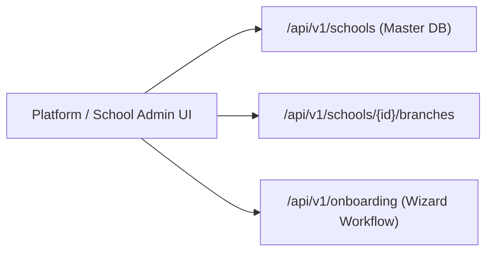

# Schools & Campus Management API Integration Guide

This document provides frontend engineering teams with complete technical specifications for integrating Vidya ERP's School Master records, Campus Branches, Platform Master Statistics, and Self-Service Onboarding Wizard APIs.

---

## 1. Architectural Scope & Context

School master records live in the **Master Database** (`vidya_master_db`). Master operations are global across the SaaS platform and manage school institution profiles, campus locations, active subscription tiers, and multi-tenant database provisioning status.



> [!NOTE]
> All `/api/v1/schools/*` and `/api/v1/onboarding/*` endpoints operate directly on the **Master Database**. Therefore, the `X-Tenant-ID` header is **exempt** and not required for these endpoints.

---

## 2. Request Headers

| Header | Required | Example / Value | Description |
| :--- | :---: | :--- | :--- |
| `Content-Type` | **Yes** | `application/json` | Request payload format |
| `Authorization` | **Yes** | `Bearer eyJhbGciOi...` | JWT access token (School Owner or Platform Admin) |
| `X-Correlation-ID` | No | `req-32a18f-9bc1` | Client request trace ID |

---

## 3. School Master APIs (`/api/v1/schools`)

### 3.1 Register New School (with optional Main Branch)
Registers a new school entity into the master registry. Automatically generates a unique `schoolCode` and prepares tenant database provisioning.

- **Method**: `POST`
- **Path**: `/api/v1/schools`
- **Access**: `PLATFORM_ADMIN`, `PLATFORM_SUPER_ADMIN`, `SCHOOL_OWNER`

#### Request Body
```json
{
  "schoolName": "Greenwood International School",
  "legalName": "Greenwood Educational Trust",
  "registrationNumber": "REG-CBSE-KA-2024-0091",
  "board": "CBSE",
  "schoolType": "PRIVATE",
  "email": "contact@greenwood.edu.in",
  "phone": "+918023456789",
  "website": "https://www.greenwood.edu.in",
  "mainBranch": {
    "branchName": "Main Campus - Whitefield",
    "isMainBranch": true,
    "addressLine1": "Plot 12, ITPL Main Road",
    "addressLine2": "Whitefield",
    "city": "Bengaluru",
    "state": "Karnataka",
    "pincode": "560066",
    "country": "India",
    "contactEmail": "admissions@greenwood.edu.in",
    "contactPhone": "+918023456790"
  }
}
```

#### Response (`201 Created`)
```json
{
  "success": true,
  "code": "SCHOOL_FOUND",
  "message": "School registered successfully",
  "data": {
    "id": "e9b2a184-7c3d-4e92-91f8-847291a53d8b",
    "schoolCode": "SCH-GRN-8472",
    "tenantId": "c8a1b2c3-d4e5-6f7a-8b9c-0d1e2f3a4b5c",
    "schoolName": "Greenwood International School",
    "legalName": "Greenwood Educational Trust",
    "registrationNumber": "REG-CBSE-KA-2024-0091",
    "board": "CBSE",
    "schoolType": "PRIVATE",
    "email": "contact@greenwood.edu.in",
    "phone": "+918023456789",
    "website": "https://www.greenwood.edu.in",
    "status": "DRAFT",
    "createdAt": "2026-10-17T09:30:00Z",
    "updatedAt": "2026-10-17T09:30:00Z",
    "branchCount": 1,
    "mainBranch": {
      "id": "f1a2b3c4-d5e6-7a8b-9c0d-1e2f3a4b5c6d",
      "branchName": "Main Campus - Whitefield",
      "branchCode": "BR-01",
      "isMainBranch": true,
      "addressLine1": "Plot 12, ITPL Main Road",
      "addressLine2": "Whitefield",
      "city": "Bengaluru",
      "state": "Karnataka",
      "pincode": "560066",
      "country": "India",
      "contactEmail": "admissions@greenwood.edu.in",
      "contactPhone": "+918023456790",
      "isActive": true
    }
  },
  "timestamp": "2026-10-17T09:30:01Z"
}
```

---

### 3.2 List Schools (Paginated with Filters & Search)
Returns paginated schools with optional filters for school board, status, or search query.

- **Method**: `GET`
- **Path**: `/api/v1/schools`
- **Query Parameters**:
  - `status` (*optional*): `DRAFT`, `ONBOARDING`, `ACTIVE`, `SUSPENDED`, `INACTIVE`
  - `board` (*optional*): `CBSE`, `ICSE`, `STATE_BOARD`, `IB`, `CAMBRIDGE`, `OTHER`
  - `search` (*optional*): Keyword matching school name, registration number, or code
  - `page` (*optional*, default: `0`): Page index (0-based)
  - `size` (*optional*, default: `20`): Page size
  - `sort` (*optional*, default: `schoolName,asc`): Sort parameter

#### Example Request
```http
GET /api/v1/schools?status=ACTIVE&board=CBSE&search=Greenwood&page=0&size=10 HTTP/1.1
Host: api.vidyaerp.com
Authorization: Bearer <accessToken>
```

#### Response (`200 OK`)
```json
{
  "success": true,
  "code": "SCHOOLS_FOUND",
  "message": "Schools retrieved successfully",
  "data": [
    {
      "id": "e9b2a184-7c3d-4e92-91f8-847291a53d8b",
      "schoolCode": "SCH-GRN-8472",
      "tenantId": "c8a1b2c3-d4e5-6f7a-8b9c-0d1e2f3a4b5c",
      "schoolName": "Greenwood International School",
      "legalName": "Greenwood Educational Trust",
      "registrationNumber": "REG-CBSE-KA-2024-0091",
      "board": "CBSE",
      "schoolType": "PRIVATE",
      "email": "contact@greenwood.edu.in",
      "phone": "+918023456789",
      "website": "https://www.greenwood.edu.in",
      "status": "ACTIVE",
      "createdAt": "2026-10-17T09:30:00Z",
      "updatedAt": "2026-10-17T09:30:00Z",
      "branchCount": 2,
      "mainBranch": { ... }
    }
  ],
  "page": {
    "number": 0,
    "size": 10,
    "totalElements": 1,
    "totalPages": 1,
    "first": true,
    "last": true
  },
  "timestamp": "2026-10-17T09:35:00Z"
}
```

---

### 3.3 Get School Details
- **By ID**: `GET /api/v1/schools/{id}`
- **By School Code**: `GET /api/v1/schools/code/{code}`
- **By Tenant UUID**: `GET /api/v1/schools/tenant/{tenantId}`

#### Response (`200 OK`)
Returns `SchoolResponse` matching the single-entity structure above.

---

### 3.4 Update School Master Details
- **Method**: `PUT`
- **Path**: `/api/v1/schools/{id}`

#### Request Body
```json
{
  "schoolName": "Greenwood World Academy",
  "legalName": "Greenwood Educational Trust",
  "registrationNumber": "REG-CBSE-KA-2024-0091",
  "board": "CBSE",
  "schoolType": "PRIVATE",
  "email": "info@greenwood.edu.in",
  "phone": "+918023459999",
  "website": "https://academy.greenwood.edu.in"
}
```

#### Response (`200 OK`)
Returns updated `SchoolResponse`.

---

### 3.5 Change School Status
Enables activating, placing on hold, or suspending a school institution.

- **Method**: `PATCH`
- **Path**: `/api/v1/schools/{id}/status?status=ACTIVE`

#### Response (`200 OK`)
```json
{
  "success": true,
  "code": "SCHOOL_ACTIVATED",
  "message": "School status updated successfully",
  "data": { ... }
}
```

---

### 3.6 Master Platform Statistics
Displays high-level operational statistics for platform and system administrators.

- **Method**: `GET`
- **Path**: `/api/v1/schools/stats`

#### Response (`200 OK`)
```json
{
  "success": true,
  "code": "SUCCESS",
  "message": "Master statistics retrieved successfully",
  "data": {
    "totalSchools": 45,
    "activeSchools": 39,
    "draftSchools": 4,
    "suspendedSchools": 2,
    "totalBranches": 64,
    "totalTenants": 39,
    "activeTenants": 39,
    "totalOnboardings": 52
  },
  "timestamp": "2026-10-17T09:40:00Z"
}
```

---

## 4. School Branches & Campuses (`/api/v1/schools/{id}/branches`)

Schools can operate multiple campus branches (e.g., North Campus, South Campus, High School Branch).

### 4.1 Add Campus Branch
- **Method**: `POST`
- **Path**: `/api/v1/schools/{id}/branches`

#### Request Body
```json
{
  "branchName": "Greenwood South Campus - Electronic City",
  "isMainBranch": false,
  "addressLine1": "Phase 1, Hosur Road",
  "addressLine2": "Electronic City",
  "city": "Bengaluru",
  "state": "Karnataka",
  "pincode": "560100",
  "country": "India",
  "contactEmail": "ecity@greenwood.edu.in",
  "contactPhone": "+918023458888"
}
```

#### Response (`201 Created`)
```json
{
  "success": true,
  "code": "SUCCESS",
  "message": "School branch created successfully",
  "data": {
    "id": "9a8b7c6d-5e4f-3a2b-1c0d-9e8f7a6b5c4d",
    "branchName": "Greenwood South Campus - Electronic City",
    "branchCode": "BR-02",
    "isMainBranch": false,
    "addressLine1": "Phase 1, Hosur Road",
    "addressLine2": "Electronic City",
    "city": "Bengaluru",
    "state": "Karnataka",
    "pincode": "560100",
    "country": "India",
    "contactEmail": "ecity@greenwood.edu.in",
    "contactPhone": "+918023458888",
    "isActive": true
  },
  "timestamp": "2026-10-17T09:42:00Z"
}
```

---

### 4.2 List School Branches (Paginated)
- **Method**: `GET`
- **Path**: `/api/v1/schools/{id}/branches`
- **Query Parameters**: `page=0&size=20`

---

### 4.3 Update School Branch
- **Method**: `PUT`
- **Path**: `/api/v1/schools/{id}/branches/{branchId}`

---

## 5. School Onboarding Wizard Workflow (`/api/v1/onboarding`)

For self-service onboarding of new schools, the onboarding workflow tracks multi-step application progress:

| Step | Endpoint | Purpose |
| :--- | :--- | :--- |
| **1. Initiate** | `POST /api/v1/onboarding` | Starts onboarding flow, creates lead/application |
| **2. Save Step Data** | `PUT /api/v1/onboarding/{id}/steps` | Saves step form state (institution, contact, documents) |
| **3. Submit** | `POST /api/v1/onboarding/{id}/submit` | Freezes draft and queues for verification |
| **4. Verify** | `POST /api/v1/onboarding/{id}/verify` | Admin approves/requests revision on documents |
| **5. Approve & Provision** | `POST /api/v1/onboarding/{id}/approve` | Automates tenant creation and database schema provisioning |

---

## 6. TypeScript Type Definitions

Save this to your frontend codebase (`src/types/schools.ts`):

```typescript
export type SchoolBoard = 'CBSE' | 'ICSE' | 'STATE_BOARD' | 'IB' | 'CAMBRIDGE' | 'OTHER';
export type SchoolType = 'PUBLIC' | 'PRIVATE' | 'INTERNATIONAL' | 'CHARTER';
export type SchoolStatus = 'DRAFT' | 'ONBOARDING' | 'ACTIVE' | 'SUSPENDED' | 'INACTIVE';

export interface SchoolBranchResponse {
  id: string;
  branchName: string;
  branchCode: string;
  isMainBranch: boolean;
  addressLine1?: string;
  addressLine2?: string;
  city?: string;
  state?: string;
  pincode?: string;
  country?: string;
  contactEmail?: string;
  contactPhone?: string;
  isActive: boolean;
}

export interface SchoolResponse {
  id: string;
  schoolCode: string;
  tenantId: string;
  schoolName: string;
  legalName?: string;
  registrationNumber?: string;
  board?: SchoolBoard;
  schoolType?: SchoolType;
  email: string;
  phone?: string;
  website?: string;
  status: SchoolStatus;
  createdAt: string;
  updatedAt: string;
  branchCount: number;
  mainBranch?: SchoolBranchResponse;
}

export interface MasterStatsResponse {
  totalSchools: number;
  activeSchools: number;
  draftSchools: number;
  suspendedSchools: number;
  totalBranches: number;
  totalTenants: number;
  activeTenants: number;
  totalOnboardings: number;
}

export interface CreateBranchRequest {
  branchName: string;
  isMainBranch?: boolean;
  addressLine1?: string;
  addressLine2?: string;
  city?: string;
  state?: string;
  pincode?: string;
  country?: string;
  contactEmail?: string;
  contactPhone?: string;
}

export interface CreateSchoolRequest {
  schoolName: string;
  legalName?: string;
  registrationNumber?: string;
  board?: SchoolBoard;
  schoolType?: SchoolType;
  email: string;
  phone?: string;
  website?: string;
  mainBranch?: CreateBranchRequest;
}

export interface UpdateSchoolRequest {
  schoolName: string;
  legalName?: string;
  registrationNumber?: string;
  board?: SchoolBoard;
  schoolType?: SchoolType;
  email: string;
  phone?: string;
  website?: string;
}

export interface UpdateBranchRequest {
  branchName: string;
  isMainBranch?: boolean;
  addressLine1?: string;
  addressLine2?: string;
  city?: string;
  state?: string;
  pincode?: string;
  country?: string;
  contactEmail?: string;
  contactPhone?: string;
}
```

---

## 7. Frontend Integration Code Sample (React + TanStack Query)

```typescript
import { useQuery, useMutation, useQueryClient } from '@tanstack/react-query';
import api from './api';
import { ApiResponse, PagedApiResponse } from './types/auth-and-users';
import { SchoolResponse, CreateSchoolRequest, MasterStatsResponse } from './types/schools';

// 1. Fetch Paginated Schools Hook
export function useSchools(page = 0, size = 10, search = '', status?: string) {
  return useQuery({
    queryKey: ['schools', { page, size, search, status }],
    queryFn: async () => {
      const params = new URLSearchParams({
        page: page.toString(),
        size: size.toString(),
      });
      if (search) params.append('search', search);
      if (status) params.append('status', status);

      const res = await api.get<PagedApiResponse<SchoolResponse>>(`/api/v1/schools?${params.toString()}`);
      return res.data;
    },
  });
}

// 2. Fetch Master Statistics Hook
export function useMasterStats() {
  return useQuery({
    queryKey: ['master-stats'],
    queryFn: async () => {
      const res = await api.get<ApiResponse<MasterStatsResponse>>('/api/v1/schools/stats');
      return res.data.data;
    },
  });
}

// 3. Register School Mutation Hook
export function useRegisterSchool() {
  const queryClient = useQueryClient();

  return useMutation({
    mutationFn: async (payload: CreateSchoolRequest) => {
      const res = await api.post<ApiResponse<SchoolResponse>>('/api/v1/schools', payload);
      return res.data.data;
    },
    onSuccess: () => {
      queryClient.invalidateQueries({ queryKey: ['schools'] });
      queryClient.invalidateQueries({ queryKey: ['master-stats'] });
    },
  });
}
```
