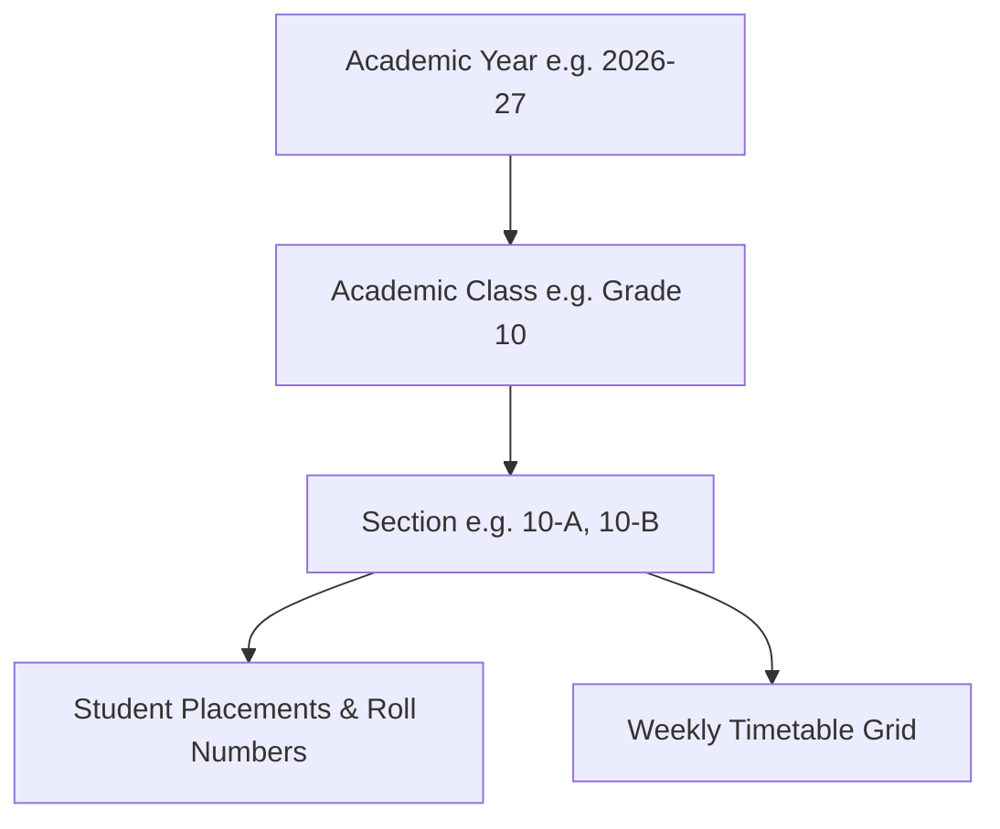

# Academic Year & Structure Management API Integration Guide

This document provides frontend engineering teams with complete technical specifications for integrating Vidya ERP's Academic Years, Academic Classes (Grades), Class Sections, Student Academic Placements, and Section Timetables.

---

## 1. Architectural Scope & Context

All academic structure APIs execute inside the active school's **Tenant Database**. 



> [!IMPORTANT]
> All requests to `/api/v1/academic-years`, `/api/v1/academic-classes`, `/api/v1/sections`, and `/api/v1/students/{studentId}/academic-assignments` **MUST** include the `X-Tenant-ID` header corresponding to the selected school.

---

## 2. Request Headers & Protocol

| Header | Required | Example / Value | Description |
| :--- | :---: | :--- | :--- |
| `Content-Type` | **Yes** | `application/json` | Request payload format |
| `Authorization` | **Yes** | `Bearer eyJhbGciOi...` | JWT access token |
| `X-Tenant-ID` | **Yes** | `d4e5f6a7-b8c9-0123-def0-123456789abc` | Target school tenant UUID or school tenant code |
| `X-Correlation-ID` | No | `req-acad-98127` | Optional request tracing correlation ID |

---

## 3. Academic Years APIs (`/api/v1/academic-years`)

### 3.1 Create Academic Year
Creates a new academic cycle (e.g., April 1 to March 31).

- **Method**: `POST`
- **Path**: `/api/v1/academic-years`
- **RBAC**: `ACADEMIC_YEAR_CREATE` or roles `SCHOOL_ADMIN`, `SCHOOL_OWNER`

#### Request Body
```json
{
  "code": "AY2026-27",
  "name": "Academic Year 2026-2027",
  "startDate": "2026-04-01",
  "endDate": "2027-03-31",
  "isCurrent": true
}
```

#### Response (`201 Created`)
```json
{
  "success": true,
  "code": "ACADEMIC_YEAR_CREATED",
  "message": "Academic year created successfully",
  "data": {
    "id": "b3e2a184-7c3d-4e92-91f8-847291a53d8b",
    "code": "AY2026-27",
    "name": "Academic Year 2026-2027",
    "startDate": "2026-04-01",
    "endDate": "2027-03-31",
    "isCurrent": true,
    "status": "PLANNED",
    "createdAt": "2026-10-17T10:00:00Z",
    "updatedAt": "2026-10-17T10:00:00Z",
    "version": 0
  },
  "timestamp": "2026-10-17T10:00:01Z"
}
```

---

### 3.2 Get Current Operational Academic Year
Convenience endpoint for frontend apps to discover the active school session on initial dashboard load.

- **Method**: `GET`
- **Path**: `/api/v1/academic-years/current`
- **RBAC**: `ACADEMIC_YEAR_READ` or roles `SCHOOL_ADMIN`, `SCHOOL_OWNER`, `TEACHER`, `STAFF`

#### Response (`200 OK`)
```json
{
  "success": true,
  "code": "CURRENT_ACADEMIC_YEAR_FETCHED",
  "message": "Current academic year retrieved",
  "data": {
    "id": "b3e2a184-7c3d-4e92-91f8-847291a53d8b",
    "code": "AY2026-27",
    "name": "Academic Year 2026-2027",
    "startDate": "2026-04-01",
    "endDate": "2027-03-31",
    "isCurrent": true,
    "status": "ACTIVE",
    "createdAt": "2026-10-17T10:00:00Z",
    "updatedAt": "2026-10-17T10:00:00Z",
    "version": 1
  },
  "timestamp": "2026-10-17T10:05:00Z"
}
```

---

### 3.3 List Academic Years (Paginated & Filtered)
- **Method**: `GET`
- **Path**: `/api/v1/academic-years`
- **Query Parameters**:
  - `status` (*optional*): `PLANNED`, `ACTIVE`, `CLOSED`, `ARCHIVED`
  - `isCurrent` (*optional*): `true` or `false`
  - `page` (*optional*, default: `0`)
  - `size` (*optional*, default: `20`)
  - `sort` (*optional*, default: `startDate,desc`)

#### Response (`200 OK`)
Returns `PagedApiResponse<AcademicYearResponse>`.

---

### 3.4 Lifecycle Transitions
- **Activate Academic Year**: `PATCH /api/v1/academic-years/{id}/activate`
- **Set as Current Year**: `PATCH /api/v1/academic-years/{id}/current`
- **Close Academic Year**: `PATCH /api/v1/academic-years/{id}/close`
- **Update Details**: `PUT /api/v1/academic-years/{id}` (Body: `name`, `startDate`, `endDate`)
- **Soft Delete**: `DELETE /api/v1/academic-years/{id}`

---

### 3.5 Get Section Timetable in Academic Year
Fetches the active weekly period grid for a section under an academic year.

- **Method**: `GET`
- **Path**: `/api/v1/academic-years/{id}/sections/{sectionId}/timetable`
- **RBAC**: `TIMETABLE_READ`

#### Response (`200 OK`)
```json
{
  "success": true,
  "code": "ACTIVE_TIMETABLE_GRID_RETRIEVED",
  "message": "Active section timetable retrieved successfully",
  "data": {
    "academicYearId": "b3e2a184-7c3d-4e92-91f8-847291a53d8b",
    "academicYearCode": "AY2026-27",
    "sectionId": "9c8b7a6d-5e4f-3a2b-1c0d-9e8f7a6b5c4d",
    "sectionName": "Class 10-A",
    "days": [
      {
        "dayOfWeek": "MONDAY",
        "periods": [
          {
            "periodNumber": 1,
            "periodName": "Mathematics",
            "startTime": "08:30:00",
            "endTime": "09:15:00",
            "subjectName": "Advanced Mathematics",
            "subjectCode": "MATH-10",
            "teacherName": "Ramesh Sharma",
            "roomNumber": "Room 301"
          }
        ]
      }
    ]
  },
  "timestamp": "2026-10-17T10:10:00Z"
}
```

---

## 4. Academic Classes & Grades APIs (`/api/v1/academic-classes`)

Academic Classes represent standard school grade levels (e.g., Nursery, Grade 1, Grade 10, Grade 12).

### 4.1 Create Academic Class
- **Method**: `POST`
- **Path**: `/api/v1/academic-classes`

#### Request Body
```json
{
  "code": "CLASS_10",
  "name": "Class 10",
  "displayName": "Grade 10 (Secondary High)",
  "sortOrder": 10
}
```

#### Response (`201 Created`)
```json
{
  "success": true,
  "code": "ACADEMIC_CLASS_CREATED",
  "message": "Academic class created successfully",
  "data": {
    "id": "c4d3e2f1-a0b9-8c7d-6e5f-4a3b2c1d0e9f",
    "code": "CLASS_10",
    "name": "Class 10",
    "displayName": "Grade 10 (Secondary High)",
    "sortOrder": 10,
    "status": "ACTIVE",
    "createdAt": "2026-10-17T10:15:00Z",
    "updatedAt": "2026-10-17T10:15:00Z",
    "version": 0
  },
  "timestamp": "2026-10-17T10:15:00Z"
}
```

---

### 4.2 List Academic Classes (Sorted by Grade Order)
- **Method**: `GET`
- **Path**: `/api/v1/academic-classes`
- **Query Parameters**:
  - `status` (*optional*): `ACTIVE`, `INACTIVE`
  - `page` (*optional*, default: `0`)
  - `size` (*optional*, default: `50`)
  - `sort` (*optional*, default: `sortOrder,asc`)

---

### 4.3 Update & Delete Academic Class
- **Update Class**: `PUT /api/v1/academic-classes/{id}` (Body: `name`, `displayName`, `sortOrder`)
- **Delete Class**: `DELETE /api/v1/academic-classes/{id}`

---

## 5. Class Sections APIs (`/api/v1/sections`)

Sections partition an Academic Class within a specific Academic Year (e.g., Grade 10 Section A for AY 2026-27).

### 5.1 Create Section
- **Method**: `POST`
- **Path**: `/api/v1/sections`

#### Request Body
```json
{
  "academicYearId": "b3e2a184-7c3d-4e92-91f8-847291a53d8b",
  "academicClassId": "c4d3e2f1-a0b9-8c7d-6e5f-4a3b2c1d0e9f",
  "code": "A",
  "name": "Section A",
  "capacity": 40
}
```

#### Response (`201 Created`)
```json
{
  "success": true,
  "code": "SECTION_CREATED",
  "message": "Section created successfully",
  "data": {
    "id": "9c8b7a6d-5e4f-3a2b-1c0d-9e8f7a6b5c4d",
    "academicYearId": "b3e2a184-7c3d-4e92-91f8-847291a53d8b",
    "academicYearCode": "AY2026-27",
    "academicClassId": "c4d3e2f1-a0b9-8c7d-6e5f-4a3b2c1d0e9f",
    "academicClassCode": "CLASS_10",
    "academicClassName": "Class 10",
    "code": "A",
    "name": "Section A",
    "capacity": 40,
    "activeStudentCount": 0,
    "status": "ACTIVE",
    "createdAt": "2026-10-17T10:20:00Z",
    "updatedAt": "2026-10-17T10:20:00Z",
    "version": 0
  },
  "timestamp": "2026-10-17T10:20:00Z"
}
```

---

### 5.2 List Sections (Filtered by Year & Class)
Used to populate cascading select dropdowns in the frontend.

- **Method**: `GET`
- **Path**: `/api/v1/sections`
- **Query Parameters**:
  - `academicYearId` (*recommended*): UUID of the selected Academic Year
  - `academicClassId` (*recommended*): UUID of the selected Grade Level
  - `status` (*optional*): `ACTIVE`, `INACTIVE`
  - `page` (*optional*, default: `0`)
  - `size` (*optional*, default: `50`)

---

## 6. Student Academic Placements & Transfers (`/api/v1/students/{studentId}/academic-assignments`)

Places a registered student into a specific academic year, class, and section with roll number assignment.

### 6.1 Assign Student to Section
- **Method**: `POST`
- **Path**: `/api/v1/students/{studentId}/academic-assignments`

#### Request Body
```json
{
  "academicYearId": "b3e2a184-7c3d-4e92-91f8-847291a53d8b",
  "academicClassId": "c4d3e2f1-a0b9-8c7d-6e5f-4a3b2c1d0e9f",
  "sectionId": "9c8b7a6d-5e4f-3a2b-1c0d-9e8f7a6b5c4d",
  "rollNumber": "12",
  "startDate": "2026-04-01"
}
```

#### Response (`201 Created`)
```json
{
  "success": true,
  "code": "STUDENT_ASSIGNED",
  "message": "Student assigned to class section successfully",
  "data": {
    "id": "e5f6a7b8-c9d0-1e2f-3a4b-5c6d7e8f9a0b",
    "studentId": "7f8e9d0c-1b2a-3c4d-5e6f-7a8b9c0d1e2f",
    "studentName": "Aarav Sharma",
    "admissionNumber": "ADM-2026-0042",
    "academicYearId": "b3e2a184-7c3d-4e92-91f8-847291a53d8b",
    "academicYearCode": "AY2026-27",
    "academicClassId": "c4d3e2f1-a0b9-8c7d-6e5f-4a3b2c1d0e9f",
    "academicClassName": "Class 10",
    "sectionId": "9c8b7a6d-5e4f-3a2b-1c0d-9e8f7a6b5c4d",
    "sectionName": "Section A",
    "rollNumber": "12",
    "startDate": "2026-04-01",
    "endDate": null,
    "status": "ACTIVE",
    "createdAt": "2026-10-17T10:25:00Z"
  },
  "timestamp": "2026-10-17T10:25:00Z"
}
```

---

### 6.2 Get Student Current Placement
- **Method**: `GET`
- **Path**: `/api/v1/students/{studentId}/academic-assignments/current`

---

### 6.3 Transfer Student (Between Sections or Grades)
Transfers an enrolled student to another section or class, automatically concluding the previous placement.

- **Method**: `PATCH`
- **Path**: `/api/v1/students/{studentId}/academic-assignments/{assignmentId}/transfer`

#### Request Body
```json
{
  "newAcademicClassId": "c4d3e2f1-a0b9-8c7d-6e5f-4a3b2c1d0e9f",
  "newSectionId": "8b7a6d5c-4e3f-2a1b-0c9d-8e7f6a5b4c3d",
  "newRollNumber": "38",
  "transferDate": "2026-07-01"
}
```

#### Response (`200 OK`)
```json
{
  "success": true,
  "code": "STUDENT_TRANSFERRED",
  "message": "Student successfully transferred to new placement",
  "data": { ... }
}
```

---

## 7. TypeScript Type Definitions

Save this to your frontend codebase (`src/types/academic.ts`):

```typescript
export type AcademicYearStatus = 'PLANNED' | 'ACTIVE' | 'CLOSED' | 'ARCHIVED';
export type AcademicClassStatus = 'ACTIVE' | 'INACTIVE';
export type SectionStatus = 'ACTIVE' | 'INACTIVE';
export type StudentAssignmentStatus = 'ACTIVE' | 'TRANSFERRED' | 'COMPLETED' | 'WITHDRAWN';

export interface AcademicYearResponse {
  id: string;
  code: string;
  name: string;
  startDate: string;
  endDate: string;
  isCurrent: boolean;
  status: AcademicYearStatus;
  createdAt: string;
  updatedAt: string;
  version: number;
}

export interface CreateAcademicYearRequest {
  code: string;
  name: string;
  startDate: string;
  endDate: string;
  isCurrent?: boolean;
}

export interface UpdateAcademicYearRequest {
  name?: string;
  startDate?: string;
  endDate?: string;
}

export interface AcademicClassResponse {
  id: string;
  code: string;
  name: string;
  displayName: string;
  sortOrder: number;
  status: AcademicClassStatus;
  createdAt: string;
  updatedAt: string;
  version: number;
}

export interface CreateAcademicClassRequest {
  code: string;
  name: string;
  displayName?: string;
  sortOrder: number;
}

export interface SectionResponse {
  id: string;
  academicYearId: string;
  academicYearCode: string;
  academicClassId: string;
  academicClassCode: string;
  academicClassName: string;
  code: string;
  name: string;
  capacity: number;
  activeStudentCount: number;
  status: SectionStatus;
  createdAt: string;
  updatedAt: string;
  version: number;
}

export interface CreateSectionRequest {
  academicYearId: string;
  academicClassId: string;
  code: string;
  name: string;
  capacity?: number;
}

export interface StudentAcademicAssignmentResponse {
  id: string;
  studentId: string;
  studentName?: string;
  admissionNumber?: string;
  academicYearId: string;
  academicYearCode?: string;
  academicClassId: string;
  academicClassName?: string;
  sectionId: string;
  sectionName?: string;
  rollNumber?: string;
  startDate: string;
  endDate?: string | null;
  status: StudentAssignmentStatus;
  createdAt: string;
}

export interface AssignStudentRequest {
  academicYearId: string;
  academicClassId: string;
  sectionId: string;
  rollNumber?: string;
  startDate?: string;
}

export interface TransferStudentAssignmentRequest {
  newAcademicClassId: string;
  newSectionId: string;
  newRollNumber?: string;
  transferDate?: string;
}
```

---

## 8. Frontend Cascading Dropdown Implementation Pattern

```tsx
import React, { useState } from 'react';
import { useQuery } from '@tanstack/react-query';
import api from './api';
import { PagedApiResponse } from './types/auth-and-users';
import { AcademicYearResponse, AcademicClassResponse, SectionResponse } from './types/academic';

export function AcademicHierarchySelector({
  onSelectionChange,
}: {
  onSelectionChange: (selection: { yearId: string; classId: string; sectionId: string }) => void;
}) {
  const [selectedYear, setSelectedYear] = useState<string>('');
  const [selectedClass, setSelectedClass] = useState<string>('');
  const [selectedSection, setSelectedSection] = useState<string>('');

  // 1. Fetch Academic Years
  const { data: years } = useQuery({
    queryKey: ['academic-years'],
    queryFn: async () => {
      const res = await api.get<PagedApiResponse<AcademicYearResponse>>('/api/v1/academic-years?size=50');
      return res.data.data;
    },
  });

  // 2. Fetch Academic Classes
  const { data: classes } = useQuery({
    queryKey: ['academic-classes'],
    queryFn: async () => {
      const res = await api.get<PagedApiResponse<AcademicClassResponse>>('/api/v1/academic-classes?size=50');
      return res.data.data;
    },
  });

  // 3. Fetch Sections for Selected Year and Class
  const { data: sections } = useQuery({
    queryKey: ['sections', { selectedYear, selectedClass }],
    queryFn: async () => {
      if (!selectedYear || !selectedClass) return [];
      const res = await api.get<PagedApiResponse<SectionResponse>>(
        `/api/v1/sections?academicYearId=${selectedYear}&academicClassId=${selectedClass}&size=50`
      );
      return res.data.data;
    },
    enabled: Boolean(selectedYear && selectedClass),
  });

  const handleSectionSelect = (sectionId: string) => {
    setSelectedSection(sectionId);
    onSelectionChange({
      yearId: selectedYear,
      classId: selectedClass,
      sectionId,
    });
  };

  return (
    <div className="grid grid-cols-1 md:grid-cols-3 gap-4 p-4 bg-slate-50 rounded-lg">
      <div>
        <label className="block text-sm font-medium text-slate-700">Academic Year</label>
        <select
          value={selectedYear}
          onChange={(e) => {
            setSelectedYear(e.target.value);
            setSelectedSection('');
          }}
          className="mt-1 block w-full rounded border-gray-300 shadow-sm"
        >
          <option value="">Select Academic Year...</option>
          {years?.map((y) => (
            <option key={y.id} value={y.id}>
              {y.name} {y.isCurrent ? '(Current)' : ''}
            </option>
          ))}
        </select>
      </div>

      <div>
        <label className="block text-sm font-medium text-slate-700">Grade / Class</label>
        <select
          value={selectedClass}
          onChange={(e) => {
            setSelectedClass(e.target.value);
            setSelectedSection('');
          }}
          className="mt-1 block w-full rounded border-gray-300 shadow-sm"
        >
          <option value="">Select Class...</option>
          {classes?.map((c) => (
            <option key={c.id} value={c.id}>
              {c.displayName || c.name}
            </option>
          ))}
        </select>
      </div>

      <div>
        <label className="block text-sm font-medium text-slate-700">Section</label>
        <select
          value={selectedSection}
          disabled={!selectedClass || !selectedYear}
          onChange={(e) => handleSectionSelect(e.target.value)}
          className="mt-1 block w-full rounded border-gray-300 shadow-sm disabled:opacity-50"
        >
          <option value="">Select Section...</option>
          {sections?.map((s) => (
            <option key={s.id} value={s.id}>
              {s.name} ({s.activeStudentCount}/{s.capacity} students)
            </option>
          ))}
        </select>
      </div>
    </div>
  );
}
```
