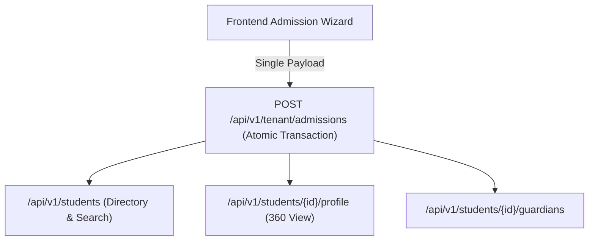

# Students & Admissions API Integration Guide

This document provides frontend engineering teams with complete technical specifications for integrating Vidya ERP's Student Directory, Transactional Admission Wizard, Guardian Relationships, and Academic Subject Enrollments.

---

## 1. Architectural Scope & Context

All student operations occur inside the school's **Tenant Database** and require the `X-Tenant-ID` header.



---

## 2. Request Headers

| Header | Required | Example / Value | Description |
| :--- | :---: | :--- | :--- |
| `Content-Type` | **Yes** | `application/json` | Request payload format |
| `Authorization` | **Yes** | `Bearer eyJhbGciOi...` | JWT access token |
| `X-Tenant-ID` | **Yes** | `d4e5f6a7-b8c9-0123-def0-123456789abc` | Target school tenant UUID or school tenant code |
| `X-Correlation-ID` | No | `req-admission-001` | Optional request tracing correlation ID |

---

## 3. Atomic Admission Wizard API (`POST /api/v1/tenant/admissions`)

Vidya ERP provides a **single transactional endpoint** that completes student admission in one atomic operation:
1. Creates Tenant Operational User (`USR-STU-xxxx`)
2. Creates Student Profile (DOB, Gender, Address)
3. Creates Student Domain Identity (`admissionNumber`, `admissionDate`, `studentCode`)
4. Creates Academic Enrollment & Section Placement (`academicYearId`, `academicClassId`, `sectionId`, `rollNumber`)
5. Automatically binds compulsory curriculum subjects (and optional electives)
6. Links parent / guardian contact records

### Request Body
```json
{
  "firstName": "Rahul",
  "lastName": "Sharma",
  "displayName": "Rahul Sharma",
  "gender": "MALE",
  "dateOfBirth": "2013-05-12",
  "email": "rahul.sharma@school.vidya.internal",
  "phone": "+919876543210",
  "addressLine1": "123 Green Avenue",
  "addressLine2": "Block C",
  "city": "Bengaluru",
  "state": "Karnataka",
  "postalCode": "560001",
  "admissionNumber": "ADM-2026-00123",
  "admissionDate": "2026-06-01",
  "academicYearId": "b3e2a184-7c3d-4e92-91f8-847291a53d8b",
  "academicClassId": "c4d3e2f1-a0b9-8c7d-6e5f-4a3b2c1d0e9f",
  "sectionId": "9c8b7a6d-5e4f-3a2b-1c0d-9e8f7a6b5c4d",
  "rollNumber": "15",
  "enrollmentDate": "2026-06-01",
  "remarks": "Admitted under general merit category",
  "autoAssignCompulsorySubjects": true,
  "subjectIds": [],
  "guardians": [
    {
      "firstName": "Suresh",
      "lastName": "Sharma",
      "relationship": "FATHER",
      "isPrimary": true,
      "isEmergencyContact": true,
      "email": "suresh.sharma@gmail.com",
      "phone": "+919876543299",
      "occupation": "Software Engineer"
    }
  ]
}
```

### Response (`201 Created`)
```json
{
  "success": true,
  "code": "STUDENT_ADMISSION_COMPLETED",
  "message": "Student admission successfully completed",
  "data": {
    "studentId": "7f8e9d0c-1b2a-3c4d-5e6f-7a8b9c0d1e2f",
    "studentCode": "STU-A1B2C3D4",
    "admissionNumber": "ADM-2026-00123",
    "admissionDate": "2026-06-01",
    "fullName": "Rahul Sharma",
    "enrollmentId": "9e8d7c6b-5a4f-3e2d-1c0b-9a8b7c6d5e4f",
    "academicYearId": "b3e2a184-7c3d-4e92-91f8-847291a53d8b",
    "academicClassId": "c4d3e2f1-a0b9-8c7d-6e5f-4a3b2c1d0e9f",
    "sectionId": "9c8b7a6d-5e4f-3a2b-1c0d-9e8f7a6b5c4d",
    "rollNumber": "15",
    "assignedSubjectCount": 6,
    "guardianCount": 1
  },
  "timestamp": "2026-10-17T10:30:00Z"
}
```

---

## 4. Student Directory & 360 Profile APIs (`/api/v1/students`)

### 4.1 Search & List Students
Supports full-text query, admission number search, student code, and status filter with pagination.

- **Method**: `GET`
- **Path**: `/api/v1/students`
- **Query Parameters**:
  - `q` (*optional*): Search string matching student name or phone
  - `admissionNumber` (*optional*): Exact or prefix match
  - `studentCode` (*optional*): Exact student code
  - `status` (*optional*): `ACTIVE`, `PROMOTED`, `DETAINED`, `ALUMNI`, `TRANSFERRED_OUT`, `SUSPENDED`
  - `page` (*optional*, default: `0`)
  - `size` (*optional*, default: `20`)
  - `sort` (*optional*, default: `createdAt,desc`)

#### Response (`200 OK`)
```json
{
  "success": true,
  "code": "STUDENTS_FETCHED",
  "message": "Students retrieved successfully",
  "data": [
    {
      "id": "7f8e9d0c-1b2a-3c4d-5e6f-7a8b9c0d1e2f",
      "studentCode": "STU-A1B2C3D4",
      "admissionNumber": "ADM-2026-00123",
      "admissionDate": "2026-06-01",
      "status": "ACTIVE",
      "firstName": "Rahul",
      "lastName": "Sharma",
      "fullName": "Rahul Sharma",
      "currentClass": "Class 10",
      "currentSection": "Section A",
      "rollNumber": "15",
      "createdAt": "2026-10-17T10:30:00Z"
    }
  ],
  "page": {
    "number": 0,
    "size": 20,
    "totalElements": 480,
    "totalPages": 24,
    "first": true,
    "last": false
  },
  "timestamp": "2026-10-17T10:35:00Z"
}
```

---

### 4.2 Comprehensive Student 360 Profile
Fetches complete student history including active enrollment, guardian contact cards, and enrolled subjects.

- **Method**: `GET`
- **Path**: `/api/v1/students/{id}/profile`

#### Response (`200 OK`)
```json
{
  "success": true,
  "code": "STUDENT_PROFILE_FETCHED",
  "message": "Student profile retrieved successfully",
  "data": {
    "student": {
      "id": "7f8e9d0c-1b2a-3c4d-5e6f-7a8b9c0d1e2f",
      "studentCode": "STU-A1B2C3D4",
      "admissionNumber": "ADM-2026-00123",
      "admissionDate": "2026-06-01",
      "status": "ACTIVE"
    },
    "profile": {
      "firstName": "Rahul",
      "lastName": "Sharma",
      "fullName": "Rahul Sharma",
      "gender": "MALE",
      "dateOfBirth": "2013-05-12",
      "phone": "+919876543210",
      "addressLine1": "123 Green Avenue",
      "city": "Bengaluru",
      "state": "Karnataka",
      "postalCode": "560001"
    },
    "currentEnrollment": {
      "academicYear": "Academic Year 2026-2027",
      "className": "Class 10",
      "sectionName": "Section A",
      "rollNumber": "15",
      "status": "ACTIVE"
    },
    "guardians": [
      {
        "id": "4c3b2a1d-0e9f-8a7b-6c5d-4e3f2a1b0c9d",
        "firstName": "Suresh",
        "lastName": "Sharma",
        "relationship": "FATHER",
        "isPrimary": true,
        "isEmergencyContact": true,
        "phone": "+919876543299",
        "email": "suresh.sharma@gmail.com"
      }
    ],
    "enrolledSubjects": [
      {
        "id": "1b2c3d4e-5f6a-7b8c-9d0e-1f2a3b4c5d6e",
        "subjectCode": "MATH-10",
        "subjectName": "Mathematics",
        "isCompulsory": true
      },
      {
        "id": "2c3d4e5f-6a7b-8c9d-0e1f-2a3b4c5d6e7f",
        "subjectCode": "SCI-10",
        "subjectName": "General Science",
        "isCompulsory": true
      }
    ]
  },
  "timestamp": "2026-10-17T10:40:00Z"
}
```

---

### 4.3 Update Student Status (Lifecycle transitions)
- **Method**: `PATCH`
- **Path**: `/api/v1/students/{id}/status`
- **Body**: `{"status": "ALUMNI"}` or `{"status": "TRANSFERRED_OUT"}`

---

## 5. TypeScript Type Definitions

Save this to your frontend codebase (`src/types/students.ts`):

```typescript
export type StudentStatus = 'ACTIVE' | 'PROMOTED' | 'DETAINED' | 'ALUMNI' | 'TRANSFERRED_OUT' | 'SUSPENDED';
export type GuardianRelationship = 'FATHER' | 'MOTHER' | 'LEGAL_GUARDIAN' | 'OTHER';

export interface CreateStudentGuardianRequest {
  firstName: string;
  lastName?: string;
  relationship: GuardianRelationship;
  isPrimary?: boolean;
  isEmergencyContact?: boolean;
  email?: string;
  phone: string;
  occupation?: string;
}

export interface CreateAdmissionRequest {
  firstName: string;
  lastName?: string;
  displayName?: string;
  gender: string;
  dateOfBirth: string;
  email?: string;
  phone?: string;
  addressLine1?: string;
  addressLine2?: string;
  city?: string;
  state?: string;
  postalCode?: string;
  admissionNumber: string;
  admissionDate: string;
  academicYearId: string;
  academicClassId: string;
  sectionId?: string;
  rollNumber?: string;
  enrollmentDate?: string;
  remarks?: string;
  autoAssignCompulsorySubjects?: boolean;
  subjectIds?: string[];
  guardians?: CreateStudentGuardianRequest[];
}

export interface AdmissionResponse {
  studentId: string;
  studentCode: string;
  admissionNumber: string;
  admissionDate: string;
  fullName: string;
  enrollmentId: string;
  academicYearId: string;
  academicClassId: string;
  sectionId?: string;
  rollNumber?: string;
  assignedSubjectCount: number;
  guardianCount: number;
}

export interface StudentSummaryResponse {
  id: string;
  studentCode: string;
  admissionNumber: string;
  admissionDate: string;
  status: StudentStatus;
  firstName: string;
  lastName: string;
  fullName: string;
  currentClass?: string;
  currentSection?: string;
  rollNumber?: string;
  createdAt: string;
}
```
