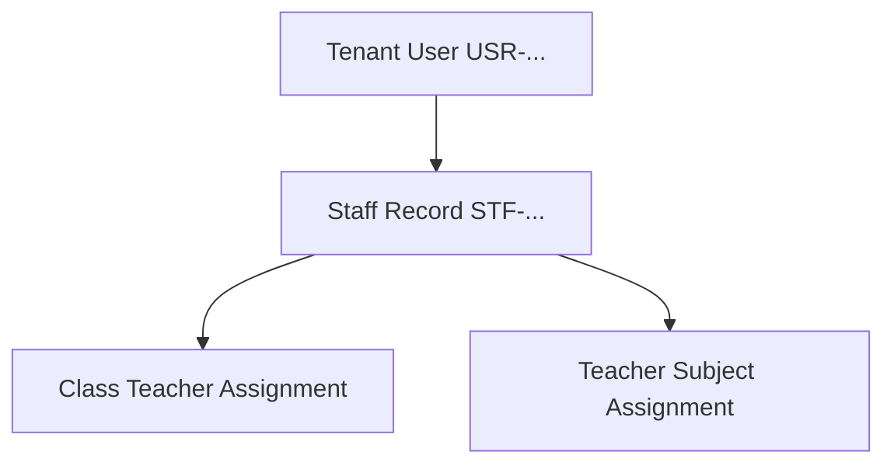

# Staff & Faculty Management API Integration Guide

This document provides frontend engineering teams with complete technical specifications for integrating Vidya ERP's Staff & Teacher Directory, Employment Lifecycle, Teacher-Subject Mappings, and Class Teacher Assignments.

---

## 1. Architectural Scope & Context

Staff and Teacher operations execute inside the school's **Tenant Database** and require the `X-Tenant-ID` header.



---

## 2. Request Headers

| Header | Required | Example / Value | Description |
| :--- | :---: | :--- | :--- |
| `Content-Type` | **Yes** | `application/json` | Request payload format |
| `Authorization` | **Yes** | `Bearer eyJhbGciOi...` | JWT access token |
| `X-Tenant-ID` | **Yes** | `d4e5f6a7-b8c9-0123-def0-123456789abc` | Target school tenant UUID or school tenant code |
| `X-Correlation-ID` | No | `req-stf-0982` | Optional request tracing correlation ID |

---

## 3. Staff & Teacher Directory APIs (`/api/v1/staff`)

### 3.1 Create Staff Member
Links a newly created or existing `tenantUserId` to a formal employment record.

- **Method**: `POST`
- **Path**: `/api/v1/staff`
- **RBAC**: `STAFF_CREATE` or roles `SCHOOL_ADMIN`, `SCHOOL_OWNER`

#### Request Body
```json
{
  "tenantUserId": "7a8b9c0d-1e2f-3a4b-5c6d-7e8f9a0b1c2d",
  "employeeId": "EMP-2024-0012",
  "joiningDate": "2024-06-01",
  "department": "Mathematics & Science",
  "designation": "Senior PGT Mathematics",
  "staffType": "TEACHING",
  "qualification": "M.Sc. Mathematics, B.Ed."
}
```

#### Response (`201 Created`)
```json
{
  "success": true,
  "code": "STAFF_CREATED",
  "message": "Staff member successfully created",
  "data": {
    "id": "2b3c4d5e-6f7a-8b9c-0d1e-2f3a4b5c6d7e",
    "staffCode": "STF-8A92K3LM",
    "tenantUserId": "7a8b9c0d-1e2f-3a4b-5c6d-7e8f9a0b1c2d",
    "employeeId": "EMP-2024-0012",
    "fullName": "Priya Sharma",
    "email": "priya.sharma@greenwood.edu.in",
    "phone": "+919876501234",
    "department": "Mathematics & Science",
    "designation": "Senior PGT Mathematics",
    "staffType": "TEACHING",
    "status": "ACTIVE",
    "joiningDate": "2024-06-01",
    "createdAt": "2026-10-17T11:00:00Z"
  },
  "timestamp": "2026-10-17T11:00:00Z"
}
```

---

### 3.2 List & Search Staff
- **Method**: `GET`
- **Path**: `/api/v1/staff`
- **Query Parameters**:
  - `status` (*optional*): `ACTIVE`, `PROBATION`, `NOTICE_PERIOD`, `TERMINATED`, `RESIGNED`
  - `staffType` (*optional*): `TEACHING`, `NON_TEACHING`, `ADMINISTRATIVE`, `SUPPORT`
  - `department` (*optional*): e.g., `Science`, `Languages`
  - `designation` (*optional*): e.g., `TGT English`
  - `q` (*optional*): Search term for staff name, employee ID, or code
  - `page` (*optional*, default: `0`)
  - `size` (*optional*, default: `20`)

---

### 3.3 Get Staff by ID / Code
- **By UUID**: `GET /api/v1/staff/{id}`
- **By Staff Code**: `GET /api/v1/staff/code/{staffCode}`
- **By Tenant User UUID**: `GET /api/v1/staff/tenant-user/{tenantUserId}`

---

### 3.4 Update Staff Profile & Status
- **Update Details**: `PUT /api/v1/staff/{id}`
- **Transition Status**: `PATCH /api/v1/staff/{id}/status` (Body: `{"status": "RESIGNED"}`)
- **Soft Delete**: `DELETE /api/v1/staff/{id}`

---

## 4. Teacher Assignments APIs

### 4.1 Assign Class Teacher to Section
Designates a faculty member as the primary teacher / mentor for an entire class section.

- **Method**: `POST`
- **Path**: `/api/v1/class-teacher-assignments`
- **Payload**:
```json
{
  "academicYearId": "b3e2a184-7c3d-4e92-91f8-847291a53d8b",
  "sectionId": "9c8b7a6d-5e4f-3a2b-1c0d-9e8f7a6b5c4d",
  "staffId": "2b3c4d5e-6f7a-8b9c-0d1e-2f3a4b5c6d7e",
  "isPrimary": true
}
```

### 4.2 Assign Teacher to Course / Subject
Maps a teacher to teach a specific subject in a section.

- **Method**: `POST`
- **Path**: `/api/v1/teacher-assignments`
- **Payload**:
```json
{
  "academicYearId": "b3e2a184-7c3d-4e92-91f8-847291a53d8b",
  "sectionId": "9c8b7a6d-5e4f-3a2b-1c0d-9e8f7a6b5c4d",
  "subjectId": "1b2c3d4e-5f6a-7b8c-9d0e-1f2a3b4c5d6e",
  "staffId": "2b3c4d5e-6f7a-8b9c-0d1e-2f3a4b5c6d7e"
}
```

---

## 5. TypeScript Type Definitions

Save this to your frontend codebase (`src/types/staff.ts`):

```typescript
export type EmploymentStatus = 'ACTIVE' | 'PROBATION' | 'NOTICE_PERIOD' | 'TERMINATED' | 'RESIGNED';
export type StaffType = 'TEACHING' | 'NON_TEACHING' | 'ADMINISTRATIVE' | 'SUPPORT';

export interface StaffResponse {
  id: string;
  staffCode: string;
  tenantUserId: string;
  employeeId?: string;
  fullName: string;
  email: string;
  phone: string;
  department?: string;
  designation?: string;
  staffType: StaffType;
  status: EmploymentStatus;
  joiningDate?: string;
  createdAt: string;
}

export interface CreateStaffRequest {
  tenantUserId: string;
  employeeId?: string;
  joiningDate: string;
  department?: string;
  designation?: string;
  staffType: StaffType;
  qualification?: string;
}

export interface UpdateStaffRequest {
  employeeId?: string;
  department?: string;
  designation?: string;
  staffType?: StaffType;
  qualification?: string;
}
```
