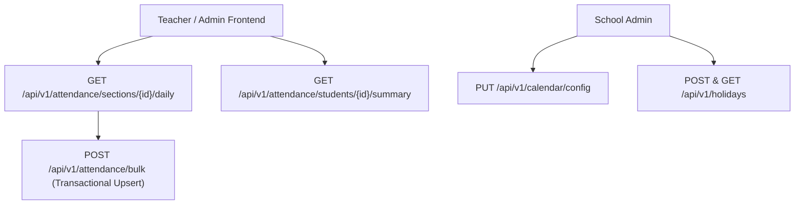

# Attendance & School Calendar API Integration Guide

This document provides frontend engineering teams with complete technical specifications for integrating Vidya ERP's Student Attendance tracking, Bulk Section Attendance Register, Academic Calendar configuration, and School Holidays.

---

## 1. Architectural Scope & Context

All attendance and calendar operations execute in the school's **Tenant Database** and require the `X-Tenant-ID` header.



---

## 2. Request Headers

| Header | Required | Example / Value | Description |
| :--- | :---: | :--- | :--- |
| `Content-Type` | **Yes** | `application/json` | Request payload format |
| `Authorization` | **Yes** | `Bearer eyJhbGciOi...` | JWT access token (Teacher or Admin) |
| `X-Tenant-ID` | **Yes** | `d4e5f6a7-b8c9-0123-def0-123456789abc` | Target school tenant UUID or school tenant code |
| `X-Correlation-ID` | No | `req-att-9912` | Optional request tracing correlation ID |

---

## 3. Student Attendance APIs (`/api/v1/attendance`)

### 3.1 Daily Section Attendance Sheet (Register View)
Fetches the full class roster for a given date. Students with attendance already recorded include their status; unrecorded students return `null` status for teachers to fill.

- **Method**: `GET`
- **Path**: `/api/v1/attendance/sections/{sectionId}/daily`
- **Query Parameters**:
  - `academicYearId` (**required**): UUID of the active academic year
  - `date` (**required**): Target date in `YYYY-MM-DD` format (e.g. `2026-10-17`)

#### Response (`200 OK`)
```json
{
  "success": true,
  "code": "DAILY_ATTENDANCE_RETRIEVED",
  "message": "Daily section attendance retrieved",
  "data": {
    "sectionId": "9c8b7a6d-5e4f-3a2b-1c0d-9e8f7a6b5c4d",
    "sectionName": "Class 10-A",
    "attendanceDate": "2026-10-17",
    "totalStudents": 35,
    "recordedCount": 35,
    "presentCount": 32,
    "absentCount": 2,
    "lateCount": 1,
    "halfDayCount": 0,
    "records": [
      {
        "studentId": "7f8e9d0c-1b2a-3c4d-5e6f-7a8b9c0d1e2f",
        "studentName": "Aarav Sharma",
        "admissionNumber": "ADM-2026-0042",
        "rollNumber": "01",
        "attendanceId": "3b2c1a0d-9e8f-7a6b-5c4d-3e2f1a0b9c8d",
        "status": "PRESENT",
        "remarks": null
      },
      {
        "studentId": "8a9b0c1d-2e3f-4a5b-6c7d-8e9f0a1b2c3d",
        "studentName": "Diya Patel",
        "admissionNumber": "ADM-2026-0043",
        "rollNumber": "02",
        "attendanceId": "4c3b2a1d-0e9f-8a7b-6c5d-4e3f2a1b0c9d",
        "status": "ABSENT",
        "remarks": "Medical leave reported by parent"
      }
    ]
  },
  "timestamp": "2026-10-17T11:15:00Z"
}
```

---

### 3.2 Bulk Mark / Upsert Attendance for Section
Saves an entire classroom's attendance sheet in a single atomic transaction. Automatically creates new records or updates existing records if corrections are made.

- **Method**: `POST`
- **Path**: `/api/v1/attendance/bulk`
- **RBAC**: `ATTENDANCE_BULK_MARK` or roles `TEACHER`, `SCHOOL_ADMIN`

#### Request Body
```json
{
  "academicYearId": "b3e2a184-7c3d-4e92-91f8-847291a53d8b",
  "sectionId": "9c8b7a6d-5e4f-3a2b-1c0d-9e8f7a6b5c4d",
  "attendanceDate": "2026-10-17",
  "records": [
    {
      "studentId": "7f8e9d0c-1b2a-3c4d-5e6f-7a8b9c0d1e2f",
      "status": "PRESENT"
    },
    {
      "studentId": "8a9b0c1d-2e3f-4a5b-6c7d-8e9f0a1b2c3d",
      "status": "ABSENT",
      "remarks": "Fever"
    }
  ]
}
```

#### Response (`200 OK`)
```json
{
  "success": true,
  "code": "BULK_ATTENDANCE_PROCESSED",
  "message": "Bulk attendance processed: 2 created, 0 updated",
  "data": {
    "sectionId": "9c8b7a6d-5e4f-3a2b-1c0d-9e8f7a6b5c4d",
    "attendanceDate": "2026-10-17",
    "totalSubmitted": 2,
    "created": 2,
    "updated": 0
  },
  "timestamp": "2026-10-17T11:18:00Z"
}
```

---

### 3.3 Student Attendance Aggregate Summary
Calculates aggregate attendance percentage and breakdown counts across the academic year (useful for student report cards and parent apps).

- **Method**: `GET`
- **Path**: `/api/v1/attendance/students/{studentId}/summary?academicYearId=...`

#### Response (`200 OK`)
```json
{
  "success": true,
  "code": "ATTENDANCE_SUMMARY_RETRIEVED",
  "message": "Attendance summary retrieved",
  "data": {
    "studentId": "7f8e9d0c-1b2a-3c4d-5e6f-7a8b9c0d1e2f",
    "academicYearId": "b3e2a184-7c3d-4e92-91f8-847291a53d8b",
    "totalWorkingDays": 110,
    "presentDays": 102,
    "absentDays": 5,
    "lateDays": 2,
    "halfDays": 1,
    "excusedDays": 0,
    "attendancePercentage": 93.64
  },
  "timestamp": "2026-10-17T11:20:00Z"
}
```

---

## 4. Academic Calendar & Working Days (`/api/v1/calendar`)

### 4.1 Working Days Configuration
Defines which weekdays are working school days (e.g., Monday through Friday active, 2nd & 4th Saturdays off).

- **Get Config**: `GET /api/v1/calendar/config?academicYearId=...`
- **Update Config**: `PUT /api/v1/calendar/config?academicYearId=...`

#### Request Body
```json
{
  "mondayWorking": true,
  "tuesdayWorking": true,
  "wednesdayWorking": true,
  "thursdayWorking": true,
  "fridayWorking": true,
  "saturdayWorking": false,
  "sundayWorking": false
}
```

### 4.2 Count Working Days in Date Range
- **Method**: `GET`
- **Path**: `/api/v1/calendar/working-days/count?from=2026-10-01&to=2026-10-31`

---

## 5. School Holidays (`/api/v1/holidays`)

### 5.1 Create Holiday
- **Method**: `POST`
- **Path**: `/api/v1/holidays`

#### Request Body
```json
{
  "academicYearId": "b3e2a184-7c3d-4e92-91f8-847291a53d8b",
  "name": "Diwali Festival Vacation",
  "description": "Deepavali festival break for students and staff",
  "startDate": "2026-11-08",
  "endDate": "2026-11-12",
  "type": "FESTIVAL"
}
```

### 5.2 Search Holidays (Filtered by Date Range or Type)
- **Method**: `GET`
- **Path**: `/api/v1/holidays?academicYearId=...&type=FESTIVAL&dateFrom=2026-11-01&dateTo=2026-11-30`

---

## 6. TypeScript Type Definitions

Save this to your frontend codebase (`src/types/attendance-calendar.ts`):

```typescript
export type AttendanceStatus = 'PRESENT' | 'ABSENT' | 'LATE' | 'HALF_DAY' | 'EXCUSED';
export type HolidayType = 'NATIONAL' | 'FESTIVAL' | 'VACATION' | 'UNPLANNED_WEATHER' | 'OTHER';

export interface StudentAttendanceRecordDto {
  studentId: string;
  studentName: string;
  admissionNumber: string;
  rollNumber?: string;
  attendanceId?: string | null;
  status: AttendanceStatus | null;
  remarks?: string | null;
}

export interface DailySectionAttendanceResponse {
  sectionId: string;
  sectionName: string;
  attendanceDate: string;
  totalStudents: number;
  recordedCount: number;
  presentCount: number;
  absentCount: number;
  lateCount: number;
  halfDayCount: number;
  records: StudentAttendanceRecordDto[];
}

export interface MarkAttendanceRecordRequest {
  studentId: string;
  status: AttendanceStatus;
  remarks?: string;
}

export interface BulkAttendanceRequest {
  academicYearId: string;
  sectionId: string;
  attendanceDate: string;
  records: MarkAttendanceRecordRequest[];
}

export interface AttendanceSummaryResponse {
  studentId: string;
  academicYearId: string;
  totalWorkingDays: number;
  presentDays: number;
  absentDays: number;
  lateDays: number;
  halfDays: number;
  excusedDays: number;
  attendancePercentage: number;
}

export interface HolidayResponse {
  id: string;
  academicYearId: string;
  name: string;
  description?: string;
  startDate: string;
  endDate: string;
  type: HolidayType;
  totalDays: number;
}
```
