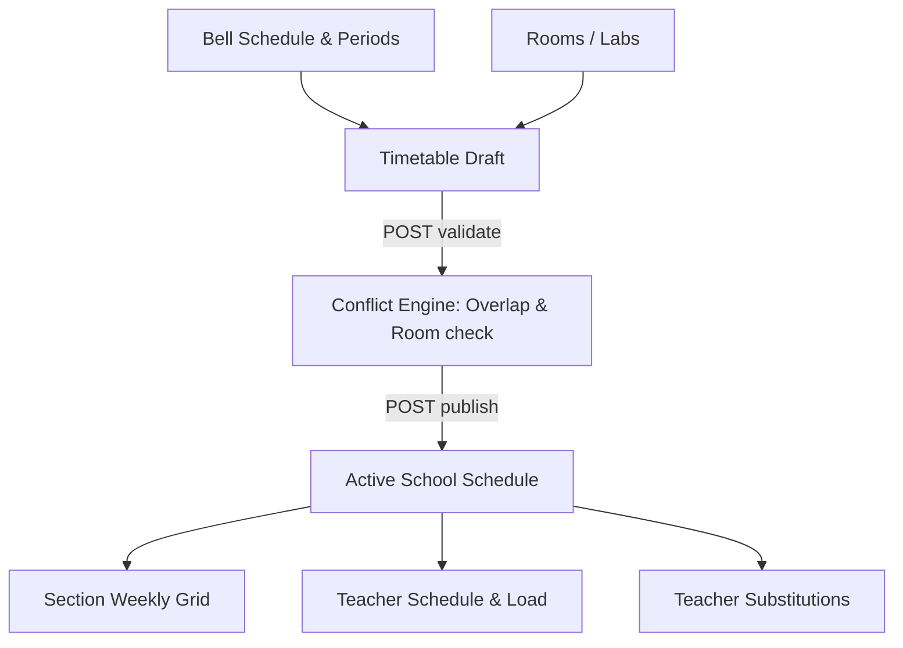

# Timetable & Scheduling API Integration Guide

This document provides frontend engineering teams with complete technical specifications for integrating Vidya ERP's Bell Schedules, Room Management, Interactive Timetable Grids, Conflict Validation, Teacher Workload, and Daily Substitutions.

---

## 1. Architectural Scope & Context

Timetable operations execute in the school's **Tenant Database** and require the `X-Tenant-ID` header.



---

## 2. Request Headers

| Header | Required | Example / Value | Description |
| :--- | :---: | :--- | :--- |
| `Content-Type` | **Yes** | `application/json` | Request payload format |
| `Authorization` | **Yes** | `Bearer eyJhbGciOi...` | JWT access token |
| `X-Tenant-ID` | **Yes** | `d4e5f6a7-b8c9-0123-def0-123456789abc` | Target school tenant UUID or school tenant code |
| `X-Correlation-ID` | No | `req-tt-7721` | Optional request tracing correlation ID |

---

## 3. Bell Schedule APIs (`/api/v1/bell-schedules`)

A Bell Schedule defines daily period durations, start/end times, and break slots (e.g., Morning Assembly, Period 1, Lunch Break).

### 3.1 Create Bell Schedule
- **Method**: `POST`
- **Path**: `/api/v1/bell-schedules`

#### Request Body
```json
{
  "name": "Standard High School Schedule",
  "academicYearId": "b3e2a184-7c3d-4e92-91f8-847291a53d8b",
  "isDefault": true,
  "periods": [
    {
      "periodNumber": 1,
      "periodName": "Period 1",
      "startTime": "08:30:00",
      "endTime": "09:15:00",
      "isBreak": false
    },
    {
      "periodNumber": 2,
      "periodName": "Short Recess",
      "startTime": "09:15:00",
      "endTime": "09:30:00",
      "isBreak": true
    }
  ]
}
```

### 3.2 List Periods in Bell Schedule
- **Method**: `GET`
- **Path**: `/api/v1/bell-schedules/{id}/periods`

---

## 4. Rooms & Labs APIs (`/api/v1/rooms`)

Maintains physical facilities (e.g., Physics Lab, Class 10A, Computer Lab 2).

### 4.1 Create Room
- **Method**: `POST`
- **Path**: `/api/v1/rooms`

#### Request Body
```json
{
  "roomNumber": "LAB-PHY-01",
  "building": "Science Block",
  "floor": 2,
  "capacity": 45,
  "roomType": "LABORATORY"
}
```

### 4.2 List Rooms (with status and capacity)
- **Method**: `GET`
- **Path**: `/api/v1/rooms?status=ACTIVE&page=0&size=50`

---

## 5. Timetable Generation & Grid APIs (`/api/v1/timetables`)

### 5.1 Create Timetable Lifecycle
1. **Create Draft**: `POST /api/v1/timetables` (Body: `academicYearId`, `bellScheduleId`, `name`)
2. **Add/Upsert Entries**: `POST /api/v1/timetables/{id}/entries`
3. **Validate Conflicts**: `POST /api/v1/timetables/{id}/validate` (Checks teacher double-booking, room overlap)
4. **Publish**: `POST /api/v1/timetables/{id}/publish` (Transitions status to `PUBLISHED`)

---

### 5.2 Section Weekly Timetable Grid
Used by frontend UI to render the interactive classroom schedule matrix.

- **Method**: `GET`
- **Path**: `/api/v1/timetables/{timetableId}/sections/{sectionId}/grid`

#### Response (`200 OK`)
```json
{
  "success": true,
  "code": "SUCCESS",
  "message": "Section timetable grid retrieved",
  "data": {
    "sectionId": "9c8b7a6d-5e4f-3a2b-1c0d-9e8f7a6b5c4d",
    "sectionName": "Class 10-A",
    "days": [
      {
        "dayOfWeek": "MONDAY",
        "slots": [
          {
            "periodNumber": 1,
            "periodName": "Period 1",
            "startTime": "08:30:00",
            "endTime": "09:15:00",
            "subjectName": "Mathematics",
            "subjectCode": "MATH-10",
            "teacherName": "Ramesh Sharma",
            "teacherId": "2b3c4d5e-6f7a-8b9c-0d1e-2f3a4b5c6d7e",
            "roomNumber": "Room 301",
            "roomId": "1a2b3c4d-5e6f-7a8b-9c0d-1e2f3a4b5c6d"
          }
        ]
      }
    ]
  },
  "timestamp": "2026-10-17T11:30:00Z"
}
```

---

### 5.3 Teacher Schedule & Workload
- **Teacher Weekly Grid**: `GET /api/v1/timetables/{timetableId}/teachers/{teacherId}/grid`
- **Teacher Workload (Weekly Hours)**: `GET /api/v1/timetables/{timetableId}/teachers/{teacherId}/load`
- **Room Occupancy**: `GET /api/v1/timetables/{timetableId}/rooms/{roomId}/occupancy`

---

## 6. Daily Teacher Substitutions (`/api/v1/substitutions`)

Enables substituting an absent teacher with another available faculty member for specific periods.

- **Create Substitution**: `POST /api/v1/substitutions`
- **List Substitutions**: `GET /api/v1/substitutions?date=2026-10-17`
- **Cancel Substitution**: `PATCH /api/v1/substitutions/{id}/cancel`

---

## 7. TypeScript Type Definitions

Save this to your frontend codebase (`src/types/timetable.ts`):

```typescript
export type DayOfWeek = 'MONDAY' | 'TUESDAY' | 'WEDNESDAY' | 'THURSDAY' | 'FRIDAY' | 'SATURDAY' | 'SUNDAY';
export type TimetableStatus = 'DRAFT' | 'VALIDATED' | 'PUBLISHED' | 'ARCHIVED';
export type RoomType = 'CLASSROOM' | 'LABORATORY' | 'AUDITORIUM' | 'SPORTS_FACILITY' | 'LIBRARY';

export interface TimetableSlotDto {
  periodNumber: number;
  periodName: string;
  startTime: string;
  endTime: string;
  subjectName: string;
  subjectCode: string;
  teacherName: string;
  teacherId: string;
  roomNumber: string;
  roomId: string;
}

export interface DayScheduleDto {
  dayOfWeek: DayOfWeek;
  slots: TimetableSlotDto[];
}

export interface SectionTimetableGridResponse {
  sectionId: string;
  sectionName: string;
  days: DayScheduleDto[];
}

export interface CreateTimetableEntryRequest {
  dayOfWeek: DayOfWeek;
  periodId: string;
  sectionId: string;
  subjectId: string;
  teacherId: string;
  roomId?: string;
}

export interface TimetableValidationResult {
  hasConflicts: boolean;
  conflicts: {
    type: 'TEACHER_DOUBLE_BOOKED' | 'ROOM_DOUBLE_BOOKED';
    description: string;
    dayOfWeek: DayOfWeek;
    periodNumber: number;
  }[];
}
```
