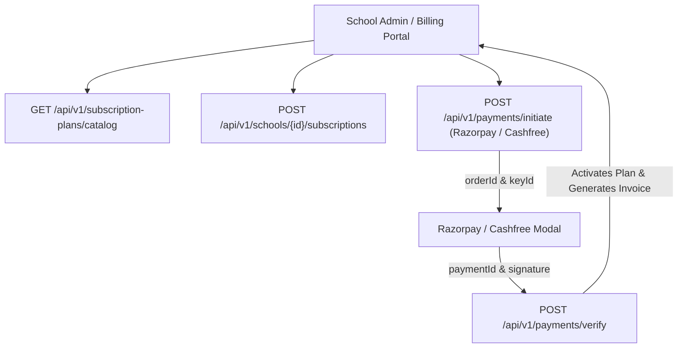

# Subscriptions & Payments API Integration Guide

This document provides frontend engineering teams with complete technical specifications for integrating Vidya ERP's Subscription Plans Catalog, School Subscription Lifecycle, Payment Gateway Checkout (Razorpay / Cashfree), and Invoice Receipts.

---

## 1. Architectural Scope & Context

Subscription and payment records live in the **Master Database** (`vidya_master_db`). Master operations are exempt from the `X-Tenant-ID` header.



---

## 2. Request Headers

| Header | Required | Example / Value | Description |
| :--- | :---: | :--- | :--- |
| `Content-Type` | **Yes** | `application/json` | Request payload format |
| `Authorization` | **Yes** | `Bearer eyJhbGciOi...` | JWT access token |
| `X-Correlation-ID` | No | `req-pay-0012` | Optional request tracing correlation ID |

> [!NOTE]
> `X-Tenant-ID` is **NOT** required for any `/api/v1/subscription-plans`, `/api/v1/schools/{schoolId}/subscriptions`, or `/api/v1/payments` endpoints.

---

## 3. Subscription Plans Catalog (`/api/v1/subscription-plans`)

### 3.1 Fetch Public Pricing & Plans Catalog
Retrieves all published subscription tiers (e.g. Basic, Professional, Enterprise) with billing frequencies, price tiers, and included feature flags.

- **Method**: `GET`
- **Path**: `/api/v1/subscription-plans/catalog`

#### Response (`200 OK`)
```json
{
  "success": true,
  "code": "SUCCESS",
  "message": "Subscription plan catalog retrieved",
  "data": [
    {
      "id": "1a2b3c4d-5e6f-7a8b-9c0d-1e2f3a4b5c6d",
      "planCode": "GROWTH_ANNUAL",
      "name": "School Growth Plan (Annual)",
      "description": "Complete ERP for K-12 schools up to 1,500 students",
      "billingCycle": "ANNUAL",
      "basePrice": 99000.00,
      "currency": "INR",
      "maxStudents": 1500,
      "maxStaff": 100,
      "features": [
        "STUDENT_MANAGEMENT",
        "ATTENDANCE_TRACKING",
        "EXAM_REPORT_CARDS",
        "TIMETABLE_GENERATOR",
        "FEE_MANAGEMENT",
        "PARENT_PORTAL"
      ]
    }
  ],
  "timestamp": "2026-10-17T11:45:00Z"
}
```

---

## 4. School Subscriptions (`/api/v1/schools/{schoolId}/subscriptions`)

### 4.1 Get Active Subscription for School
- **Method**: `GET`
- **Path**: `/api/v1/schools/{schoolId}/subscriptions/active`

#### Response (`200 OK`)
```json
{
  "success": true,
  "code": "SUCCESS",
  "message": "Active subscription retrieved",
  "data": {
    "id": "7f8e9d0c-1b2a-3c4d-5e6f-7a8b9c0d1e2f",
    "schoolId": "e9b2a184-7c3d-4e92-91f8-847291a53d8b",
    "planCode": "GROWTH_ANNUAL",
    "planName": "School Growth Plan (Annual)",
    "status": "ACTIVE",
    "startDate": "2026-04-01T00:00:00Z",
    "endDate": "2027-03-31T23:59:59Z",
    "isAutoRenew": true,
    "maxStudents": 1500,
    "currentStudents": 820
  },
  "timestamp": "2026-10-17T11:48:00Z"
}
```

---

## 5. Payment Gateway Integration (`/api/v1/payments`)

### 5.1 Initiate Gateway Order
Initiates an order for Razorpay or Cashfree and returns the client order ID to launch the checkout popup.

- **Method**: `POST`
- **Path**: `/api/v1/payments/initiate`

#### Request Body
```json
{
  "schoolId": "e9b2a184-7c3d-4e92-91f8-847291a53d8b",
  "subscriptionPlanId": "1a2b3c4d-5e6f-7a8b-9c0d-1e2f3a4b5c6d",
  "gateway": "RAZORPAY",
  "currency": "INR",
  "amount": 99000.00
}
```

#### Response (`200 OK`)
```json
{
  "success": true,
  "code": "PAYMENT_INITIATED",
  "message": "Gateway order initiated successfully",
  "data": {
    "transactionCode": "TXN-2026-88192",
    "gateway": "RAZORPAY",
    "gatewayOrderId": "order_EKf34d7uQ9L1",
    "amount": 99000.00,
    "currency": "INR",
    "keyId": "rzp_live_abcdef123456"
  },
  "timestamp": "2026-10-17T11:50:00Z"
}
```

---

### 5.2 Verify Gateway Signature & Activate Subscription
Called immediately after the user completes payment in the frontend Razorpay modal.

- **Method**: `POST`
- **Path**: `/api/v1/payments/verify`

#### Request Body
```json
{
  "transactionCode": "TXN-2026-88192",
  "gatewayPaymentId": "pay_EKf99m21kL8s",
  "gatewayOrderId": "order_EKf34d7uQ9L1",
  "gatewaySignature": "9f82d1c7a8b34e56..."
}
```

#### Response (`200 OK`)
```json
{
  "success": true,
  "code": "PAYMENT_VERIFIED",
  "message": "Payment verified and subscription activated successfully",
  "data": {
    "transactionCode": "TXN-2026-88192",
    "status": "SUCCESS",
    "amount": 99000.00,
    "invoiceNumber": "INV-2026-00412",
    "subscriptionId": "7f8e9d0c-1b2a-3c4d-5e6f-7a8b9c0d1e2f"
  },
  "timestamp": "2026-10-17T11:52:00Z"
}
```

---

## 6. TypeScript Type Definitions & Razorpay Checkout Hook

```typescript
export interface InitiatePaymentRequest {
  schoolId: string;
  subscriptionPlanId: string;
  gateway: 'RAZORPAY' | 'CASHFREE';
  currency: string;
  amount: number;
}

export interface InitiatePaymentResponse {
  transactionCode: string;
  gateway: 'RAZORPAY' | 'CASHFREE';
  gatewayOrderId: string;
  amount: number;
  currency: string;
  keyId: string;
}

export interface VerifyPaymentRequest {
  transactionCode: string;
  gatewayPaymentId: string;
  gatewayOrderId: string;
  gatewaySignature: string;
}

// Client-side Razorpay Modal Launcher
export async function launchRazorpayCheckout(
  order: InitiatePaymentResponse,
  schoolName: string,
  userEmail: string,
  onSuccess: (verifyPayload: VerifyPaymentRequest) => void
) {
  const options = {
    key: order.keyId,
    amount: order.amount * 100, // paise
    currency: order.currency,
    name: 'Vidya ERP',
    description: `Subscription for ${schoolName}`,
    order_id: order.gatewayOrderId,
    prefill: {
      email: userEmail,
    },
    theme: {
      color: '#4F46E5', // Indigo
    },
    handler: function (response: any) {
      onSuccess({
        transactionCode: order.transactionCode,
        gatewayPaymentId: response.razorpay_payment_id,
        gatewayOrderId: response.razorpay_order_id,
        gatewaySignature: response.razorpay_signature,
      });
    },
  };

  const razorpay = new (window as any).Razorpay(options);
  razorpay.open();
}
```
