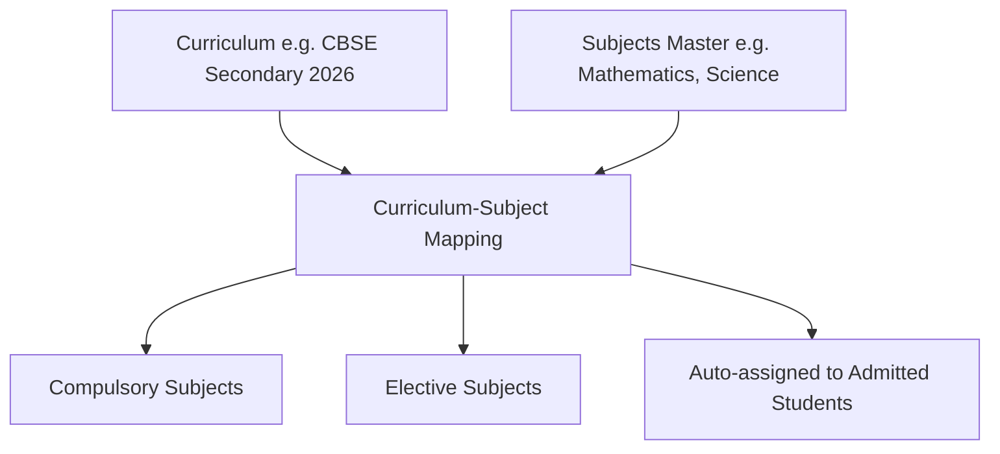

# Curriculum & Course Subjects API Integration Guide

This document provides frontend engineering teams with complete technical specifications for integrating Vidya ERP's Academic Curriculums, Course Subjects, and Curriculum-Subject Mapping APIs.

---

## 1. Architectural Scope & Context

Curriculum and Subject entities execute inside the active school's **Tenant Database** and require the `X-Tenant-ID` header.



---

## 2. Request Headers

| Header | Required | Example / Value | Description |
| :--- | :---: | :--- | :--- |
| `Content-Type` | **Yes** | `application/json` | Request payload format |
| `Authorization` | **Yes** | `Bearer eyJhbGciOi...` | JWT access token |
| `X-Tenant-ID` | **Yes** | `d4e5f6a7-b8c9-0123-def0-123456789abc` | Target school tenant UUID or school tenant code |
| `X-Correlation-ID` | No | `req-curr-881` | Optional request tracing correlation ID |

---

## 3. Course Subjects Master APIs (`/api/v1/tenant/subjects`)

Course Subjects represent individual subjects offered across grades (e.g., Mathematics, Physics, History).

### 3.1 Create Subject
- **Method**: `POST`
- **Path**: `/api/v1/tenant/subjects`

#### Request Body
```json
{
  "code": "MATH-10",
  "name": "Standard Mathematics",
  "department": "Mathematics",
  "subjectType": "THEORY_AND_PRACTICAL",
  "description": "CBSE Class 10 Core Mathematics Curriculum"
}
```

#### Response (`201 Created`)
```json
{
  "success": true,
  "code": "SUBJECT_CREATED",
  "message": "Subject created successfully",
  "data": {
    "id": "1b2c3d4e-5f6a-7b8c-9d0e-1f2a3b4c5d6e",
    "code": "MATH-10",
    "name": "Standard Mathematics",
    "department": "Mathematics",
    "subjectType": "THEORY_AND_PRACTICAL",
    "status": "ACTIVE",
    "createdAt": "2026-10-17T12:00:00Z"
  },
  "timestamp": "2026-10-17T12:00:00Z"
}
```

### 3.2 List Subjects (Paginated & Filtered)
- **Method**: `GET`
- **Path**: `/api/v1/tenant/subjects`
- **Query Parameters**:
  - `department` (*optional*): e.g. `Science`, `Languages`
  - `status` (*optional*): `ACTIVE`, `INACTIVE`
  - `page` (*optional*, default: `0`)
  - `size` (*optional*, default: `50`)

---

## 4. Curriculums APIs (`/api/v1/tenant/curricula`)

Curriculums bundle subjects together for a particular board and grade level.

### 4.1 Create Curriculum
- **Method**: `POST`
- **Path**: `/api/v1/tenant/curricula`

#### Request Body
```json
{
  "code": "CURR-CBSE-10",
  "name": "CBSE Class 10 Curriculum 2026-27",
  "board": "CBSE",
  "academicClassId": "c4d3e2f1-a0b9-8c7d-6e5f-4a3b2c1d0e9f"
}
```

### 4.2 Map Subjects to Curriculum
- **Method**: `POST`
- **Path**: `/api/v1/tenant/curricula/{curriculumId}/subjects`

#### Request Body
```json
{
  "subjectId": "1b2c3d4e-5f6a-7b8c-9d0e-1f2a3b4c5d6e",
  "isCompulsory": true,
  "weeklyPeriods": 6
}
```

---

## 5. TypeScript Type Definitions

```typescript
export type SubjectType = 'THEORY' | 'PRACTICAL' | 'THEORY_AND_PRACTICAL' | 'ACTIVITY';

export interface SubjectResponse {
  id: string;
  code: string;
  name: string;
  department?: string;
  subjectType: SubjectType;
  status: 'ACTIVE' | 'INACTIVE';
  createdAt: string;
}

export interface CurriculumResponse {
  id: string;
  code: string;
  name: string;
  board: string;
  academicClassId: string;
  createdAt: string;
}

export interface CurriculumSubjectMappingResponse {
  curriculumId: string;
  subjectId: string;
  subjectCode: string;
  subjectName: string;
  isCompulsory: boolean;
  weeklyPeriods: number;
}
```
