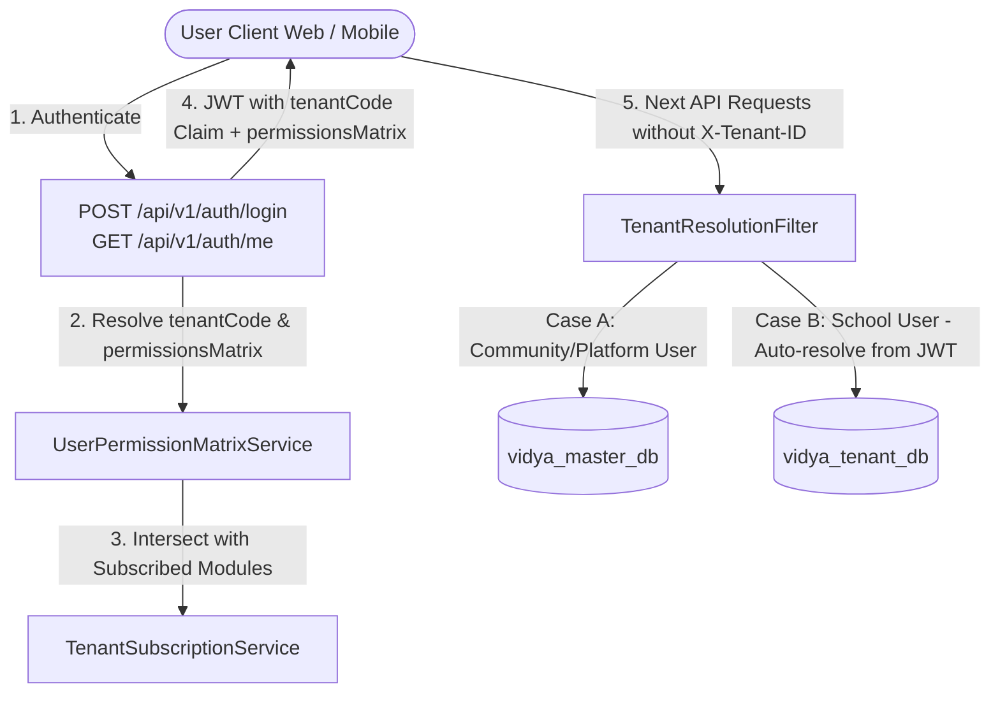
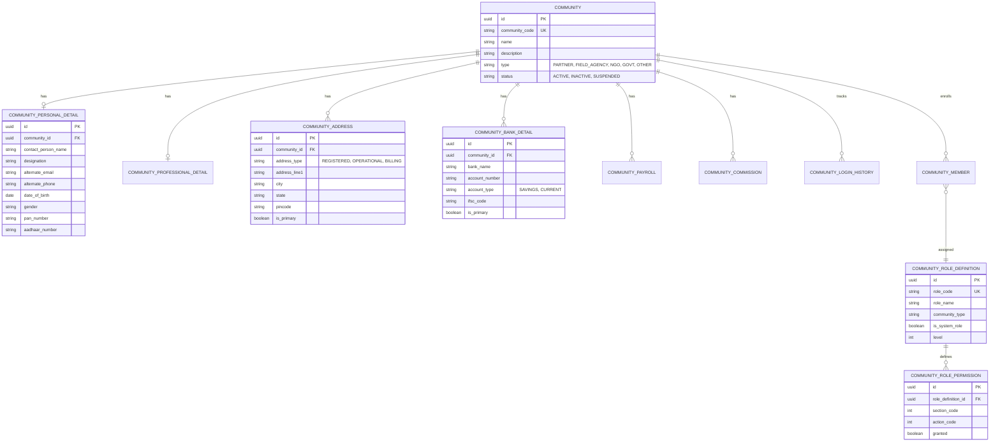
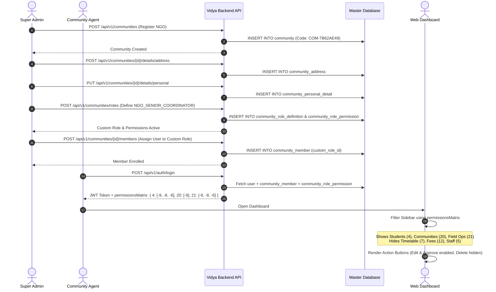

# 11. Community Management & Universal Role Permission Matrix

This guide provides end-to-end technical documentation for the **Community Organization System** and the **Universal Section & Action Permission Matrix**. It covers backend domain architecture, REST API contracts, TypeScript definitions, permission validation algorithms, frontend dashboard navigation rendering, and UI action guards.

---

## 1. Architectural Overview

The Vidya platform uses a multi-faceted permission and tenant model:
1. **Zero-Header Multi-Tenancy (Token-Based Resolution)**:
   - **School-Based Users** (`schoolId != null`): The user's assigned `tenantCode` is embedded directly into the JWT access token claims at login/refresh and resolved automatically by `TenantResolutionFilter`. The frontend **does NOT need to send the `X-Tenant-ID` header**. If missing, the backend extracts the tenant directly from the token or resolves it via `schoolId`.
   - **Community & Platform Users** (`schoolId == null`): Possess no tenant boundary and operate universally on the **Master Database** (`vidya_master_db`). `TenantResolutionFilter` transparently continues request execution on the master DB without requiring `X-Tenant-ID` or throwing tenant errors.
   - **Exempt Routes**: Master routes like `/api/v1/communities/**`, `/api/v1/schools/**`, `/api/v1/school-subscriptions/**`, `/api/v1/payments/**`, and `/api/v1/auth/**` always route directly to the Master DB.
2. **Core Community Identity**: Communities represent partner organizations, field agencies, NGOs, or government entities that operate schools, recruit educators, or coordinate admissions.
3. **Normalized Sub-Tables**: Rather than bloating the core `community` table, sub-details (personal, professional, multi-address, bank accounts, payroll, and commission) are isolated into dedicated relational tables with independent access controls.
4. **Universal Integer Permission Matrix**: Replaces rigid enums with high-performance integer codes (`sectionCode` for domain entities and `actionCode` for operation verbs). This matrix is uniformly applied to **all** personas—Platform Admins, School Admins, Principals, Coordinators, Teachers, Subject Teachers, Accounts, Parents, Students, and Community Agents.
5. **Subscription Entitlement Intersection**: The permission matrix is computed on the fly during authentication (`/auth/login` and `/auth/me`). Permissions are intersected with active school/tenant subscription module entitlements—ensuring users never gain access to features their institution has not subscribed to.



---

## 2. Universal Permission Matrix Specification

### 2.1 Section Codes (`sectionCode`)
Integer identifiers representing discrete platform modules and dashboard sections:

| Section Code | Name | Domain Description |
| :---: | :--- | :--- |
| `1` | **Dashboard / Analytics** | Main overview KPIs, executive summaries, school performance widgets |
| `2` | **School Registry** | School institution details, campus branches, affiliation records |
| `3` | **Academic Management** | Academic calendars, terms, classes/grades, section definitions |
| `4` | **Students & Admissions** | Student registry, 360 profiles, enrolment, guardian records |
| `5` | **Staff & Faculty** | Teachers, non-teaching staff, department & designation master |
| `6` | **Attendance & Calendar** | Daily student/staff attendance sheets, holiday schedules |
| `7` | **Timetable & Bell Schedules**| Class periods, room assignments, teacher timetable grids |
| `8` | **Subscriptions & Billing** | School subscription plans, invoicing, payment receipts |
| `9` | **Curriculum & Subjects** | Course catalog, subject groupings, syllabi management |
| `10` | **Exams & Assessments** | Grading scales, exam terms, papers, marks entry, report cards |
| `11` | **Classroom Assignment** | Teacher-to-subject & class teacher bindings |
| `12` | **Fee Management** | Fee structures, installment plans, fee collection, receipts |
| `13` | **Notice Board & Circulars** | School announcements, circular broadcasts, alerts |
| `14` | **Library System** | Book inventory, cataloguing, issuance, returns, fines |
| `15` | **Transport & Fleet** | Bus routes, vehicle fleet, driver records, stop pick-up |
| `16` | **Hostel & Dormitory** | Hostel rooms, bed allocations, warden management |
| `17` | **Inventory & Assets** | School assets, lab equipment, stock ledger |
| `18` | **Parent Portal** | Parent 360 view, ward performance, teacher messaging |
| `19` | **Student Portal** | Student assignments, report cards, class timetable |
| `20` | **Community Registry** | Partner organizations, NGOs, field agencies directory |
| `21` | **Field Operations** | School onboarding pipeline, field agent visits, surveys |
| `22` | **Payroll & Commission** | Agent commissions, staff salary structures, payout cycles |
| `23` | **Roles & Permissions** | Custom community roles, platform user permission assignment |

---

### 2.2 Action Codes (`actionCode`)
Negative integers representing operational authority hierarchy:

| Action Code | Action Name | Description |
| :---: | :--- | :--- |
| `-9` | **View (Read-Only)** | View section overview, read records, download exports |
| `-8` | **Edit (Update)** | Modify existing records, save draft states |
| `-7` | **Delete (Remove)** | Soft-delete, purge, or archive records |
| `-6` | **Approve / Authorize** | Verify documents, approve marks, sanction leaves, sign-off |
| `-5` | **Scoped Access** | Restricts viewing/editing to the user's assigned class/department |
| `-4` | **Full Admin / Wildcard**| Unrestricted super-user administrative control over the section |

---

### 2.3 Permissions Matrix Payload in Auth Response

When any user logs in or fetches their profile (`/api/v1/auth/login` or `/api/v1/auth/me`), the backend delivers the `permissionsMatrix`:

```json
{
  "success": true,
  "code": "LOGIN_SUCCESS",
  "data": {
    "accessToken": "eyJhbGciOiJIUzI1NiIsInR5cCI6...",
    "refreshToken": "4a7f05b1-e7c6-48c9-...",
    "expiresIn": 86400,
    "user": {
      "id": "e41ea4bf-a879-4b4d-9441-ec96e7fe20da",
      "email": "agent@edupartners.org",
      "fullName": "Rohit Verma",
      "role": "FIELD_AGENT",
      "status": "ACTIVE",
      "tenantCode": null,
      "schoolId": null,
      "permissionsMatrix": {
        "1": [-9],
        "4": [-9, -8],
        "20": [-9],
        "21": [-9, -8, -6]
      }
    }
  }
}
```

> **Note on Multi-Tenancy**:
> - For **School Users** (teachers, students, school admins), `tenantCode` (e.g. `"SCH-001"`) is present in both the JWT claims and the user object. The client does **NOT** need to pass `X-Tenant-ID` in headers; backend automatically binds the tenant context from the Bearer token!
> - For **Community & Platform Users**, `tenantCode` is `null`. They operate directly on the Master DB with zero tenant configuration required.

---

## 3. Frontend Integration & Dashboard Flow

### 3.1 TypeScript Permission Store & Helper Utility

Create a clean client-side authorization utility (`src/utils/permissions.ts`):

```typescript
export type PermissionsMatrix = Record<number, number[]>;

export interface AuthUser {
  id: string;
  email: string;
  fullName: string;
  role: string;
  status: string;
  tenantCode?: string | null;
  schoolId?: string | null;
  permissionsMatrix?: PermissionsMatrix;
}

/**
 * Checks if the user holds authority to execute an action on a target section.
 *
 * @param matrix The user's permissionsMatrix from auth state
 * @param sectionCode The integer code of the target section (e.g. 4 for Students)
 * @param actionCode The required action code (e.g. -9 for View, -8 for Edit)
 */
export function hasPermission(
  matrix: PermissionsMatrix | undefined | null,
  sectionCode: number,
  actionCode: number
): boolean {
  if (!matrix) return false;
  const actions = matrix[sectionCode];
  if (!actions || !Array.isArray(actions)) return false;

  // Wildcard full admin (-4) grants all actions
  if (actions.includes(-4)) return true;

  // Exact action match
  return actions.includes(actionCode);
}
```

---

### 3.2 Dynamic Dashboard Navigation / Sidebar Menu

Use `hasPermission` to filter navigation menus so users only see authorized modules:

```tsx
import React from 'react';
import { NavLink } from 'react-router-dom';
import { useAuth } from '../context/AuthContext';
import { hasPermission } from '../utils/permissions';

interface NavMenuItem {
  label: string;
  path: string;
  sectionCode: number;
  icon: string;
}

const MENU_ITEMS: NavMenuItem[] = [
  { label: 'Dashboard', path: '/dashboard', sectionCode: 1, icon: 'dashboard' },
  { label: 'Schools', path: '/schools', sectionCode: 2, icon: 'school' },
  { label: 'Academics', path: '/academics', sectionCode: 3, icon: 'calendar_month' },
  { label: 'Students', path: '/students', sectionCode: 4, icon: 'people' },
  { label: 'Staff & Teachers', path: '/staff', sectionCode: 5, icon: 'badge' },
  { label: 'Attendance', path: '/attendance', sectionCode: 6, icon: 'event_available' },
  { label: 'Timetable', path: '/timetable', sectionCode: 7, icon: 'schedule' },
  { label: 'Examinations', path: '/exams', sectionCode: 10, icon: 'quiz' },
  { label: 'Fees & Accounts', path: '/fees', sectionCode: 12, icon: 'payments' },
  { label: 'Communities', path: '/communities', sectionCode: 20, icon: 'groups' },
  { label: 'Field Operations', path: '/field-ops', sectionCode: 21, icon: 'handshake' },
  { label: 'Payroll & Comm.', path: '/commissions', sectionCode: 22, icon: 'account_balance_wallet' },
  { label: 'Role Settings', path: '/roles', sectionCode: 23, icon: 'admin_panel_settings' },
];

export const AppSidebar: React.FC = () => {
  const { user } = useAuth();

  // Filter items where user has at least View authority (-9)
  const visibleMenuItems = MENU_ITEMS.filter((item) =>
    hasPermission(user?.permissionsMatrix, item.sectionCode, -9)
  );

  return (
    <aside className="sidebar-nav">
      <div className="sidebar-brand">Vidya Platform</div>
      <ul className="nav-list">
        {visibleMenuItems.map((item) => (
          <li key={item.path}>
            <NavLink to={item.path} className={({ isActive }) => (isActive ? 'active' : '')}>
              <span className="material-icons">{item.icon}</span>
              <span className="nav-label">{item.label}</span>
            </NavLink>
          </li>
        ))}
      </ul>
    </aside>
  );
};
```

---

### 3.3 Reusable React `<PermissionGuard>` Component

Wrap buttons, forms, or entire views to enforce granular access:

```tsx
import React from 'react';
import { useAuth } from '../context/AuthContext';
import { hasPermission } from '../utils/permissions';

interface PermissionGuardProps {
  section: number;
  action: number;
  fallback?: React.ReactNode;
  children: React.ReactNode;
}

export const PermissionGuard: React.FC<PermissionGuardProps> = ({
  section,
  action,
  fallback = null,
  children,
}) => {
  const { user } = useAuth();
  const allowed = hasPermission(user?.permissionsMatrix, section, action);

  if (!allowed) {
    return <>{fallback}</>;
  }

  return <>{children}</>;
};

// Example Usage in a Student List Table:
export const StudentActionsCell: React.FC<{ studentId: string }> = ({ studentId }) => {
  return (
    <div className="action-buttons">
      {/* View Details button (action -9) */}
      <PermissionGuard section={4} action={-9}>
        <button onClick={() => viewStudent(studentId)}>View</button>
      </PermissionGuard>

      {/* Edit Student button (action -8) */}
      <PermissionGuard section={4} action={-8}>
        <button onClick={() => editStudent(studentId)}>Edit</button>
      </PermissionGuard>

      {/* Delete Student button (action -7) */}
      <PermissionGuard section={4} action={-7}>
        <button className="btn-danger" onClick={() => deleteStudent(studentId)}>
          Delete
        </button>
      </PermissionGuard>
    </div>
  );
};
```

---

## 4. Community Domain Data Model

The Community domain is organized into modular tables linked via `community_id`:



---

## 5. Complete REST API Reference

### 5.1 Community Core Identity Endpoints
Base URL: `/api/v1/communities`

| Method | Endpoint | Description | Required Role / Permission |
| :--- | :--- | :--- | :--- |
| `POST` | `/api/v1/communities` | Register new community organization | `PLATFORM_SUPER_ADMIN` |
| `GET` | `/api/v1/communities/{id}` | Get core community by UUID | Section `20`, Action `-9` |
| `GET` | `/api/v1/communities/code/{code}` | Get core community by Code (`COM-XXXX`) | Section `20`, Action `-9` |
| `GET` | `/api/v1/communities` | Paginated search & list (filter by `status`, `type`, `search`) | Section `20`, Action `-9` |
| `PUT` | `/api/v1/communities/{id}` | Update core community info (`name`, `description`, `type`) | Section `20`, Action `-8` |
| `PATCH` | `/api/v1/communities/{id}/status?status={status}` | Transition lifecycle status (`ACTIVE`, `SUSPENDED`) | `PLATFORM_SUPER_ADMIN` |

#### Payload: Create Community
```http
POST /api/v1/communities
Content-Type: application/json

{
  "name": "Pratham Education Foundation",
  "description": "Educational NGO dedicated to primary literacy and field school onboarding.",
  "type": "NGO"
}
```

#### Response:
```json
{
  "success": true,
  "code": "COMMUNITY_CREATED",
  "message": "Community created successfully",
  "data": {
    "id": "e41ea4bf-a879-4b4d-9441-ec96e7fe20da",
    "communityCode": "COM-7B62AE49",
    "name": "Pratham Education Foundation",
    "description": "Educational NGO dedicated to primary literacy and field school onboarding.",
    "type": "NGO",
    "status": "ACTIVE",
    "createdAt": "2026-10-24T14:40:00Z",
    "updatedAt": "2026-10-24T14:40:00Z",
    "memberCount": 0
  }
}
```

---

### 5.2 Community Sub-Details Endpoints
Base URL: `/api/v1/communities/{id}/details`

| Method | Endpoint | Description | Required Role / Permission |
| :--- | :--- | :--- | :--- |
| `GET` | `.../details/personal` | Fetch personal & contact person details | Section `20`, Action `-9` |
| `PUT` | `.../details/personal` | Upsert personal & contact person details | Section `20`, Action `-8` |
| `GET` | `.../details/professional` | Fetch business registration, GST, and turnover | Section `20`, Action `-9` |
| `PUT` | `.../details/professional` | Upsert business & professional details | Section `20`, Action `-8` |
| `GET` | `.../details/address` | List all registered/operational addresses | Section `20`, Action `-9` |
| `POST` | `.../details/address` | Add new address record | Section `20`, Action `-8` |
| `PUT` | `.../details/address/{addressId}` | Update address record | Section `20`, Action `-8` |
| `DELETE` | `.../details/address/{addressId}` | Delete address record | Section `20`, Action `-7` |
| `GET` | `.../details/bank` | List registered bank accounts | Section `20`, Action `-9` |
| `POST` | `.../details/bank` | Register new bank account | Section `20`, Action `-8` |
| `PUT` | `.../details/bank/{bankId}` | Update bank account | Section `20`, Action `-8` |
| `DELETE` | `.../details/bank/{bankId}` | Delete bank account | Section `20`, Action `-7` |
| `GET` | `.../details/payroll` | Fetch active payroll configuration | Section `22`, Action `-9` |
| `PUT` | `.../details/payroll` | Upsert payroll configuration | Section `22`, Action `-8` |
| `GET` | `.../details/commission` | Fetch active commission tier rules | Section `22`, Action `-9` |
| `PUT` | `.../details/commission` | Upsert commission rules | Section `22`, Action `-8` |
| `GET` | `.../details/login-history` | Paginated login audit log | Section `20`, Action `-9` |

#### Payload: Upsert Personal Details
```http
PUT /api/v1/communities/e41ea4bf-a879-4b4d-9441-ec96e7fe20da/details/personal
Content-Type: application/json

{
  "contactPersonName": "Sunita Rao",
  "designation": "State Operations Director",
  "alternateEmail": "sunita.rao@pratham.org",
  "alternatePhone": "+919876543210",
  "dateOfBirth": "1984-06-15",
  "gender": "FEMALE",
  "panNumber": "ABCDE1234F",
  "aadhaarNumber": "987654321012"
}
```

#### Payload: Add Address Detail
```http
POST /api/v1/communities/e41ea4bf-a879-4b4d-9441-ec96e7fe20da/details/address
Content-Type: application/json

{
  "addressType": "REGISTERED",
  "addressLine1": "Plot 42, Knowledge Park III",
  "addressLine2": "Sector 62",
  "landmark": "Near Metro Station",
  "city": "Noida",
  "state": "Uttar Pradesh",
  "pincode": "201309",
  "country": "India",
  "isPrimary": true
}
```

---

### 5.3 Custom Roles & Permission Matrix Endpoints
Base URL: `/api/v1/communities/roles`

| Method | Endpoint | Description | Required Role / Permission |
| :--- | :--- | :--- | :--- |
| `POST` | `/api/v1/communities/roles` | Create new custom role with permission matrix | Section `23`, Action `-8` |
| `GET` | `/api/v1/communities/roles/{id}` | Fetch role definition by ID | Section `23`, Action `-9` |
| `GET` | `/api/v1/communities/roles/type/{communityType}` | List all roles available for a community type | Section `23`, Action `-9` |
| `PUT` | `/api/v1/communities/roles/{id}` | Update role details and modify permission matrix | Section `23`, Action `-8` |
| `PATCH` | `/api/v1/communities/roles/{id}/status?active={boolean}` | Activate or deactivate custom role | Section `23`, Action `-8` |
| `DELETE` | `/api/v1/communities/roles/{id}` | Delete custom non-system role | Section `23`, Action `-7` |
| `POST` | `/api/v1/communities/roles/members/assign` | Assign custom role to a community member | Section `23`, Action `-8` |
| `GET` | `/api/v1/communities/roles/my-permissions` | Returns current caller's active permissions matrix | Authenticated |
| `GET` | `/api/v1/communities/roles/{id}/audit-logs` | Audit trail of changes made to this role | Section `23`, Action `-9` |

#### Payload: Create Custom Community Role with Granular Permissions
```http
POST /api/v1/communities/roles
Content-Type: application/json

{
  "roleCode": "NGO_SENIOR_COORDINATOR",
  "roleName": "Senior Program Coordinator",
  "roleDescription": "Manages school onboarding and student admissions across North Zone",
  "communityType": "NGO",
  "level": 2,
  "permissions": [
    { "sectionCode": 4, "actionCode": -9, "granted": true },
    { "sectionCode": 4, "actionCode": -8, "granted": true },
    { "sectionCode": 4, "actionCode": -6, "granted": true },
    { "sectionCode": 20, "actionCode": -9, "granted": true },
    { "sectionCode": 21, "actionCode": -9, "granted": true },
    { "sectionCode": 21, "actionCode": -8, "granted": true },
    { "sectionCode": 21, "actionCode": -6, "granted": true }
  ]
}
```

#### Response:
```json
{
  "success": true,
  "code": "COMMUNITY_ROLE_CREATED",
  "message": "Role created successfully",
  "data": {
    "id": "77372134-8c85-4df3-bc53-a3d24ea26198",
    "roleCode": "NGO_SENIOR_COORDINATOR",
    "roleName": "Senior Program Coordinator",
    "roleDescription": "Manages school onboarding and student admissions across North Zone",
    "communityType": "NGO",
    "isSystemRole": false,
    "isActive": true,
    "level": 2,
    "permissions": [
      { "sectionCode": 4, "actionCode": -9, "granted": true },
      { "sectionCode": 4, "actionCode": -8, "granted": true },
      { "sectionCode": 4, "actionCode": -6, "granted": true },
      { "sectionCode": 20, "actionCode": -9, "granted": true },
      { "sectionCode": 21, "actionCode": -9, "granted": true },
      { "sectionCode": 21, "actionCode": -8, "granted": true },
      { "sectionCode": 21, "actionCode": -6, "granted": true }
    ],
    "createdAt": "2026-10-24T14:45:00Z",
    "updatedAt": "2026-10-24T14:45:00Z"
  }
}
```

#### Payload: Assign Role to Community Member
```http
POST /api/v1/communities/roles/members/assign
Content-Type: application/json

{
  "memberId": "1ff1f71b-a3e8-45b6-918a-66b558c0a331",
  "roleId": "77372134-8c85-4df3-bc53-a3d24ea26198",
  "notes": "Promoted to Senior Field Coordinator"
}
```

#### Response:
```json
{
  "success": true,
  "code": "MEMBER_ROLE_ASSIGNED",
  "message": "Role assigned to member successfully",
  "data": {
    "id": "1ff1f71b-a3e8-45b6-918a-66b558c0a331",
    "memberCode": "MEM-01",
    "communityId": "e41ea4bf-a879-4b4d-9441-ec96e7fe20da",
    "userId": "4c761b83-f28a-48c8-9ab1-0598eda03c33",
    "role": "CUSTOM",
    "customRoleId": "77372134-8c85-4df3-bc53-a3d24ea26198",
    "customRoleName": "Senior Program Coordinator",
    "status": "ACTIVE"
  }
}
```

#### Fetch Current User's Active Permissions Matrix:
```http
GET /api/v1/communities/roles/my-permissions
Authorization: Bearer <accessToken>
```

#### Response:
```json
{
  "success": true,
  "code": "PERMISSIONS_RETRIEVED",
  "message": "Permissions retrieved successfully",
  "data": {
    "4": [-9, -8, -6],
    "20": [-9],
    "21": [-9, -8, -6]
  }
}
```

---

### 5.4 Community Member Enrolment Endpoints
Base URL: `/api/v1/communities/{id}/members`

| Method | Endpoint | Description |
| :--- | :--- | :--- |
| `POST` | `/api/v1/communities/{id}/members` | Enroll a platform user into community with custom role |
| `GET` | `/api/v1/communities/{id}/members` | Paginated listing of community members |
| `PUT` | `/api/v1/communities/{id}/members/{memberId}/role` | Change member's assigned role |
| `DELETE` | `/api/v1/communities/{id}/members/{memberId}` | Remove member from community |

#### Payload: Add Member to Community
```http
POST /api/v1/communities/e41ea4bf-a879-4b4d-9441-ec96e7fe20da/members
Content-Type: application/json

{
  "platformUserId": "4c761b83-f28a-48c8-9ab1-0598eda03c33",
  "customRoleId": "77372134-8c85-4df3-bc53-a3d24ea26198"
}
```

---

## 6. End-to-End Onboarding & Role Assignment Workflow



---

## 7. Error & Exception Handling Reference

| HTTP Status | Error Code | Description | Frontend Remediation |
| :---: | :--- | :--- | :--- |
| `400` | `VALIDATION_ERROR` | Request payload failed schema checks | Highlight form fields with invalid inputs |
| `401` | `UNAUTHORIZED` | Token expired or invalid signature | Redirect user to login page `/login` |
| `403` | `FORBIDDEN` | Missing required `actionCode` or section | Render `403 Access Denied` or disable button |
| `404` | `RESOURCE_NOT_FOUND` | Community ID, Role ID, or Member ID not found | Display toast notification: Record not found |
| `409` | `DUPLICATE_RESOURCE` | Community name, role code, or member already exists | Prompt user to change unique name or code |
| `422` | `INVALID_STATE` | Attempted invalid lifecycle transition | Verify current state before making transition |
