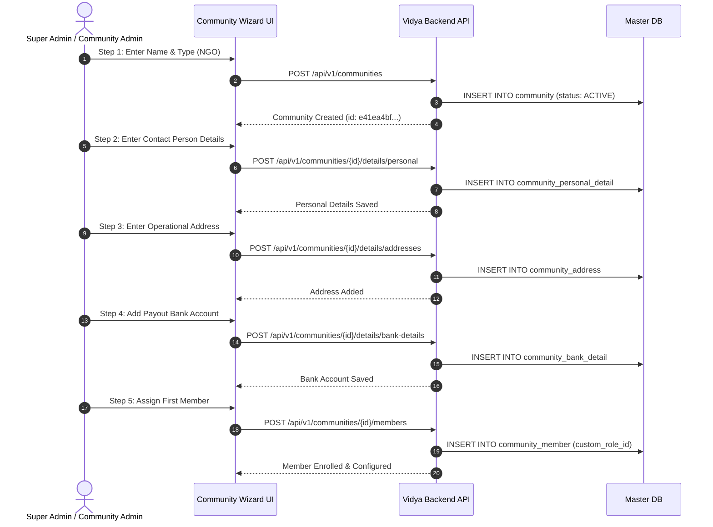

# 13. Community Management & Sub-Details Lifecycle Flow

This guide provides frontend engineers with end-to-end technical specifications for building the **Community Management Module** in Vidya ERP. It documents the core organization lifecycle, status transitions (`ACTIVE`, `SUSPENDED`, `INACTIVE`), normalized sub-details management (Personal, Professional, Multi-Address, Bank Details, Payroll, Commission), member onboarding, and audit history.

---

## 1. Architectural Overview & Domain Isolation

Communities represent external education partners, NGOs, field agencies, or government entities that onboard schools, conduct field surveys, coordinate admissions, and manage educators.

```mermaid
graph TD
    UI[Frontend Community Dashboard]
    MasterAPI["Community APIs (/api/v1/communities/*)"]
    MasterDB[(vidya_master_db)]

    UI -->|1. Direct Request (Bearer token, NO X-Tenant-ID)| MasterAPI
    MasterAPI -->|2. Master Transaction Manager| MasterDB

    subgraph Master DB Relational Structure
        Core[community]
        Personal[community_personal_detail]
        Professional[community_professional_detail]
        Address[community_address]
        Bank[community_bank_detail]
        Payroll[community_payroll]
        Commission[community_commission]
        Member[community_member]
        Audit[community_login_history]

        Core --- Personal
        Core --- Professional
        Core --- Address
        Core --- Bank
        Core --- Payroll
        Core --- Commission
        Core --- Member
        Core --- Audit
    end
```

### Key Engineering Principles:
1. **Direct Master DB Route**: Communities belong to the platform layer, not to any individual school. Requests are handled entirely within `vidya_master_db`. Frontend requests do **NOT** require `X-Tenant-ID`.
2. **Normalized Sub-Table Design**: Rather than a bloated single table, domain facets are isolated into dedicated sub-tables. Each facet can be managed and validated independently.
3. **Audit History & Verification**: Bank details and payroll structures support verification workflows and historical audit logs.

---

## 2. Core Community Identity & Lifecycle Management

Base URL: `/api/v1/communities`

| Method | Endpoint | Description | Guard / Permission |
| :--- | :--- | :--- | :--- |
| `POST` | `/api/v1/communities` | Register a new community organization | Section `20`, Action `-8` |
| `GET` | `/api/v1/communities/{id}` | Get core community by UUID | Section `20`, Action `-9` |
| `GET` | `/api/v1/communities/code/{code}` | Get core community by Code (`COM-XXXX`) | Section `20`, Action `-9` |
| `GET` | `/api/v1/communities` | Paginated search & list (filter by `status`, `type`, `search`) | Section `20`, Action `-9` |
| `PUT` | `/api/v1/communities/{id}` | Update core community info (`name`, `description`, `type`) | Section `20`, Action `-8` |
| `PATCH` | `/api/v1/communities/{id}/status?status={status}` | Transition lifecycle status (`ACTIVE`, `SUSPENDED`) | `PLATFORM_SUPER_ADMIN` |

---

### 2.1 Register New Community (`POST /api/v1/communities`)

#### Request Headers:
```http
Authorization: Bearer <accessToken>
Content-Type: application/json
```

#### Request Payload (`CreateCommunityRequest`):
```json
{
  "name": "Pratham Education Foundation",
  "description": "Educational NGO dedicated to primary literacy and field school onboarding.",
  "type": "NGO"
}
```

#### Response (HTTP 201 Created):
```json
{
  "success": true,
  "code": "COMMUNITY_CREATED",
  "message": "Community created successfully",
  "data": {
    "id": "e41ea4bf-a879-4b4d-9441-ec96e7fe20da",
    "communityCode": "COM-7B62AE49",
    "name": "Pratham Education Foundation",
    "description": "Educational NGO dedicated to primary literacy and field school onboarding.",
    "type": "NGO",
    "status": "ACTIVE",
    "createdAt": "2026-10-24T16:30:00Z",
    "updatedAt": "2026-10-24T16:30:00Z",
    "memberCount": 0
  }
}
```

---

### 2.2 List & Filter Communities (`GET /api/v1/communities`)

#### Query Parameters:
- `status`: `ACTIVE`, `INACTIVE`, `SUSPENDED` (optional)
- `type`: `NGO`, `FIELD_AGENCY`, `PARTNER`, `GOVT`, `OTHER` (optional)
- `search`: Case-insensitive search on community name or code (optional)
- `page`: Page index (default: `0`)
- `size`: Page size (default: `20`)
- `sort`: Sort property and direction (e.g. `name,asc` or `createdAt,desc`)

#### Example Request:
```http
GET /api/v1/communities?status=ACTIVE&type=NGO&search=Pratham&page=0&size=10
Authorization: Bearer <accessToken>
```

#### Response (HTTP 200 OK):
```json
{
  "success": true,
  "code": "COMMUNITIES_FOUND",
  "message": "Communities retrieved successfully",
  "data": [
    {
      "id": "e41ea4bf-a879-4b4d-9441-ec96e7fe20da",
      "communityCode": "COM-7B62AE49",
      "name": "Pratham Education Foundation",
      "description": "Educational NGO dedicated to primary literacy.",
      "type": "NGO",
      "status": "ACTIVE",
      "memberCount": 12,
      "createdAt": "2026-10-24T16:30:00Z",
      "updatedAt": "2026-10-24T16:30:00Z"
    }
  ],
  "page": {
    "number": 0,
    "size": 10,
    "totalElements": 1,
    "totalPages": 1
  }
}
```

---

### 2.3 Update Core Community (`PUT /api/v1/communities/{id}`)

#### Request Payload (`UpdateCommunityRequest`):
```json
{
  "name": "Pratham Education Foundation - North",
  "description": "Updated regional focus for North India school onboarding.",
  "type": "NGO"
}
```

---

### 2.4 Lifecycle Status Transitions (`PATCH /api/v1/communities/{id}/status`)

Transitions community between operational states.

#### Query Parameter:
- `status`: `ACTIVE`, `SUSPENDED`

#### Example Request:
```http
PATCH /api/v1/communities/e41ea4bf-a879-4b4d-9441-ec96e7fe20da/status?status=SUSPENDED
Authorization: Bearer <accessToken>
```

#### Response (HTTP 200 OK):
```json
{
  "success": true,
  "code": "COMMUNITY_STATUS_CHANGED",
  "message": "Community status changed successfully",
  "data": {
    "id": "e41ea4bf-a879-4b4d-9441-ec96e7fe20da",
    "communityCode": "COM-7B62AE49",
    "name": "Pratham Education Foundation - North",
    "status": "SUSPENDED"
  }
}
```

---

## 3. Normalized Sub-Details Management

Base URL: `/api/v1/communities/{communityId}/details`

---

### 3.1 Personal & Contact Person Details (`.../details/personal`)

Manages primary authorized representative or director contact information.

| Method | Endpoint | Description |
| :--- | :--- | :--- |
| `POST` | `/api/v1/communities/{id}/details/personal` | Create personal details record |
| `PUT` | `/api/v1/communities/{id}/details/personal` | Update personal details record |
| `GET` | `/api/v1/communities/{id}/details/personal` | Retrieve personal details record |

#### Request Payload (`CommunityPersonalDetailRequest`):
```json
{
  "contactPersonName": "Sunita Rao",
  "designation": "State Operations Director",
  "alternateEmail": "sunita.rao@pratham.org",
  "alternatePhone": "+919876543210",
  "dateOfBirth": "1984-06-15",
  "gender": "FEMALE",
  "panNumber": "ABCDE1234F",
  "aadhaarNumber": "987654321012"
}
```

#### Response:
```json
{
  "success": true,
  "code": "PERSONAL_DETAIL_CREATED",
  "message": "Personal details created successfully",
  "data": {
    "id": "c1a2b3c4-d5e6-7f8a-9b0c-1d2e3f4a5b6c",
    "communityId": "e41ea4bf-a879-4b4d-9441-ec96e7fe20da",
    "contactPersonName": "Sunita Rao",
    "designation": "State Operations Director",
    "alternateEmail": "sunita.rao@pratham.org",
    "alternatePhone": "+919876543210",
    "dateOfBirth": "1984-06-15",
    "gender": "FEMALE",
    "panNumber": "ABCDE1234F",
    "aadhaarNumber": "987654321012"
  }
}
```

---

### 3.2 Professional & Business Details (`.../details/professional`)

Manages organization registration number, tax identifiers (GST/PAN), and revenue scope.

| Method | Endpoint | Description |
| :--- | :--- | :--- |
| `POST` | `/api/v1/communities/{id}/details/professional` | Create business/professional details |
| `GET` | `/api/v1/communities/{id}/details/professional` | Retrieve business/professional details |

#### Request Payload:
```json
{
  "registrationNumber": "NGO-DL-2018-98432",
  "dateOfRegistration": "2018-04-12",
  "gstNumber": "07AAAAA0000A1Z5",
  "panNumber": "AAAAA0000A",
  "tanNumber": "DELA12345E",
  "annualRevenueRange": "ONE_TO_TEN_CRORE",
  "website": "https://pratham.org"
}
```

---

### 3.3 Multi-Address Management (`.../details/addresses`)

Supports multiple physical locations (`REGISTERED`, `OPERATIONAL`, `BILLING`) with a designated primary flag.

| Method | Endpoint | Description |
| :--- | :--- | :--- |
| `POST` | `/api/v1/communities/{id}/details/addresses` | Add a new address record |
| `GET` | `/api/v1/communities/{id}/details/addresses` | List all addresses for the community |

#### Request Payload:
```json
{
  "addressType": "REGISTERED",
  "addressLine1": "Plot 42, Institutional Area",
  "addressLine2": "Sector 62",
  "landmark": "Near Knowledge Metro",
  "city": "Noida",
  "state": "Uttar Pradesh",
  "pincode": "201309",
  "country": "India",
  "isPrimary": true
}
```

---

### 3.4 Bank Account Details (`.../details/bank-details`)

Maintains bank payout accounts for agency commission disbursements.

| Method | Endpoint | Description |
| :--- | :--- | :--- |
| `POST` | `/api/v1/communities/{id}/details/bank-details` | Register a new bank account |
| `GET` | `/api/v1/communities/{id}/details/bank-details` | List all registered bank accounts |

#### Request Payload:
```json
{
  "bankName": "State Bank of India",
  "branchName": "Connaught Place Branch",
  "accountHolderName": "Pratham Education Foundation",
  "accountNumber": "100029384756",
  "accountType": "CURRENT",
  "ifscCode": "SBIN0000691",
  "isPrimary": true
}
```

---

### 3.5 Payroll Configuration (`.../details/payroll`)

Configures staff salary cycle, base payout amounts, and disbursement frequency.

| Method | Endpoint | Description |
| :--- | :--- | :--- |
| `POST` | `/api/v1/communities/{id}/details/payroll` | Configure payroll structure |
| `GET` | `/api/v1/communities/{id}/details/payroll` | List active payroll configurations |

#### Request Payload:
```json
{
  "frequency": "MONTHLY",
  "payoutDay": 5,
  "baseSalary": 45000.00,
  "currency": "INR",
  "tdsPercentage": 10.0,
  "effectiveFrom": "2026-11-01"
}
```

---

### 3.6 Commission Tier Rules (`.../details/commissions`)

Configures incentive commissions earned by field agencies per school onboarded or student enrolled.

| Method | Endpoint | Description |
| :--- | :--- | :--- |
| `POST` | `/api/v1/communities/{id}/details/commissions` | Configure commission rule |
| `GET` | `/api/v1/communities/{id}/details/commissions` | List all commission rules |

#### Request Payload:
```json
{
  "commissionType": "PER_SCHOOL_ONBOARDING",
  "commissionBasis": "FLAT_AMOUNT",
  "rate": 5000.00,
  "currency": "INR",
  "minimumThreshold": 1,
  "effectiveFrom": "2026-10-01"
}
```

---

### 3.7 Login History Audit (`.../details/login-history`)

Provides chronological security audit logs of member logins into the community portal.

| Method | Endpoint | Description |
| :--- | :--- | :--- |
| `GET` | `/api/v1/communities/{id}/details/login-history` | Paginated login history records |

#### Response:
```json
{
  "success": true,
  "code": "RESOURCE_FOUND",
  "message": "Login history retrieved successfully",
  "data": [
    {
      "id": "d0e1f2a3-b4c5-d6e7-f8a9-b0c1d2e3f4a5",
      "communityId": "e41ea4bf-a879-4b4d-9441-ec96e7fe20da",
      "userId": "4c761b83-f28a-48c8-9ab1-0598eda03c33",
      "loginTimestamp": "2026-10-24T16:10:00Z",
      "ipAddress": "103.21.244.2",
      "userAgent": "Mozilla/5.0 (Macintosh; Intel Mac OS X 10_15_7)...",
      "status": "SUCCESS"
    }
  ]
}
```

---

## 4. Community Member Enrolment & Role Binding

Base URL: `/api/v1/communities/{communityId}/members`

| Method | Endpoint | Description |
| :--- | :--- | :--- |
| `POST` | `/api/v1/communities/{id}/members` | Enroll a platform user into community with custom role |
| `GET` | `/api/v1/communities/{id}/members` | Paginated listing of community members |
| `PUT` | `/api/v1/communities/{id}/members/{memberId}/role` | Change member's assigned role |
| `DELETE` | `/api/v1/communities/{id}/members/{memberId}` | Remove member from community |

#### Payload: Enroll Member
```http
POST /api/v1/communities/e41ea4bf-a879-4b4d-9441-ec96e7fe20da/members
Content-Type: application/json

{
  "platformUserId": "4c761b83-f28a-48c8-9ab1-0598eda03c33",
  "customRoleId": "77372134-8c85-4df3-bc53-a3d24ea26198"
}
```

#### Response:
```json
{
  "success": true,
  "code": "COMMUNITY_MEMBER_ADDED",
  "message": "Member added to community successfully",
  "data": {
    "id": "1ff1f71b-a3e8-45b6-918a-66b558c0a331",
    "memberCode": "MEM-WR43UXGP",
    "communityId": "e41ea4bf-a879-4b4d-9441-ec96e7fe20da",
    "userId": "4c761b83-f28a-48c8-9ab1-0598eda03c33",
    "role": "CUSTOM",
    "customRoleId": "77372134-8c85-4df3-bc53-a3d24ea26198",
    "customRoleName": "Lead Regional Coordinator",
    "status": "ACTIVE"
  }
}
```

---

## 5. Frontend Onboarding Wizard Flow


