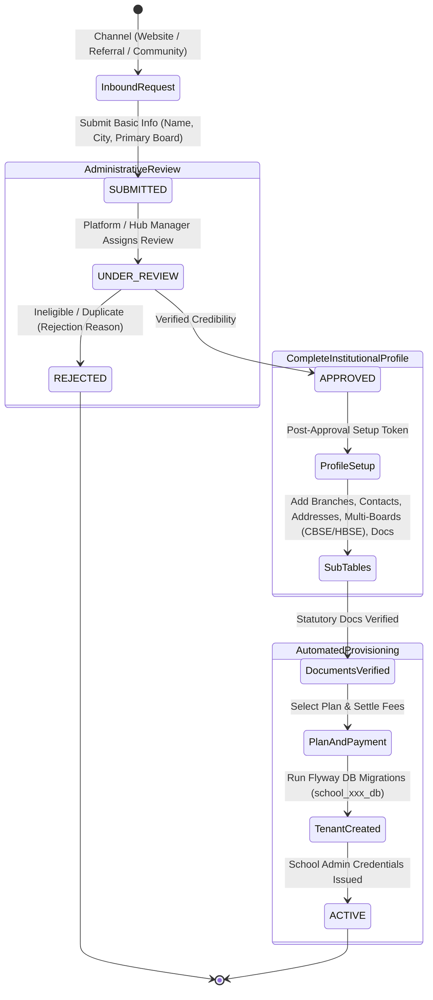

# Module 15: School Onboarding Journey & Normalized Sub-Tables Architecture

## 1. Overview & Architectural Blueprint

The **Vidya ERP School Onboarding Journey** provides an end-to-end institutional onboarding lifecycle. Rather than dumping all institution details into a single monolithic `school` table, Vidya ERP decouples the onboarding process into an asynchronous, verified funnel backed by **normalized sub-tables**:

1. **Multi-Channel Acquisition**:
   - **Website Self-Registration (`WEBSITE`)**: Inbound leads self-applying directly via public portal.
   - **Direct Referral (`REFERRAL`)**: Applications driven by referral codes or partner incentives.
   - **Community Partner (`COMMUNITY`)**: Field community agents and partners introducing regional schools.
2. **Progressive 3-Stage Lifecycle**:
   - **Stage 1 (Inbound Expression of Interest)**: Captures only basic essential info (Name, contact person, phone, email, city, state, primary educational board, initial notes). Saves as `SUBMITTED`.
   - **Stage 2 (Verification & Administrative Approval)**: Platform Users or Regional Hub Managers review the basic submission, verify contact credibility, and either `APPROVE` or `REJECT` (with audit trail & reason).
   - **Stage 3 (Complete Profile across Normalized Sub-Tables)**: Post-approval, administrators provide institutional details structured across dedicated relational sub-tables:
     - **Main School & Branches (`school_branch`)**: Multi-campus hierarchy with main branch designation.
     - **Contact Directory (`school_contact_detail`)**: Key leadership contacts (`PRINCIPAL`, `VICE_PRINCIPAL`, `ADMINISTRATIVE_HEAD`, `BILLING_FINANCE`, `EXAM_COORDINATOR`, `ACADEMIC_DIRECTOR`).
     - **Campus Addresses (`school_address`)**: Campus locations, registered offices, correspondence addresses.
     - **Multi-Board Affiliations (`school_board_affiliation`)**: Support for multiple boards simultaneously (e.g., **CBSE**, **HBSE [Haryana Board]**, **ICSE**, **IB**, **State Board**) with affiliation numbers, levels (`PRIMARY`, `MIDDLE`, `SECONDARY`, `SENIOR_SECONDARY`), validity dates, and certificates.
     - **Statutory Documents & Certificates (`school_document`)**: Compliance documents (Affiliation Letters, Trust/Society Deeds, Building Safety, Fire Safety NOC, Land Titles, 12A/80G) with verification statuses (`PENDING`, `VERIFIED`, `REJECTED`).
     - **Community & Hub Governance**: Binding onboarding partner, assigned School Relation Manager (RM), and regional Hub.
   - **Stage 4 (Orchestrated Activation & Tenant Provisioning)**: Plan selection, payment settlement, automated tenant database provisioning, admin credentials generation, and school activation.

---

## 2. Onboarding State Machine & Flowchart



---

## 3. Database Schema: Normalized Sub-Tables

| Table Name | Primary Responsibility | Key Fields |
| :--- | :--- | :--- |
| `school` | Core institution identity | `id`, `school_code`, `legal_name`, `short_name`, `status`, `onboarding_source`, `onboarding_community_id` |
| `school_branch` | Physical campuses & branches | `id`, `school_id`, `branch_code`, `branch_name`, `is_main_branch`, `branch_type`, `status` |
| `school_contact_detail` | Leadership & department contacts | `id`, `school_id`, `branch_id`, `contact_type`, `full_name`, `designation`, `email`, `phone`, `is_primary` |
| `school_address` | Geo & statutory addresses | `id`, `school_id`, `branch_id`, `address_type`, `address_line1`, `city`, `state`, `pincode`, `country` |
| `school_board_affiliation` | Multi-board accreditations | `id`, `school_id`, `board`, `affiliation_type`, `affiliation_number`, `valid_until`, `status` |
| `school_document` | Legal deeds & statutory certificates | `id`, `school_id`, `branch_id`, `document_type`, `title`, `document_url`, `verification_status` |

---

## 4. REST API Endpoint Reference

### 4.1 Stage 1: Inbound Onboarding Requests

#### `POST /api/v1/onboarding/initiate`
Initiates an onboarding application via any supported acquisition channel with basic initial details.

- **Security**: Public or Authenticated (Platform Admin / Hub Manager / Community Agent)
- **Request Body**:
```json
{
  "schoolName": "Heritage International Academy",
  "contactPersonName": "Dr. Rajeshwar Sharma",
  "email": "admissions@heritageacademy.org",
  "phone": "+91-9876543210",
  "city": "Gurugram",
  "state": "Haryana",
  "primaryBoard": "CBSE",
  "channel": "COMMUNITY",
  "communityId": "a1b2c3d4-0000-0000-0000-000000000001",
  "communityMemberId": "e1f2a3b4-0000-0000-0000-000000000002",
  "referralCode": null,
  "initialNotes": "Reputed K-12 campus seeking digital ERP transformation."
}
```

- **Response (`201 Created`)**:
```json
{
  "status": 201,
  "success": true,
  "message": "Onboarding initiated successfully",
  "data": {
    "id": "7f8a9b0c-1234-5678-90ab-cdef12345678",
    "applicationCode": "ONB-8X9Y2Z1A",
    "schoolId": "5c166971-afe9-4ec2-a3a2-ca80d3a647cb",
    "schoolName": "Heritage International Academy",
    "source": "COMMUNITY",
    "status": "SUBMITTED",
    "currentStep": "BASIC_INFORMATION",
    "progressPercentage": 25,
    "createdAt": "2026-10-24T22:50:00Z"
  }
}
```

---

### 4.2 Stage 2: Review, Verification & Approval

#### `POST /api/v1/onboarding/{id}/verify`
Platform Admin or Hub Manager marks an inbound application as verified.
```json
{
  "verified": true,
  "notes": "Verified school premises, leadership credentials, and phone numbers."
}
```

#### `POST /api/v1/onboarding/{id}/approve`
Approves the verified application, enabling post-approval complete profile management.
```json
{
  "notes": "Approved for full institutional onboarding."
}
```

#### `POST /api/v1/onboarding/{id}/reject`
Rejects an invalid or fraudulent submission.
```json
{
  "reason": "Duplicate application. School already onboarded under branch code BR-DEL-02."
}
```

---

### 4.3 Stage 3: Normalized Sub-Tables Management

Mounted under `/api/v1/schools/{id}`:

#### A. School Branches (`/api/v1/schools/{id}/branches`)
- `GET /api/v1/schools/{id}/branches`: List all physical campuses.
- `POST /api/v1/schools/{id}/branches`: Create a branch.
```json
{
  "branchCode": "BR-GUR-MAIN",
  "branchName": "Gurugram Main Campus",
  "isMainBranch": true,
  "branchType": "MAIN",
  "email": "gurugram.main@heritageacademy.org",
  "phone": "+91-124-4567890",
  "city": "Gurugram",
  "state": "Haryana",
  "pincode": "122001",
  "country": "India"
}
```

#### B. Contact Details Directory (`/api/v1/schools/{id}/contacts`)
- `GET /api/v1/schools/{id}/contacts`: Retrieve all designated contacts.
- `POST /api/v1/schools/{id}/contacts`: Add a key contact.
```json
{
  "branchId": null,
  "contactType": "PRINCIPAL",
  "fullName": "Dr. Rameshwar Sharma",
  "designation": "Principal & Director of Academics",
  "email": "principal@heritageacademy.org",
  "phone": "+91-9876543210",
  "alternatePhone": "+91-9876543211",
  "isPrimary": true,
  "notes": "Authorized signatory for academic accreditations"
}
```
*Supported `contactType` values*: `PRINCIPAL`, `VICE_PRINCIPAL`, `ADMINISTRATIVE_HEAD`, `BILLING_FINANCE`, `EXAM_COORDINATOR`, `ACADEMIC_DIRECTOR`, `HR_MANAGER`, `IT_ADMINISTRATOR`, `TRUSTEE_DIRECTOR`, `OTHER`.

#### C. Addresses Directory (`/api/v1/schools/{id}/addresses`)
- `GET /api/v1/schools/{id}/addresses`: List all addresses.
- `POST /api/v1/schools/{id}/addresses`: Register an address.
```json
{
  "branchId": null,
  "addressType": "CAMPUS",
  "addressLine1": "Plot 42, Sector 54, Golf Course Road",
  "addressLine2": "Near DLF Phase 5",
  "landmark": "Opposite Horizon Centre",
  "city": "Gurugram",
  "state": "Haryana",
  "pincode": "122002",
  "country": "India",
  "isPrimary": true
}
```
*Supported `addressType` values*: `CAMPUS`, `REGISTERED_OFFICE`, `CORRESPONDENCE`, `BRANCH_OFFICE`, `HOSTEL_PREMISES`, `SPORTS_COMPLEX`, `OTHER`.

#### D. Multi-Board Affiliations (`/api/v1/schools/{id}/boards`)
- `GET /api/v1/schools/{id}/boards`: List all boards (e.g., both CBSE and HBSE simultaneously).
- `POST /api/v1/schools/{id}/boards`: Add a board affiliation.
```json
{
  "board": "HBSE",
  "affiliationType": "REGULAR",
  "affiliationNumber": "HBSE-AFF-2024-9876",
  "affiliationLevel": "SENIOR_SECONDARY",
  "affiliationStatus": "ACTIVE",
  "validFrom": "2020-04-01",
  "validUntil": "2030-03-31",
  "certificateUrl": "https://cdn.vidya.io/certs/hbse_aff_2024.pdf",
  "notes": "State board accreditation for Grades 9-12"
}
```
*Supported `board` values*: `CBSE`, `HBSE` *(Haryana Board)*, `ICSE`, `IB`, `CAMBRIDGE`, `STATE_BOARD`, `OTHER`.

#### E. Statutory Documents & Certificates (`/api/v1/schools/{id}/documents`)
- `GET /api/v1/schools/{id}/documents`: List all compliance documents.
- `POST /api/v1/schools/{id}/documents`: Upload/register statutory document.
```json
{
  "branchId": null,
  "documentType": "FIRE_SAFETY_NOC",
  "title": "Haryana Fire Service NOC 2026",
  "documentNumber": "FS-HR-2026-449",
  "documentUrl": "https://cdn.vidya.io/documents/fire_noc_2026.pdf",
  "issuingAuthority": "Haryana Fire and Rescue Service",
  "issueDate": "2026-01-15",
  "expiryDate": "2029-01-14",
  "notes": "Valid for next 3 academic cycles"
}
```
- `PATCH /api/v1/schools/{id}/documents/{documentId}/verify`: Platform verifier approval:
```json
{
  "status": "VERIFIED",
  "rejectionReason": null
}
```
*Supported `documentType` values*: `AFFILIATION_LETTER`, `TRUST_SOCIETY_DEED`, `RECOGNITION_CERTIFICATE`, `NOC_STATE_GOVT`, `BUILDING_SAFETY_CERTIFICATE`, `FIRE_SAFETY_NOC`, `LAND_TITLE_DEED`, `PAN_12A_80G`, `POLLUTION_WATER_NOC`, `OTHER`.

#### F. Unified 360 Institutional Profile (`/api/v1/schools/{id}/complete-profile`)
- `GET /api/v1/schools/{id}/complete-profile`: Aggregates the school, its branches, contacts, addresses, boards, documents, and regional Hub/RM relationships in a single payload.
- `PUT /api/v1/schools/{id}/complete-profile`: Bulk upserts the complete profile during post-approval setup.

---

### 4.4 Stage 4: Orchestrated Tenant Provisioning

#### `POST /api/v1/onboarding/orchestrate/complete-activation`
Platform Admin triggers automated database and tenant creation once the complete profile is ready.

- **Request Body**:
```json
{
  "onboardingId": "7f8a9b0c-1234-5678-90ab-cdef12345678",
  "subscriptionPlanId": "49f5544f-88b9-4d72-9734-c70781125d6f",
  "billingCycle": "ANNUAL",
  "paymentAmount": 120000.00,
  "paymentMethod": "NET_BANKING",
  "paymentReference": "TXN-SBI-998877",
  "tenantCode": "heritage01",
  "adminEmail": "admin@heritageacademy.org",
  "adminFullName": "Dr. Rajeshwar Sharma",
  "adminPhone": "+91-9876543210"
}
```

- **Result**:
1. Binds subscription plan and registers receipt.
2. Creates isolated tenant PostgreSQL database `school_heritage01_db`.
3. Runs all tenant Flyway migrations.
4. Generates initial Super Admin credentials for school leadership.
5. School status transitioned to `ACTIVE`.

---

## 5. TypeScript Interfaces for Frontend Clients

```typescript
export type AcquisitionChannel = 'WEBSITE' | 'REFERRAL' | 'COMMUNITY' | 'DIRECT';

export type SchoolBoard = 'CBSE' | 'HBSE' | 'ICSE' | 'IB' | 'CAMBRIDGE' | 'STATE_BOARD' | 'OTHER';

export type ContactType =
  | 'PRINCIPAL'
  | 'VICE_PRINCIPAL'
  | 'ADMINISTRATIVE_HEAD'
  | 'BILLING_FINANCE'
  | 'EXAM_COORDINATOR'
  | 'ACADEMIC_DIRECTOR'
  | 'HR_MANAGER'
  | 'IT_ADMINISTRATOR'
  | 'TRUSTEE_DIRECTOR'
  | 'OTHER';

export type AddressType =
  | 'CAMPUS'
  | 'REGISTERED_OFFICE'
  | 'CORRESPONDENCE'
  | 'BRANCH_OFFICE'
  | 'HOSTEL_PREMISES'
  | 'SPORTS_COMPLEX'
  | 'OTHER';

export type DocumentType =
  | 'AFFILIATION_LETTER'
  | 'TRUST_SOCIETY_DEED'
  | 'RECOGNITION_CERTIFICATE'
  | 'NOC_STATE_GOVT'
  | 'BUILDING_SAFETY_CERTIFICATE'
  | 'FIRE_SAFETY_NOC'
  | 'LAND_TITLE_DEED'
  | 'PAN_12A_80G'
  | 'POLLUTION_WATER_NOC'
  | 'OTHER';

export type DocumentVerificationStatus = 'PENDING' | 'VERIFIED' | 'REJECTED' | 'EXPIRED';

export interface InitiateOnboardingPayload {
  schoolName: string;
  contactPersonName: string;
  email: string;
  phone: string;
  city: string;
  state: string;
  primaryBoard: SchoolBoard;
  channel: AcquisitionChannel;
  communityId?: string | null;
  communityMemberId?: string | null;
  referralCode?: string | null;
  initialNotes?: string;
}

export interface CompleteSchoolProfileResponse {
  school: {
    id: string;
    schoolCode: string;
    legalName: string;
    status: string;
    email: string;
  };
  branches: Array<{
    id: string;
    branchCode: string;
    branchName: string;
    isMainBranch: boolean;
    city: string;
    state: string;
  }>;
  contacts: Array<{
    id: string;
    contactType: ContactType;
    fullName: string;
    designation: string;
    email: string;
    phone: string;
    isPrimary: boolean;
  }>;
  addresses: Array<{
    id: string;
    addressType: AddressType;
    addressLine1: string;
    city: string;
    state: string;
    pincode: string;
    isPrimary: boolean;
  }>;
  boards: Array<{
    id: string;
    board: SchoolBoard;
    affiliationNumber: string;
    affiliationLevel: string;
    affiliationStatus: string;
    validUntil?: string;
  }>;
  documents: Array<{
    id: string;
    documentType: DocumentType;
    title: string;
    documentUrl: string;
    verificationStatus: DocumentVerificationStatus;
  }>;
  relationship?: {
    hubId?: string;
    hubName?: string;
    onboardingCommunityId?: string;
    onboardingCommunityName?: string;
    relationManagerCommunityId?: string;
    relationManagerCommunityName?: string;
  };
}
```

---

## 6. Frontend Form Component Architecture

### Multi-Step Onboarding Wizard Form

```tsx
import React, { useState } from 'react';
import axios from 'axios';

export const WebsiteSchoolOnboardingForm: React.FC = () => {
  const [formData, setFormData] = useState({
    schoolName: '',
    contactPersonName: '',
    email: '',
    phone: '',
    city: '',
    state: '',
    primaryBoard: 'CBSE' as const,
    channel: 'WEBSITE' as const,
    initialNotes: '',
  });

  const [loading, setLoading] = useState(false);
  const [successCode, setSuccessCode] = useState<string | null>(null);

  const handleSubmit = async (e: React.FormEvent) => {
    e.preventDefault();
    setLoading(true);
    try {
      const response = await axios.post('/api/v1/onboarding/initiate', formData);
      setSuccessCode(response.data.data.applicationCode);
    } catch (err: any) {
      alert(err.response?.data?.message || 'Submission failed');
    } finally {
      setLoading(false);
    }
  };

  if (successCode) {
    return (
      <div className="p-8 text-center bg-green-50 rounded-lg">
        <h2 className="text-2xl font-bold text-green-800">Application Submitted!</h2>
        <p className="mt-2 text-gray-700">
          Your application reference code is <strong>{successCode}</strong>.
        </p>
        <p className="text-sm text-gray-500 mt-1">
          Our regional team will review your basic institutional details and notify you to complete the compliance documentation.
        </p>
      </div>
    );
  }

  return (
    <form onSubmit={handleSubmit} className="space-y-4 max-w-lg mx-auto p-6 bg-white shadow rounded">
      <h2 className="text-xl font-bold text-gray-800">Register Your School with Vidya ERP</h2>
      
      <div>
        <label className="block text-sm font-medium">School Legal Name</label>
        <input
          type="text"
          required
          className="w-full border p-2 rounded"
          value={formData.schoolName}
          onChange={(e) => setFormData({ ...formData, schoolName: e.target.value })}
        />
      </div>

      <div>
        <label className="block text-sm font-medium">Contact Person (Principal / Director)</label>
        <input
          type="text"
          required
          className="w-full border p-2 rounded"
          value={formData.contactPersonName}
          onChange={(e) => setFormData({ ...formData, contactPersonName: e.target.value })}
        />
      </div>

      <div className="grid grid-cols-2 gap-4">
        <div>
          <label className="block text-sm font-medium">Official Email</label>
          <input
            type="email"
            required
            className="w-full border p-2 rounded"
            value={formData.email}
            onChange={(e) => setFormData({ ...formData, email: e.target.value })}
          />
        </div>
        <div>
          <label className="block text-sm font-medium">Phone Number</label>
          <input
            type="tel"
            required
            className="w-full border p-2 rounded"
            value={formData.phone}
            onChange={(e) => setFormData({ ...formData, phone: e.target.value })}
          />
        </div>
      </div>

      <div className="grid grid-cols-2 gap-4">
        <div>
          <label className="block text-sm font-medium">City</label>
          <input
            type="text"
            required
            className="w-full border p-2 rounded"
            value={formData.city}
            onChange={(e) => setFormData({ ...formData, city: e.target.value })}
          />
        </div>
        <div>
          <label className="block text-sm font-medium">State</label>
          <input
            type="text"
            required
            className="w-full border p-2 rounded"
            value={formData.state}
            onChange={(e) => setFormData({ ...formData, state: e.target.value })}
          />
        </div>
      </div>

      <div>
        <label className="block text-sm font-medium">Primary Educational Board</label>
        <select
          className="w-full border p-2 rounded"
          value={formData.primaryBoard}
          onChange={(e) => setFormData({ ...formData, primaryBoard: e.target.value as any })}
        >
          <option value="CBSE">CBSE (Central Board of Secondary Education)</option>
          <option value="HBSE">HBSE (Haryana Board of School Education)</option>
          <option value="ICSE">ICSE / CISCE</option>
          <option value="IB">International Baccalaureate (IB)</option>
          <option value="CAMBRIDGE">Cambridge (IGCSE)</option>
          <option value="STATE_BOARD">Other State Board</option>
        </select>
      </div>

      <button
        type="submit"
        disabled={loading}
        className="w-full bg-blue-600 text-white py-2 rounded hover:bg-blue-700 font-semibold"
      >
        {loading ? 'Submitting...' : 'Submit Application'}
      </button>
    </form>
  );
};
```
