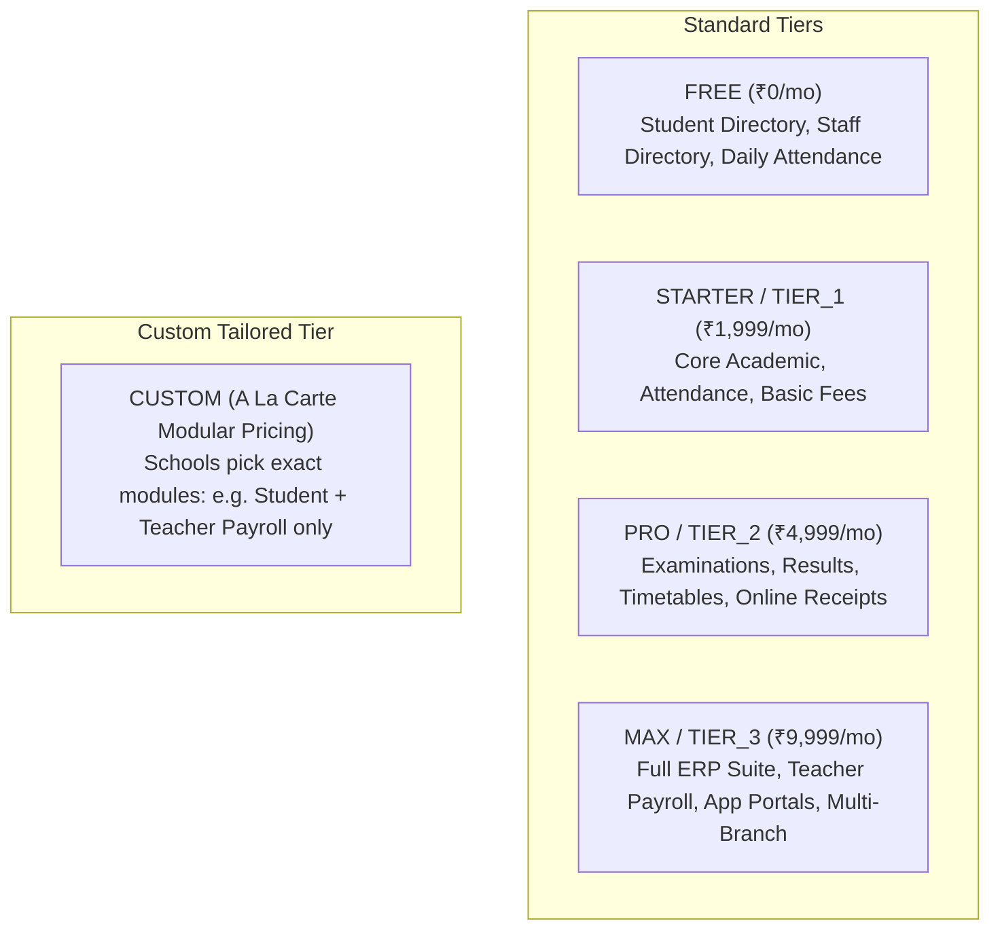

# Module 16: Subscription Tiers, Modular Pricing & Granular Entitlements

## 1. Architectural Overview & Value Proposition

Vidya ERP features a **Tier-Based & Modular Subscription Engine** designed to cater to diverse educational institutions:
- **Small / Rural Schools**: Can start completely free (`FREE` tier) with basic student and staff directories, or select only "Student & Teacher" modules without being forced to buy the entire ERP.
- **Mid-Sized Schools**: Can subscribe to packaged plans (`STARTER`, `PRO`, `MAX` / `TIER_1`, `TIER_2`, `TIER_3`).
- **Bespoke / Custom Deployments**: Can create tailored `CUSTOM` plans where schools pick and pay only for specific modules or individual sub-categories (e.g., in the Teacher section: enabling **Attendance** only, or adding **Payroll** as an a la carte add-on).
- **SuperUser & Platform Admin Governance**: Platform SuperUsers and Admins can toggle and override any feature or sub-category on an individual school's subscription at any time (`/subscriptions/feature-overrides`), dynamically controlling UI tabs and backend API authorizations.

---

## 2. Plan Tiers & Hierarchy



---

## 3. Modular Feature & Sub-Category Catalog

Every platform feature belongs to a parent **Module** and has a specific **Sub-Category**, base price, and add-on flag:

| Parent Module (`moduleCode`) | Granular Feature (`featureCode`) | Sub-Category | Type | Base Price (Monthly) | Key Capabilities |
| :--- | :--- | :--- | :--- | :--- | :--- |
| **`STAFF_MANAGEMENT`** | `STAFF_DIRECTORY` | `STAFF_PROFILE` | Core | ₹200.00 | Staff profiles, KYC, qualifications |
| | `STAFF_ATTENDANCE` | `ATTENDANCE` | Addon | ₹400.00 | Teacher biometric clock-in, duty logs |
| | `STAFF_PAYROLL` | `PAYROLL` | Addon | ₹1,200.00 | Monthly salary slips, deductions, bank transfer |
| | `STAFF_LEAVE` | `LEAVE` | Addon | ₹350.00 | Casual/earned leave balance, approvals |
| | `STAFF_SUBJECT_MAPPING` | `ACADEMICS` | Core | ₹250.00 | Class teacher & subject allocations |
| **`STUDENT_MANAGEMENT`** | `STUDENT_ADMISSIONS` | `ADMISSION` | Addon | ₹600.00 | Online enquiry, registration wizard |
| | `STUDENT_DIRECTORY` | `STUDENT_PROFILE`| Core | ₹300.00 | 360 profile, guardian link, documents |
| | `STUDENT_PROMOTION` | `PROMOTION` | Core | ₹300.00 | Academic year promotion engine |
| | `STUDENT_TRANSFER` | `EXIT` | Core | ₹250.00 | Statutory Transfer Certificate (TC) generation |
| **`ATTENDANCE`** | `STUDENT_DAILY_ATTENDANCE`| `ATTENDANCE` | Core | ₹250.00 | Section daily roll-call & registers |
| | `ATTENDANCE_SMS_ALERTS` | `ALERTS` | Addon | ₹400.00 | Instant absent parent SMS notifications |
| | `BIOMETRIC_SYNC` | `HARDWARE` | Addon | ₹800.00 | RFID turnstile & biometric machine sync |
| **`EXAMINATION`** | `EXAM_SCHEDULING` | `EXAM_PLANNING` | Core | ₹400.00 | Term datesheet & hall tickets |
| | `MARKS_ENTRY` | `MARKS` | Core | ₹350.00 | Teacher marks entry & grade moderation |
| | `REPORT_CARDS` | `REPORT_CARD` | Addon | ₹500.00 | CBSE & State Board printable report cards |
| **`FEES`** | `FEE_STRUCTURE` | `FEE_SETUP` | Core | ₹400.00 | Tuition, transport installment templates |
| | `FEE_COLLECTION` | `COLLECTION` | Core | ₹500.00 | Counter cash/cheque collection & receipts |
| | `ONLINE_PAYMENT_GATEWAY`| `PAYMENT_GATEWAY`| Addon | ₹900.00 | Parent app Razorpay/Cashfree pay |
| | `FEE_CONCESSIONS` | `CONCESSIONS` | Addon | ₹350.00 | Scholarships & sibling waivers |

---

## 4. REST API Endpoints

### 4.1 Plan Tiers & Modular Catalog

#### `GET /api/v1/subscription-plans/tiers`
Returns all available plan tier types.
```json
{
  "status": 200,
  "success": true,
  "message": "Available plan tiers retrieved successfully",
  "data": ["FREE", "STARTER", "PRO", "MAX", "TIER_1", "TIER_2", "TIER_3", "CUSTOM"]
}
```

#### `GET /api/v1/subscription-plans/modules`
Returns the hierarchical module and sub-feature catalog for custom plan builders and admin configuration panels.
```json
{
  "status": 200,
  "success": true,
  "data": [
    {
      "moduleCode": "STAFF_MANAGEMENT",
      "moduleName": "Staff Management",
      "description": "Complete modular suite for Staff Management",
      "moduleBasePrice": 2400.00,
      "isModuleEnabled": true,
      "subFeatures": [
        {
          "featureId": "1a2b3c-...",
          "featureCode": "STAFF_DIRECTORY",
          "name": "Staff Directory & Documents",
          "category": "CORE",
          "subCategory": "STAFF_PROFILE",
          "basePrice": 200.00,
          "isAddon": false,
          "isEnabled": true,
          "usageLimit": null
        },
        {
          "featureId": "2b3c4d-...",
          "featureCode": "STAFF_ATTENDANCE",
          "name": "Teacher & Staff Attendance",
          "category": "CORE",
          "subCategory": "ATTENDANCE",
          "basePrice": 400.00,
          "isAddon": true,
          "isEnabled": true,
          "usageLimit": null
        },
        {
          "featureId": "3c4d5e-...",
          "featureCode": "STAFF_PAYROLL",
          "name": "Teacher & Staff Payroll",
          "category": "CORE",
          "subCategory": "PAYROLL",
          "basePrice": 1200.00,
          "isAddon": true,
          "isEnabled": true,
          "usageLimit": null
        }
      ]
    }
  ]
}
```

---

### 4.2 Dynamic Quote Calculator

#### `POST /api/v1/subscription-plans/calculate-quote`
Allows schools or sales reps to calculate an accurate, itemized quotation based on chosen tier, modular add-on codes, student volume, and promotional discounts.

- **Request Body**:
```json
{
  "tier": "CUSTOM",
  "billingCycle": "ANNUAL",
  "selectedFeatureCodes": [
    "STUDENT_DIRECTORY",
    "STAFF_DIRECTORY",
    "STAFF_ATTENDANCE",
    "STAFF_PAYROLL"
  ],
  "studentCount": 750,
  "staffCount": 45,
  "discountPercentage": 10.00
}
```

- **Response (`200 OK`)**:
```json
{
  "status": 200,
  "success": true,
  "data": {
    "tier": "CUSTOM",
    "billingCycle": "ANNUAL",
    "basePrice": 0.00,
    "addonsTotal": 21000.00,
    "grossAmount": 21000.00,
    "discountAmount": 2100.00,
    "taxableAmount": 18900.00,
    "taxRate": 18.00,
    "taxAmount": 3402.00,
    "netPayableAmount": 22302.00,
    "itemizedBreakdown": [
      {
        "code": "STAFF_ATTENDANCE",
        "name": "Teacher & Staff Attendance",
        "category": "ADDON_FEATURE",
        "amount": 4000.00,
        "calculationRule": "STAFF_MANAGEMENT / ATTENDANCE"
      },
      {
        "code": "STAFF_PAYROLL",
        "name": "Teacher & Staff Payroll",
        "category": "ADDON_FEATURE",
        "amount": 12000.00,
        "calculationRule": "STAFF_MANAGEMENT / PAYROLL"
      },
      {
        "code": "STUDENT_CAPACITY_BLOCKS",
        "name": "Additional Student Capacity (200 seats)",
        "category": "CAPACITY_ADDON",
        "amount": 3000.00,
        "calculationRule": "₹150/100 students per month"
      }
    ]
  }
}
```

---

### 4.3 Custom School Plan Creation

#### `POST /api/v1/subscription-plans/custom-plan`
SuperUsers or Platform Admins can directly package and publish a tailored custom plan for a specific school.

```json
{
  "schoolId": "5c166971-afe9-4ec2-a3a2-ca80d3a647cb",
  "planName": "DPS Custom Academic & Teacher Suite",
  "description": "Bespoke plan with Student Records, Teacher Attendance, and Payroll",
  "billingCycle": "ANNUAL",
  "customBasePrice": 25000.00,
  "trialDays": 14,
  "features": [
    { "featureId": "3c4d5e-...", "included": true, "usageLimit": 100 },
    { "featureId": "4d5e6f-...", "included": true, "usageLimit": null }
  ]
}
```

---

### 4.4 School Runtime Entitlements & Overrides

#### `GET /api/v1/schools/{schoolId}/subscriptions/entitlements`
Returns the 360-degree runtime entitlement tree for the school after merging the active plan and any school-specific overrides.
- Use this endpoint on frontend app load to enable/disable UI tabs, sidebar buttons, and feature guards.

#### `PUT /api/v1/schools/{schoolId}/subscriptions/feature-overrides`
SuperUsers or Platform Users enable or disable a specific feature (or change usage limits) for an individual school.

- **Request Body**:
```json
{
  "featureCode": "STAFF_PAYROLL",
  "isEnabled": true,
  "customUsageLimit": 60,
  "addonPrice": 1200.00,
  "notes": "Enabled Teacher Payroll addon upon principal's request"
}
```

- **Response (`200 OK`)**:
```json
{
  "status": 200,
  "success": true,
  "data": {
    "id": "8f9a0b1c-...",
    "schoolId": "5c166971-afe9-4ec2-a3a2-ca80d3a647cb",
    "featureCode": "STAFF_PAYROLL",
    "featureName": "Teacher & Staff Payroll",
    "parentModuleCode": "STAFF_MANAGEMENT",
    "subCategory": "PAYROLL",
    "isEnabled": true,
    "customUsageLimit": 60,
    "addonPrice": 1200.00,
    "notes": "Enabled Teacher Payroll addon upon principal's request",
    "overriddenBy": "a0000000-0000-0000-0000-000000000001",
    "updatedAt": "2026-10-24T23:35:00Z"
  }
}
```

#### `DELETE /api/v1/schools/{schoolId}/subscriptions/feature-overrides/{featureCode}`
Deletes the school-level override and restores the feature's status back to whatever is defined in the school's base subscription plan.

---

## 5. TypeScript Interfaces for Frontend Clients

```typescript
export type PlanTier = 'FREE' | 'STARTER' | 'PRO' | 'MAX' | 'TIER_1' | 'TIER_2' | 'TIER_3' | 'CUSTOM';
export type BillingCycle = 'MONTHLY' | 'QUARTERLY' | 'ANNUAL' | 'ONE_TIME';

export interface ModuleFeatureItem {
  featureId: string;
  featureCode: string;
  name: string;
  description: string;
  category: string;
  subCategory: string;
  basePrice: number;
  isAddon: boolean;
  displayOrder: number;
  isEnabled: boolean;
  usageLimit?: number | null;
}

export interface ModuleFeatureGroup {
  moduleCode: string;
  moduleName: string;
  description: string;
  moduleBasePrice: number;
  isModuleEnabled: boolean;
  subFeatures: ModuleFeatureItem[];
}

export interface SchoolEntitlement {
  schoolId: string;
  activeSubscriptionId?: string | null;
  planCode: string;
  planName: string;
  planTier: PlanTier;
  isCustomPlan: boolean;
  modules: ModuleFeatureGroup[];
  overrides: Array<{
    featureCode: string;
    featureName: string;
    parentModuleCode: string;
    subCategory: string;
    isEnabled: boolean;
    customUsageLimit?: number | null;
    addonPrice: number;
    notes?: string;
  }>;
}

export interface CalculatePlanQuotePayload {
  tier?: PlanTier;
  billingCycle: BillingCycle;
  selectedFeatureCodes: string[];
  studentCount?: number;
  staffCount?: number;
  discountPercentage?: number;
}

export interface CalculatePlanQuoteResult {
  tier: PlanTier;
  billingCycle: BillingCycle;
  basePrice: number;
  addonsTotal: number;
  grossAmount: number;
  discountAmount: number;
  taxableAmount: number;
  taxRate: number;
  taxAmount: number;
  netPayableAmount: number;
  itemizedBreakdown: Array<{
    code: string;
    name: string;
    category: string;
    amount: number;
    calculationRule: string;
  }>;
}
```

---

## 6. Frontend Entitlement Guard Hook (React)

```tsx
import React, { createContext, useContext, useEffect, useState } from 'react';
import axios from 'axios';
import { SchoolEntitlement } from './subscription-types';

const EntitlementContext = createContext<{
  isFeatureEnabled: (featureCode: string) => boolean;
  isModuleEnabled: (moduleCode: string) => boolean;
  loading: boolean;
}>({
  isFeatureEnabled: () => false,
  isModuleEnabled: () => false,
  loading: true,
});

export const EntitlementProvider: React.FC<{ schoolId: string; children: React.ReactNode }> = ({
  schoolId,
  children,
}) => {
  const [entitlements, setEntitlements] = useState<SchoolEntitlement | null>(null);
  const [loading, setLoading] = useState(true);

  useEffect(() => {
    axios
      .get(`/api/v1/schools/${schoolId}/subscriptions/entitlements`)
      .then((res) => {
        setEntitlements(res.data.data);
      })
      .finally(() => setLoading(false));
  }, [schoolId]);

  const isFeatureEnabled = (code: string): boolean => {
    if (!entitlements) return false;
    for (const group of entitlements.modules) {
      const feat = group.subFeatures.find((f) => f.featureCode === code);
      if (feat) return feat.isEnabled;
    }
    return false;
  };

  const isModuleEnabled = (moduleCode: string): boolean => {
    if (!entitlements) return false;
    const group = entitlements.modules.find((m) => m.moduleCode === moduleCode);
    return group ? group.isModuleEnabled : false;
  };

  return (
    <EntitlementContext.Provider value={{ isFeatureEnabled, isModuleEnabled, loading }}>
      {children}
    </EntitlementContext.Provider>
  );
};

export const useEntitlement = () => useContext(EntitlementContext);

// Example usage: Conditional rendering of Teacher Payroll tab
export const StaffPayrollTab: React.FC = () => {
  const { isFeatureEnabled } = useEntitlement();

  if (!isFeatureEnabled('STAFF_PAYROLL')) {
    return (
      <div className="p-4 bg-amber-50 border border-amber-200 rounded">
        <h3 className="font-semibold text-amber-800">Feature Locked</h3>
        <p className="text-sm text-gray-600">
          Teacher & Staff Payroll is not included in your school's current plan. Contact your platform administrator to unlock this add-on.
        </p>
      </div>
    );
  }

  return <div>{/* Full Teacher Payroll UI rendered here */}</div>;
};
```
