# Vidya ERP — Frontend API Integration Hub

Welcome to the frontend API integration hub for Vidya ERP. This repository provides section-wise documentation, request/response contracts, TypeScript interfaces, and integration examples tailored for frontend developers.

---

## 1. Documentation Index

Click any section below to navigate directly to its technical integration guide:

| Section | Documentation File | Database Scope | Key Features & Endpoints |
| :--- | :--- | :--- | :--- |
| **01. Authentication & Unified Login** | [01_auth_and_user_login_flow.md](file:///Users/chhaviduttbhardwaj/IdeaProjects/Vidya-Backend-Project/docs/frontend-api/01_auth_and_user_login_flow.md) | Master DB | Unified login for Platform & School users, token refresh, lockout, zero-header tenant resolution |
| **02. Schools & Campuses** | [02_schools_api.md](file:///Users/chhaviduttbhardwaj/IdeaProjects/Vidya-Backend-Project/docs/frontend-api/02_schools_api.md) | Master DB | School institution registry, campus branches, platform stats, onboarding wizard |
| **03. Academic Management** | [03_academic_management_api.md](file:///Users/chhaviduttbhardwaj/IdeaProjects/Vidya-Backend-Project/docs/frontend-api/03_academic_management_api.md) | Tenant DB | Academic years lifecycle, grade levels / classes, sections, student academic placements |
| **04. Students & Admissions** | [04_students_admissions_api.md](file:///Users/chhaviduttbhardwaj/IdeaProjects/Vidya-Backend-Project/docs/frontend-api/04_students_admissions_api.md) | Tenant DB | Atomic admission wizard (`/admissions`), student directory, 360 profile, guardians |
| **05. Staff & Faculty** | [05_staff_faculty_api.md](file:///Users/chhaviduttbhardwaj/IdeaProjects/Vidya-Backend-Project/docs/frontend-api/05_staff_faculty_api.md) | Tenant DB | Staff directory, departments, designations, class teachers, teacher subject assignments |
| **06. Attendance & Calendar** | [06_attendance_and_calendar_api.md](file:///Users/chhaviduttbhardwaj/IdeaProjects/Vidya-Backend-Project/docs/frontend-api/06_attendance_and_calendar_api.md) | Tenant DB | Daily section attendance sheet, bulk mark upsert, student percentage summary, holidays |
| **07. Timetable & Scheduling** | [07_timetable_scheduling_api.md](file:///Users/chhaviduttbhardwaj/IdeaProjects/Vidya-Backend-Project/docs/frontend-api/07_timetable_scheduling_api.md) | Tenant DB | Bell schedules, rooms, conflict validation, section/teacher weekly grids, substitutions |
| **08. Subscriptions & Payments** | [08_subscriptions_payments_api.md](file:///Users/chhaviduttbhardwaj/IdeaProjects/Vidya-Backend-Project/docs/frontend-api/08_subscriptions_payments_api.md) | Master DB | Pricing catalog, active subscriptions, Razorpay/Cashfree order initiation, verification |
| **09. Curriculum & Subjects** | [09_curriculum_and_subjects_api.md](file:///Users/chhaviduttbhardwaj/IdeaProjects/Vidya-Backend-Project/docs/frontend-api/09_curriculum_and_subjects_api.md) | Tenant DB | Course subjects, curriculum definitions, compulsory/elective subject bindings |
| **10. Examination & Assessment** | [10_examination_and_assessment_api.md](file:///Users/chhaviduttbhardwaj/IdeaProjects/Vidya-Backend-Project/docs/frontend-api/10_examination_and_assessment_api.md) | Tenant DB | Grading scales, exam terms, class exam schedules, paper configs, bulk student marks |
| **11. Community & Role Permissions** | [11_community_and_role_permissions_flow.md](file:///Users/chhaviduttbhardwaj/IdeaProjects/Vidya-Backend-Project/docs/frontend-api/11_community_and_role_permissions_flow.md) | Master DB | Modular community sub-tables, universal integer permission matrix, dynamic nav & action guards |
| **12. RBAC & Dynamic Roles** | [12_rbac_and_roles_management_flow.md](file:///Users/chhaviduttbhardwaj/IdeaProjects/Vidya-Backend-Project/docs/frontend-api/12_rbac_and_roles_management_flow.md) | Master DB | Role creation, editing, active/inactive toggle, deletion safety, SuperUser dynamic role inheritance |
| **13. Community Sub-Details** | [13_community_details_management_flow.md](file:///Users/chhaviduttbhardwaj/IdeaProjects/Vidya-Backend-Project/docs/frontend-api/13_community_details_management_flow.md) | Master DB | Complete personal, professional, address, bank, payroll, commission sub-details lifecycle |

---

## 2. Multi-Tenancy Architecture Contract

Vidya ERP features **Zero-Header Multi-Tenancy**:
- **School-Based Users** (e.g. teachers, principals, students): The user's `tenantCode` is embedded directly into the JWT claims upon login. The backend automatically extracts and resolves the tenant database. **Frontend does NOT need to pass `X-Tenant-ID`**.
- **Platform & Community Users**: Operate directly on `vidya_master_db`. No tenant header required.
- **Header Override**: `X-Tenant-ID` is supported as an optional override for cross-tenant platform super-admins when inspecting specific tenant data.

```mermaid
graph TD
    Client[Frontend Web & Mobile Apps]

    subgraph "Master Database (vidya_master_db)"
        Auth["/api/v1/auth/*"]
        Schools["/api/v1/schools/*"]
        Communities["/api/v1/communities/*"]
        Roles["/api/v1/communities/roles/*"]
        Plans["/api/v1/subscription-plans/*"]
        Payments["/api/v1/payments/*"]
    end

    subgraph "Tenant School Database (school_xxx_db)"
        TenantUsers["/api/v1/tenant/users/*"]
        Academic["/api/v1/academic-years/*, /api/v1/sections/*"]
        Students["/api/v1/students/*, /api/v1/tenant/admissions"]
        Staff["/api/v1/staff/*"]
        Attendance["/api/v1/attendance/*"]
        Timetable["/api/v1/timetables/*"]
        Exams["/api/v1/exam-terms/*, /api/v1/exam-schedules/*, /api/v1/exam-marks/*"]
    end

    Client -->|Bearer Token only - No X-Tenant-ID needed| Auth
    Client -->|Bearer Token only - No X-Tenant-ID needed| Schools
    Client -->|Bearer Token only - No X-Tenant-ID needed| Communities
    Client -->|Bearer Token only - No X-Tenant-ID needed| Roles
    Client -->|Bearer Token only - Auto-resolved from JWT| Students
    Client -->|Bearer Token only - Auto-resolved from JWT| Staff
    Client -->|Bearer Token only - Auto-resolved from JWT| Attendance
    Client -->|Bearer Token only - Auto-resolved from JWT| Timetable
    Client -->|Requires X-Tenant-ID Header| Staff
    Client -->|Requires X-Tenant-ID Header| Attendance
    Client -->|Requires X-Tenant-ID Header| Timetable
    Client -->|Requires X-Tenant-ID Header| Exams
```



### Header Matrix:
- **Master Endpoints**: Require only `Authorization: Bearer <token>`.
- **Tenant Endpoints**: Require both `Authorization: Bearer <token>` **AND** `X-Tenant-ID: <schoolTenantId>`.

---

## 3. Standard Response Envelopes

### 3.1 Single Payload (`ApiResponse<T>`)
```json
{
  "success": true,
  "code": "SUCCESS",
  "message": "Human readable confirmation message",
  "data": { ... },
  "timestamp": "2026-10-17T08:00:00Z",
  "correlationId": "req-uuid"
}
```

### 3.2 Paginated Payload (`PagedApiResponse<T>`)
```json
{
  "success": true,
  "code": "SUCCESS",
  "message": "Items retrieved",
  "data": [ { ... } ],
  "page": {
    "number": 0,
    "size": 20,
    "totalElements": 240,
    "totalPages": 12,
    "first": true,
    "last": false
  },
  "timestamp": "2026-10-17T08:00:00Z",
  "correlationId": "req-uuid"
}
```

---

## 4. Standard Error Handling & Status Codes

All errors returned by the backend adhere to the unified envelope:

```json
{
  "success": false,
  "code": "RESOURCE_NOT_FOUND",
  "message": "Academic year with ID 3fa85f64-... does not exist",
  "data": null,
  "timestamp": "2026-10-17T08:00:00Z"
}
```

| HTTP Status | Typical Error Code | Meaning / Frontend Action |
| :---: | :--- | :--- |
| `400` | `VALIDATION_FAILED` | Show field validation errors returned in response |
| `401` | `UNAUTHORIZED`, `TOKEN_EXPIRED` | Automatically invoke `/api/v1/auth/refresh` or redirect to `/login` |
| `403` | `ACCESS_DENIED`, `ROLE_NOT_AUTHORIZED` | User lacks required role/permission; show unauthorized screen |
| `404` | `NOT_FOUND` | Resource not found |
| `409` | `RESOURCE_CONFLICT` | Duplicate code (e.g. academic year code or roll number already exists) |
| `500` | `INTERNAL_SERVER_ERROR` | Unexpected backend error; display error toast with `correlationId` |

---

## 5. Ready-to-Use Frontend Axios Client Setup

```typescript
// src/api/client.ts
import axios, { AxiosError, InternalAxiosRequestConfig } from 'axios';

export const apiClient = axios.create({
  baseURL: process.env.NEXT_PUBLIC_API_URL || 'https://api.vidyaerp.com',
  headers: {
    'Content-Type': 'application/json',
  },
});

// Request interceptor: attach token and active tenant
apiClient.interceptors.request.use((config: InternalAxiosRequestConfig) => {
  const token = localStorage.getItem('access_token');
  const activeTenantId = localStorage.getItem('active_tenant_id');

  if (token) {
    config.headers.Authorization = `Bearer ${token}`;
  }

  // Exempt paths that do not require X-Tenant-ID
  const exemptPrefixes = [
    '/api/v1/auth',
    '/api/v1/schools',
    '/api/v1/onboarding',
    '/api/v1/subscription-plans',
    '/api/v1/payments',
  ];

  const isExempt = exemptPrefixes.some((prefix) => config.url?.startsWith(prefix));
  if (!isExempt && activeTenantId) {
    config.headers['X-Tenant-ID'] = activeTenantId;
  }

  return config;
});

// Response interceptor: handle 401 token refresh automatically
apiClient.interceptors.response.use(
  (response) => response,
  async (error: AxiosError) => {
    const originalRequest = error.config as InternalAxiosRequestConfig & { _retry?: boolean };

    if (error.response?.status === 401 && !originalRequest._retry && !originalRequest.url?.includes('/auth/login')) {
      originalRequest._retry = true;
      const refreshToken = localStorage.getItem('refresh_token');

      if (!refreshToken) {
        window.location.href = '/login';
        return Promise.reject(error);
      }

      try {
        const refreshRes = await axios.post(`${apiClient.defaults.baseURL}/api/v1/auth/refresh`, {
          refreshToken,
        });

        const newAccessToken = refreshRes.data.data.accessToken;
        localStorage.setItem('access_token', newAccessToken);

        originalRequest.headers.Authorization = `Bearer ${newAccessToken}`;
        return apiClient(originalRequest);
      } catch (refreshErr) {
        localStorage.removeItem('access_token');
        localStorage.removeItem('refresh_token');
        window.location.href = '/login';
        return Promise.reject(refreshErr);
      }
    }

    return Promise.reject(error);
  }
);
```
